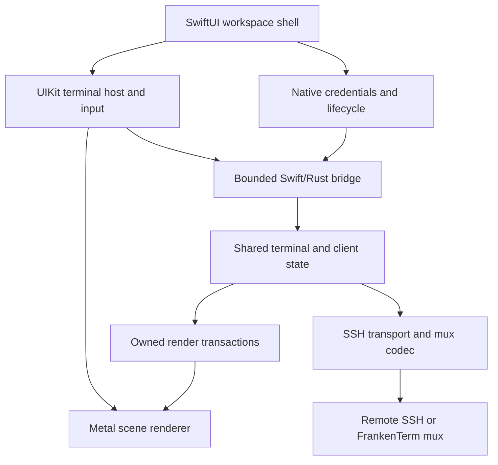

# COMPREHENSIVE PLAN FOR A NATIVE iOS FRANKENTERM APP

> **Design proposal, 2026-10-20.** Build an exceptional iPhone and iPad terminal around SwiftUI, UIKit text input, the existing FrankenTerm terminal and mux semantics, and native Metal presentation.
>
> **Repository evidence baseline:** `fb570a9f536c151adda75f8f127005b2735b3162`. Existing implementation and Beads status below refer to this commit. All mobile components, commands, schemas, numerical budgets, and milestones introduced here are proposed work unless explicitly identified as existing. This document does not declare an iOS app implemented or qualified.
>
> **Product promise:** Export the machine group you already use on your Mac, open it on your phone, connect with the appropriate SSH identities, recognize every machine by its familiar appearance, and move between machines and their panes with fluid, distinct gestures. Put the exact terminal you need under your thumb in a second, without losing your place or sending input to the wrong host.

## Contents

- [0. Executive design](#0-executive-design)
- [1. Repository baseline and the important gaps](#1-repository-baseline-and-the-important-gaps)
- [2. Product experience and release scope](#2-product-experience-and-release-scope)
- [3. Machine and pane navigation](#3-machine-and-pane-navigation)
- [4. Visual identity and native presentation](#4-visual-identity-and-native-presentation)
- [5. Architecture and ownership](#5-architecture-and-ownership)
- [6. The portable core and Swift/Rust boundary](#6-the-portable-core-and-swiftrust-boundary)
- [7. Connection modes and SSH transport](#7-connection-modes-and-ssh-transport)
- [18. Resource, bandwidth, and battery design](#18-resource-bandwidth-and-battery-design)
- [19. Accessibility, ergonomics, and international use](#19-accessibility-ergonomics-and-international-use)
- [20. Features that make the fleet useful on a phone](#20-features-that-make-the-fleet-useful-on-a-phone)
- [21. Local data, privacy, and recovery of the workspace](#21-local-data-privacy-and-recovery-of-the-workspace)
- [22. Build, packaging, and release architecture](#22-build-packaging-and-release-architecture)
- [23. Performance targets and measurement](#23-performance-targets-and-measurement)
- [24. Verification through complete user journeys](#24-verification-through-complete-user-journeys)

---

## 0. Executive design

### 0.1 The experience to build

On the Mac, choose **Export to iPhone**, select an existing group of machines, and see a faithful preview of its order, names, themes, routes, and credential requirements. Pair the phone or transfer a workspace file. The phone imports the group transactionally, authenticates the selected machine first, and connects the remaining eligible machines through a bounded queue. A problem with one host stays attached to that host.

The terminal fills the phone. A compact identity strip always names the machine, connection route, and selected pane. A one-finger horizontal swipe changes machines. A two-finger horizontal swipe changes panes within the current machine. Each machine remembers its selected pane; each pane remembers its scroll position and local viewing preferences. Opening the keyboard does not destroy that navigation state. A readable overview makes a fleet of dozens of hosts manageable without dozens of sequential swipes.

Every terminal surface, glyph, cursor, selection, supported image, and terminal transition is presented through Metal. SwiftUI provides the application shell and native controls. CPU parsing, font shaping, SSH, and state reconciliation retain their appropriate ownership; GPU acceleration is a rendering requirement, not a claim that every operation runs on a GPU.

The phone can attach directly to a persistent remote FrankenTerm mux, use a conventional SSH terminal, or view the Mac's existing mux sessions. These modes share the interface but have explicitly different dependencies and continuity guarantees.

### 0.2 The decisions that matter most

1. **Build a client of real terminals.** The remote mux owns persistent PTYs. The phone owns its view, input intent, credentials, and bounded caches.
2. **Share terminal meaning and renderer data.** Adapt the existing Rust terminal, protocol contracts, Metal data structures, and shaders. Add native iOS surface and lifecycle integration.
3. **Make Mac export a product feature.** Export a typed, resolved workspace, with a portability report and deliberate credential handling. A copied Lua file or SSH config is insufficient.
4. **Treat input destination as immutable evidence.** Capture machine, route, connection generation, exact pane registration, and focus generation before admitting input. A later swipe cannot retarget it.
5. **Separate viewing from controlling.** Looking at a pane, changing local zoom, or previewing another machine never implicitly resizes a shared PTY or steals another client's input authority.
6. **Make suspension ordinary.** Save local state, stop rendering, and resume by reauthorizing and resynchronizing the exact surviving remote pane. Never depend on indefinite background SSH execution.
7. **Spend resources on what is visible.** One renderer per scene, bounded adjacent previews, a small active working set, and separate budgets for transport, scrollback, glyphs, images, and retained frames.
8. **Deliver vertical slices early.** A real phone, a real key, a real shell, and a real Metal frame come before elaborate fleet automation or speculative renderer optimizations.

### 0.3 The first compelling release

The first release should comfortably support the concrete journey **20 configured machines, 200 discovered panes, one focused phone viewport**, with optional two-to-four-pane iPad layouts. These are qualification targets, not current capacity claims and not a requirement to stream or render all 200 panes continuously.

The defining features are trustworthy Mac import, familiar machine themes, excellent terminal input, fast machine/pane navigation, direct SSH usefulness, and attachment to persistent FrankenTerm sessions. File browsing, remote notifications, collaboration, and agent-fleet interventions extend that foundation; they must not postpone it.

---

## 1. Repository baseline and the important gaps

### 1.1 Read these sources in the right order

The historical [implementation plan](docs/planning/PLAN.md) remains a model for user stories, explicit invariants, architecture, and phased delivery. Its own opening notice makes clear that its transitional backend, Tokio, local-Cargo, and workflow examples are historical. Current [repository instructions](AGENTS.md), [product journey contract](docs/design/product-journey-contract.md), [codec history](docs/codec-versions.md), and live source govern this plan.

The root [Mac rendering plan](PLAN_TO_MAKE_FRANKENTERM_MAC_RENDERING_SUPER_FAST.md) contributes the short-lock snapshot, persistent GPU buffers, dirty rows, row-ring scrolling, bounded atlases, and measurement discipline. Its October 5 implementation statements are not a current source inventory. At the evidence baseline, actual macOS GUI consumers feed terminal panes into the native Metal renderer.

The complete [Beads snapshot](.beads/issues.jsonl) contains 5,788 records: 4,612 closed, 760 open, 347 in progress, 64 blocked, and 5 deferred. The `ft-yccm0.4` Metal subtree contains 26 records, of which 22 are open, 3 closed, and 1 in progress. These counts describe work tracking. They neither prove absence of implementation nor qualify mobile behavior.

### 1.2 Reuse map grounded in source

| Existing surface | Evidence and useful content | Mobile consequence |
|---|---|---|
| Terminal engine | [frankenterm/term](frankenterm/term), [cell](frankenterm/cell), [surface](frankenterm/surface), [escape-parser](frankenterm/escape-parser), [input-types](frankenterm/input-types) | Keep canonical terminal semantics, cell occupancy, modes, and input encoding. Establish a genuinely buildable iOS dependency slice. |
| Native Metal implementation | [renderer crate](crates/frankenterm-renderer-metal), especially `cell_bg.rs`, `cell_text.rs`, `frame.rs`, `atlas.rs`, `window_frame.rs`, and `src/shaders/` | Share portable rendering representations and shader behavior. Its native implementation is macOS-gated; other targets currently use an unsupported-platform stub. |
| Live GUI Metal consumers | [metal_render_thread.rs](crates/frankenterm-gui/src/termwindow/metal_render_thread.rs), [metal_window.rs](crates/frankenterm-gui/src/termwindow/metal_window.rs), [termwindow/mod.rs](crates/frankenterm-gui/src/termwindow/mod.rs) | A dedicated render path and actual pane conversion already exist. Adapt these algorithms instead of creating an unrelated terminal renderer. |
| Incremental render mirror | [render_mirror.rs](frankenterm/mux/src/render_mirror.rs) | Reuse `RenderMirror` and changed-row capture. The generic pane fallback can combine consecutive states; it is not automatically an atomic mobile snapshot. |
| Mux protocol and client | [codec](frankenterm/codec), [client.rs](frankenterm/client/src/client.rs), [codec history](docs/codec-versions.md) | Preserve version/capability negotiation, exact pane registration, effect certainty, bounded messages, and layout-bound reads. Factor platform coupling deliberately. |
| Mac SSH domains | [config/src/ssh.rs](frankenterm/config/src/ssh.rs), [config/src/config.rs](frankenterm/config/src/config.rs) | Source automatic connection preferences, routes, and resolved palettes. `SSH:<host>` and `SSHMUX:<host>` can describe routes to the same machine. |
| SSH configuration resolver | [ssh/src/config.rs](frankenterm/ssh/src/config.rs) | Use its explicit `MatchExecPolicy::Deny` and diagnostic surface for preview. Its default permits `Match exec`; two-phase matching and direct ProxyJump resolution have limitations. |
| SSH implementation | [ssh/Cargo.toml](frankenterm/ssh/Cargo.toml) | Current native backends include libssh/libssh2/OpenSSL. An iOS build, external signing, and nested-hop adapter are substantial work. |
| Core policy, events, and runtime | [frankenterm-core](crates/frankenterm-core), [runtime_async.rs](crates/frankenterm-core/src/runtime_async.rs) | Preserve the core crate and canonical asupersync ownership. Reuse selected contracts; avoid linking the complete desktop control plane into the phone. |
| Session persistence | [persistence architecture](docs/session-persistence-architecture.md), [remote setup](docs/remote-setup-spec.md) | Capture/inspection and restore substrates do not establish live process recovery. Phone reconnect and remote mux crash recovery must remain separate claims. |

### 1.3 Six gaps with the highest product impact

| Priority | Gap | Why it is critical | First concrete result |
|---|---|---|---|
| P0 | iOS portability and transport | No amount of SwiftUI polish compensates for a terminal core or key backend that cannot run on a device. | Link the shared core into an iOS app and establish authenticated SSH with a selected existing identity. |
| P0 | Faithful remote-pane attachment | SSH channels alone do not discover the existing panes on a machine or preserve exact pane identity. | Attach to one existing mux pane through a verified first-party endpoint, with correct state and input authority. |
| P0 | Mac export and mobile import | Re-entering a fleet manually defeats the central use case. | Export/import a real selected group with exact order, routes, themes, and credential references. |
| P0 | Native input and focus correctness | A wrong-machine key, duplicate Enter, broken IME, or hidden cursor makes the product unusable. | Complete shell/editor interaction on a physical phone, including switching while callbacks are pending. |
| P0 | Metal surface and mobile resource control | Existing macOS rendering does not automatically supply UIKit lifecycle handling or phone memory limits. | A live, legible, responsive Metal terminal that remains bounded during floods and transitions. |
| P1 | Mobile reconnection and shared geometry | Phones routinely suspend and change networks; a phone viewport must not disrupt a Mac session. | Lock/resume and route-change recovery to the same surviving pane, with observer-safe geometry. |

There is no native SwiftUI iOS application in the baseline source inventory. Mobile mentions in the Beads snapshot predominantly belong to the browser terminal campaign. Native iOS adapters and device qualification therefore need their own implementation track while sharing applicable server-side work.

---

## 2. Product experience and release scope

### 2.1 The complete first-use journey

1. **Mac selection.** The user chooses an existing machine group or selects concrete SSH domains. The export sheet shows familiar names, colors, ordering, and selected live sessions.
2. **Portability preview.** Each machine is ready for direct access, requires a credential, depends on the Mac, or has an unsupported setting. The user can finish the useful portion immediately.
3. **Pair or transfer.** A short-lived authenticated pairing flow is the preferred path. A workspace document supports deliberate offline transfer and repeatable import.
4. **Credential decision.** Use the Mac's existing sessions, enroll a device identity, or transfer selected exportable keys. Already imported matching identities are reused by fingerprint and policy.
5. **Atomic import.** Validate the whole candidate before publishing its configuration. Host-specific readiness failures do not corrupt the manifest or roll back otherwise useful machines.
6. **First connection.** Select the initial host, show its identity before any authentication prompt, connect it first, then work through the group with bounded concurrency.
7. **First interaction.** The keyboard exposes Esc, Ctrl, Alt, Tab, and arrows immediately. A small, dismissible gesture demonstration teaches the machine/pane distinction.
8. **Return later.** Reopening the app restores the same machine and pane preference, clearly distinguishes retained content from live state, and reattaches when the server authorizes the original pane.

### 2.2 Everyday operator stories

| Story | Required behavior | Release |
|---|---|---|
| Check a build on a train | Select a machine, recognize its theme, reach the last pane, inspect output, send a deliberate response. | First useful beta |
| Move across twenty machines | Swipe quickly, jump from overview/search, preserve order and per-machine focus. | First useful beta |
| Inspect six panes on one host | Two-finger cycling, pane rail, direct picker, unread indicators. | First useful beta |
| Fix a problem in Vim or another TUI | Correct alternate screen, Unicode, control keys, modifiers, mouse policy, resize, and paste. | First useful beta |
| Keep the Mac session intact | Attach as observer, fit or pan locally, explicitly take control before changing shared geometry. | Persistent-mux beta |
| Use a Mac-only identity | Connect through the paired Mac with the dependency clearly visible, or enroll a new phone key. | Mac-paired beta |
| Lose Wi-Fi after pressing Enter | Display the precise delivery state; never turn reconnect into automatic command resubmission. | Every interactive build |
| Return after a remote restart | Detect a new server incarnation and explain the available recovery path. | Every mux build |
| Read output with VoiceOver | Navigate machine, pane, command blocks, and readable transcript without a stream of disruptive announcements. | Public release |

### 2.3 Scope boundaries that protect delivery

The first product is a native remote terminal and fleet workspace. A local Unix environment, local agent execution, an embedded desktop scripting runtime, a public relay service, and complete parity with every desktop plugin are separate projects.

Direct SSH remains useful without installing a remote mux, but its tabs represent phone-created terminal channels. Existing remote pane discovery and strong reattachment belong to FrankenTerm mux mode. A tmux process launched inside a raw SSH terminal remains a remote application; this plan does not create a second mux backend or interpret tmux panes as native FrankenTerm panes.

iPad is part of the architecture from the start. The initial phone journey is the first delivery gate; multiwindow and richer split layouts follow once the same session and rendering contracts are stable.

### 2.4 Product definition of done

An actual user can import their group, connect with supported existing keys, tell which machine owns the visible terminal, switch machines and panes, use a full-screen editor, search and copy output, survive a phone suspension, and return to the correct surviving remote session. These actions work with hardware keyboard and accessible controls as well as touch.

The installed app must remain responsive under a noisy neighboring machine, report partial failures locally, and stay within its declared memory and bandwidth budgets. A successful simulator launch, a screenshot, or a working one-host prototype does not establish this complete journey.

---

## 3. Machine and pane navigation

### 3.1 Two stable rings

Model the workspace as an ordered ring of machines. Each machine owns an ordered ring of pane references. Moving between machines restores that machine's last valid pane; moving between panes never changes the machine group or another machine's remembered pane.

The rings are navigation overlays. Reordering a phone's pane list does not reorder the remote mux topology. Imported ordering is explicit; remote tab/pane ordering is used only when the source actually supplies authoritative order. Numeric pane IDs, titles, and discovery timing are unsuitable order authorities.

Preserve three useful orders separately:

- **Imported group order:** the Mac's intended order, editable by the user.
- **Remote structural order:** window/tab/split hierarchy advertised by the mux.
- **Local navigation order:** stable pinned/reordered views, with newly discovered panes appended predictably.

Recency and attention may drive explicit filters or an overview section. They must not silently rearrange the primary rings while the user builds muscle memory.

### 3.2 Gesture contract

| Gesture | Default action | Arbitration |
|---|---|---|
| One-finger horizontal drag on the machine identity rail | Previous/next machine | Always available outside system-reserved edges and assistive gesture ownership. |
| One-finger horizontal drag on the terminal canvas | Previous/next machine in normal navigation mode | Enabled only when selection, horizontal viewport panning, or terminal mouse interaction does not own the gesture. The rail remains the dependable alternative. |
| Two-finger horizontal drag on the terminal canvas | Previous/next pane within the current machine | Resolve touch count before committing; pinch and accessibility gestures take precedence where appropriate. |
| One-finger vertical drag | Scrollback or explicit remote mouse-mode scrolling | Never changes machines or panes. |
| Long press | Select text and reveal context actions | Captures the interaction until selection ends or is cancelled. |
| Pinch | Preview terminal font size | Commit a local zoom preference at gesture end; resize the PTY only with geometry authority. |
| Tap machine name or pane position | Open overview/picker | Full alternative for one-handed use, keyboard, VoiceOver, and Switch Control. |

Machine and pane switching must be distinct in both gesture and visual feedback. Machine transitions move the complete terminal plus its identity treatment. Pane transitions retain the machine identity strip and move the pane content beneath it.

Provide optional remapping after the defaults are excellent. Do not reserve three-finger editing gestures or the iOS back/home/control-center edges. UIKit supports explicit recognizer precedence and simultaneous-recognition policy through [UIGestureRecognizerDelegate](https://developer.apple.com/documentation/uikit/uigesturerecognizerdelegate); one terminal-owned arbiter must define those relationships coherently.

### 3.3 Gesture state and commit rules

Use a single serialized gesture state machine:

`idle -> possible -> classified -> dragging -> settling -> committed/cancelled -> idle`

At classification, capture the source route, source pane, candidate ring, ring revision, gesture class, initial geometry, and focus generation. Suggested tuning seeds are 10-14 points of slop, a horizontal-to-vertical displacement ratio around 1.4, and a settle decision based on both distance and projected velocity. These are usability-tuning inputs, not correctness constants or release guarantees.

Once classified, a gesture cannot become a different gesture because another finger arrived late. Cancel or continue its existing classification; never apply half a machine switch and half a pane switch. Resolve one-finger/two-finger ambiguity before either action changes focus.

Only the final focus commit selects a new input destination. During dragging, the old pane remains the selected route and the destination is a preview. The UI clearly marks both identities. Input admission follows the routing barrier described below; an animation frame is never an authorization event.

If a candidate pane closes during the gesture, render its closing state and cancel or settle to the original pane. Never redirect the gesture to a numerically reused pane or to a newly adjacent machine. Reconcile inventory after settling.

### 3.4 Wrapping, offline machines, and scale

Offer circular cycling, enabled by default for groups with more than one item. Crossing the last-to-first boundary gets a subtle visual marker and optional differentiated haptic. A one-item ring does not animate a fake move.

Disconnected machines retain their positions and show a last-viewed preview with a timestamp and explicit status. Do not automatically skip them. A user-selected **Connected only** filter may narrow the ring, with the filter visible and its order stable.

For large groups, the overview offers name/tag search, favorites, recent machines, connection status, and attention counts. It uses bounded low-resolution previews, not a live terminal renderer per card. The direct picker should reach any machine or pane in two or three intentional actions regardless of fleet size.

### 3.5 Focus and input barrier

Every admitted input event carries an immutable route token containing:

`workspace_id, machine_id, route_id, scene_id, input_stream_id, transport_generation, source_identity, focus_generation`

`source_identity` is a tagged union: direct SSH uses a local session UUID plus SSH channel generation; mux attachment uses the server incarnation, exact pane registration, and authoritative origin/route witness. A raw SSH server is not required to invent a mux pane identity.

Focus generation is scoped to the scene/input stream, not globally to the workspace. Controller-lease generation and terminal mode/layout witnesses are included when the negotiated operation needs them. The queued event is never resolved later through a mutable `currentPane` pointer.

When focus changes:

1. Settle active IME composition on the source under the explicit policy in section 15; a preview can animate, but focus cannot move while composition is unresolved.
2. Stop accepting new source input and enqueue an ordered barrier behind its already admitted events. Await the runtime's acknowledgement asynchronously, without blocking MainActor.
3. Keep already admitted source events attached to their original route and disposition; settle or report them there. A later focus change alone cannot invalidate or retarget an admitted event.
4. End held-key state on the source where the terminal protocol supports key release. Never forward a delayed release to the new pane.
5. Publish the destination identity and new focus generation together after the barrier is acknowledged. The acknowledgement settles local ordering; it does not pretend that an outstanding remote operation has a known outcome.
6. Open destination input only after its connection, source identity, and applicable controller authority are valid.

Admission checks the current focus token. Subsequent delivery checks the admitted operation's original authority and connection identity, not whichever pane happens to be visible later. If that original authority is lost, report the original operation's effect state.

This is a core product invariant. Sending one password character to the next machine is more serious than dropping an animation frame.

---

## 4. Visual identity and native presentation

### 4.1 Recognize the machine before reading the prompt

Each machine has a stable display name, optional short label, icon, accent, full terminal palette, and optional light/dark variants. Preserve the Mac's resolved per-machine themes when available. The importer previews any font or color mapping it cannot reproduce exactly.

Machine identity appears in the top strip, overview card, reconnect screen, authentication prompt, and paste/input destination UI. A small accent or edge treatment remains visible even when a remote program paints an opaque full-screen background. The name is always present; color reinforces identity rather than carrying it alone.

Keep connection health visually distinct from machine color. A green-themed machine can be offline; its explicit disconnected icon and label must remain unambiguous.

### 4.2 Native, bright, precise chrome

Use SwiftUI's native navigation, sheets, menus, controls, and system materials. Default chrome follows system appearance with a strong light presentation. A terminal's imported theme remains its own preference, independent of the surrounding chrome.

Favor generous touch targets around compact controls, restrained depth, crisp typography, and short direct labels. Avoid decorative gradients behind code or translucency that damages glyph contrast. Machine color belongs to identity, not arbitrary recoloring of remote application content.

The focused view has four deliberate layers:

| Layer | Contents | Behavior |
|---|---|---|
| Identity strip | Group/back affordance, machine name, route/status, pane position | Stable through output and pane transitions. |
| Terminal | Metal-rendered cells, cursor, selection, images, search marks | Receives the maximum practical screen area. |
| Context strip | Scrollback/live indicator, pending input state, selected text actions | Appears when useful and does not hide the cursor. |
| Keyboard accessory | Esc, modifiers, Tab, arrows, expanded keys | Respects safe areas, keyboard geometry, and accessibility. |

### 4.3 State should remain understandable

Show **Connecting**, **Unlock key**, **Host identity changed**, **Via Mac**, **Resynchronizing**, **Viewing saved state**, and **Input outcome unknown** as distinct states. Do not collapse them into a spinner or a generic failure toast.

Remote titles, paths, and user variables are untrusted terminal content. Truncate and sanitize their presentation. They cannot replace the trusted machine name, impersonate system permission UI, or become automatic deep links or commands.

Motion follows the finger and settles quickly. Reduced Motion uses a restrained crossfade or direct change. Haptics occur at discrete selection boundaries, not continuously during movement, and remain optional.

---

## 5. Architecture and ownership

### 5.1 Component shape

The two data paths have different timing. Terminal data moves through bounded queues and render transactions. SwiftUI receives coarse semantic updates such as focus, status, inventory changes, settings, and attention summaries. There is no observable Swift string containing the entire terminal and no SwiftUI view per cell.

### 5.2 Ownership table

| Owner | Owns | Must not own or block on |
|---|---|---|
| MainActor workspace store | Navigation, sheets, per-scene/input-stream focus, user preferences, focus commits | SSH I/O, terminal parsing, full scrollback, disk flushes, GPU completion waits. |
| UIKit terminal host | Responder chain, gesture arbitration, composition, caret geometry, accessibility projection | Mutable terminal internals or remote PTY ownership. |
| Native credential broker | Keychain references, LocalAuthentication context, signing grants, foreground prompts | General terminal transcripts or a global queue of plaintext private keys. |
| Shared Rust mobile session runtime | Exact pane references, protocol effects, ordered input, bounded transport/session tasks | SwiftUI object lifetimes or implicit access to the current view. |
| Terminal/model owner | Parser state for direct SSH; authoritative mirror transactions for mux mode | Main-thread UI calls, disk I/O in parse-critical regions, GPU resources. |
| Native render preparation owner | CoreText shaping, glyph rasterization, atlas allocation decisions, cell-to-instance conversion, per-row versions | Long terminal locks, synchronous network reads, authentication. |
| Native Metal owner per scene | Device/queue/pipelines, frame slots, drawables, atlas textures, presentation | Remote mutation or selecting input targets. |
| Remote mux | Processes, PTYs, canonical pane identity, shared geometry and control authority | Reliance on a phone staying foregrounded. |

One connection does not require one permanently running thread per pane. Use a bounded runtime and explicit ownership. Shared Rust asynchronous work continues through the repository's `runtime_async`/asupersync surface. Swift actors own platform state; they do not introduce Tokio into the Rust graph.

### 5.3 Native application structure

Proposed native sources live under `apps/ios/FrankenTerm/`, with Xcode project/workspace settings alongside them. Suggested logical groups are `App`, `Workspace`, `Terminal`, `Rendering`, `Input`, `Connectivity`, `Credentials`, `ImportExport`, `Accessibility`, and `Diagnostics`. These are responsibilities, not a requirement to create empty directories or a proliferation of tiny packages.

Add one narrow Rust integration crate, provisionally `crates/frankenterm-ios-bridge`, only when the first device spike demonstrates its required API. Reuse existing crates in place. A portable codec/type leaf is justified only where dependency inspection proves that it removes desktop coupling for both existing and mobile consumers.

The permanent `crates/frankenterm-core` remains intact. This project adds a mobile consumption boundary; it does not replace the desktop core, add another mux backend, or copy large subsystems into a parallel implementation.

### 5.4 Two terminal data modes, one presentation contract

**Direct SSH:** the phone receives the remote PTY byte stream and advances the shared terminal engine locally. Its local terminal state owns parser continuation and scrollback within explicit limits.

**FrankenTerm mux:** the remote mux is authoritative for terminal state. The phone consumes negotiated pane state, rows, layout witnesses, and render updates into a client mirror. Do not replay plain-text captures through a second parser and call that the same terminal.

Both produce the same owned mobile render transaction containing semantic rows, style and image references, and geometry/identity witnesses. One native preparation owner performs CoreText shaping, glyph rasterization, atlas allocation, and final cell-instance preparation for the native Metal owner. Rust does not assign atlas coordinates that Swift subsequently replaces.

Reuse the renderer's canonical background/text instance layout and shader behavior through an explicitly verified bridge representation. One definition governs field offsets, alignment, and packed color semantics; the ABI must not acquire an independently evolving Swift copy. The data-mode difference remains visible in capability and continuity state, while fonts, gestures, selection, and Metal presentation share their implementation.

---

## 6. The portable core and Swift/Rust boundary

### 6.1 Establish portability before expanding the app

Build an exact dependency inventory for the device and simulator targets. The existing `codec` depends on desktop-oriented `config`, `mux`, PTY, and compression surfaces; the existing client includes OpenSSL, SSH, and Unix-domain assumptions. Merely adding an iOS target to the workspace is insufficient.

The first extraction should make the smallest useful vertical slice compile:

1. Terminal primitives and input types.
2. A bounded terminal instance or mux mirror.
3. Owned semantic render transactions plus verified shared background/text layout definitions for native preparation.
4. Lifecycle/effect state and only the required wire definitions.
5. A narrow transport and signer interface.

Disable or isolate desktop process spawning, Lua execution, filesystem watching, Unix-socket assumptions, desktop font backends, optional image decoders, and large search/runtime integrations where they are not part of the mobile artifact. Reuse one canonical implementation behind features or adapters; do not fork terminal semantics.

Apple device and simulator targets require the corresponding Xcode SDK. Rust documents `aarch64-apple-ios` and `aarch64-apple-ios-sim` as distinct targets; a simulator library cannot stand in for a device library. See the [Rust iOS target documentation](https://doc.rust-lang.org/rustc/platform-support/apple-ios.html).

### 6.2 Preferred bridge shape

Use an XCFramework containing the Rust static library slices, a small C-compatible header, and a module map consumed by Swift. The C ABI is a language boundary, not a proposal to write a second terminal implementation in C. Prefer explicit, versioned handles and fixed-width fields over exposing Rust layouts or Swift objects.

The initial bridge should offer these operation classes:

| Operation | Contract |
|---|---|
| Create/configure session | Validated typed configuration, explicit capabilities, bounded resources. |
| Submit input or control intent | Nonblocking admission; immutable destination; accepted/rejected/pending result. |
| Feed/drain transport data | Bounded buffers and explicit backpressure; no unbounded callback recursion. |
| Acquire render transaction | Owned immutable snapshot/delta handle with identity and version witnesses. |
| Read transaction spans | Checked offsets/counts over data owned by that transaction. |
| Release handles | Exactly one documented release path; stale/double release rejected by handle generation. |
| Poll/drain semantic events | Bounded batch, explicit reschedule signal, no event per rendered cell. |
| Cancel/close | Idempotent request with a terminal settlement result. |

Start with owned packed buffers. Their bounded copy cost is easier to understand than borrowing terminal memory across Swift, Rust, and GPU lifetimes. Optimize a measured copy only after proving all three lifetimes and cancellation paths.

### 6.3 Boundary invariants

- No borrowed Rust pointer escapes its declared call or owning snapshot handle.
- Swift never frees Rust allocations directly; Rust never retains an unowned Swift object.
- All byte ranges, string lengths, row counts, image dimensions, and arithmetic products are checked before allocation or indexing.
- The ABI uses fixed-width integers and explicit endianness for serialized data; do not export `usize`, compiler-dependent enums, or raw `Vec`/`String` layouts.
- Callbacks carry an owner generation. Late completion after scene/session destruction is ignored safely and releases its resources.
- A callback never reenters a mutable session operation synchronously. Deliver through the documented queue.
- Cancellation propagates across the boundary and settles owned work; dropping a Swift task does not silently abandon a Rust child task or an SSH authentication operation.
- Rust panics do not unwind through Swift or C. Use the repository's documented recoverable-panic boundary where applicable; otherwise return a terminal failure under an explicit boundary contract. Do not silently change release panic policy to make the bridge seem simpler.
- Any new unsafe/native operation has a narrow ownership, aliasing, lifetime, thread, and error contract. Existing audited renderer exceptions are a model, not a blanket exemption.

The bridge protocol version, mobile workspace schema version, terminal semantic version, and mux codec version are independent. Negotiating one does not authorize the others.

### 6.4 Core and frame identity

A render transaction identifies its machine/route, tagged direct-SSH or mux source identity, transport generation, terminal sequence, geometry revision, viewport origin, palette revision, font revision, and row versions. It also states whether it is a full replacement, a compatible delta, or retained stale content.

The consumer rejects an incompatible delta and requests a bounded replacement. It does not combine a new cursor with old dimensions or a new palette with an unrelated row generation. Snapshot production should reuse the existing short-lock dirty-row capture approach, then perform shaping and expansion outside the terminal lock.

---

## 7. Connection modes and SSH transport

### 7.1 Three explicit modes

| Mode | Connection | What a pane means | Continuity |
|---|---|---|---|
| Direct SSH | Phone authenticates to the selected host and opens one or more SSH PTY channels. | A terminal channel created for this client. | No guarantee of survival or exact reattachment after a broken SSH connection. |
| Direct FrankenTerm mux | Phone authenticates to the host, then attaches to an existing persistent FrankenTerm mux through a verified endpoint. | The server's exact registered pane. | Reattach to surviving panes while that mux remains alive; stronger recovery requires separately advertised capabilities. |
| Via Mac | Phone authenticates to the paired Mac's endpoint; the Mac exposes selected existing local/remote mux sessions. | A pane plus its authoritative origin/route within the Mac's session graph. | Depends on the Mac and every required downstream route remaining available. |

The [SSH connection protocol](https://www.rfc-editor.org/rfc/rfc4254) provides channels, PTY requests, window changes, and data transport. Persistent pane discovery and exact reattachment are higher-level mux semantics.

Do not silently fail over from Via Mac to direct access: that changes the credential path, trust boundary, session ownership, and potentially the pane. A user-configured alternate route can be selected only after its identity and continuity requirements are checked.

### 7.2 Preferred first transport spike

Start by qualifying **one existing libssh2-based backend** behind an iOS feature of `frankenterm-ssh`. This has the strongest continuity with existing key/configuration behavior and avoids adding a second Rust async runtime. Build only the chosen native dependency stack into the mobile artifact, pin it, and document every added iOS/native boundary.

The spike must establish: real-device linking, nonblocking socket operation, existing-key authentication, strict host verification, keyboard-interactive prompts, cancellation, bounded I/O, external signing, and the intended jump-host route. It must measure binary size and memory and identify the exact cryptographic backend. Passing a desktop SSH test does not establish these properties on iOS.

The underlying [libssh2 API](https://libssh2.org/docs.html) offers nonblocking operation, memory-key authentication, direct TCP channels, and public-key signing callbacks. The existing Rust wrapper must be audited for what it actually exposes. A general external-signing callback and a nested-channel transport adapter may require small audited additions; neither is assumed to exist already.

If this spike fails on a concrete requirement, evaluate an Apple SwiftNIO SSH adapter behind the same transport contract. Record algorithm coverage, encrypted OpenSSH-key import, keyboard-interactive support, certificate support, signing integration, and its native event-loop ownership before selecting it. Do not silently replace the existing authentication matrix with a narrower implementation. A Tokio-dependent SSH crate is not an admissible drop-in under the repository runtime policy.

### 7.3 Authentication and nested-hop ownership

Authentication prompts belong to the native credential broker. Preauthorize a selected credential where possible, then perform blocking library callbacks on an isolated, bounded authentication worker. A synchronous C signing or keyboard-interactive callback cannot become asynchronous merely by returning a retry code. Prove its reentry behavior or preserve the library's synchronous contract without blocking MainActor or an asupersync executor thread.

For ProxyJump, an inner SSH session consumes the outer session's `direct-tcpip` channel as a byte transport. It must not use the outer TCP socket descriptor as though that socket were already the destination host. Specify bounded buffering, independent inner/outer host verification, cancellation propagation, and parent-route invalidation. Qualify one hop first; a proposed initial limit of three hops bounds prompt, buffer, and failure complexity.

Do not export arbitrary local `ProxyCommand` shell execution to the phone. The portability report offers a structured jump route, an explicitly supported transport adapter, or Via Mac.

### 7.4 First-party mux attachment is real implementation work

The current inherited client builds a command equivalent to `exec <configured executable> cli --prefer-mux proxy`, and uses `--no-auto-start` on later proxy attempts. Its source explicitly says the standalone `ft` does not implement that inherited `cli` grammar. Therefore **`ft cli proxy` is not an existing setup instruction**.

Add a narrow first-party endpoint, provisionally **`ft mobile attach --stdio --no-auto-start`**, as proposed work. It must attach to the selected existing mux, expose only negotiated client capabilities, preserve binary-clean stdin/stdout, put diagnostics on stderr, enforce frame/time/resource bounds, and distinguish absent mux, denied access, incompatible codec, and transport failure. It must not launch a new shell or install a daemon merely because a phone is browsing.

The SSH exec command is assembled from an explicitly selected executable and fixed typed arguments with correct remote-shell quoting. Imported labels, titles, environment strings, and arbitrary commands cannot enter it. Remote provisioning is a separate deliberate Mac workflow with an inspectable change plan and verified artifact identity.

Current native SSH domains do not automatically inherit reconnectability from the existing client: `Reconnectable::reconnectable()` returns false for that mode at the evidence baseline. Mobile reconnection, authentication coalescing, and exact-pane reattachment are new requirements to implement and qualify.

### 7.5 Connection admission

Connect the selected machine first, then its immediate navigation neighbors, then the rest of the opted-in group. Suggested initial limits are three concurrent connection attempts globally, one interactive authentication prompt at a time, and one reconnect attempt per machine. A shared identity may coalesce unlock preparation without weakening its actual Keychain access policy.

Use bounded exponential backoff with jitter and a per-route retry budget. A user selecting a machine can promote its next attempt; repeated swipes must not spawn duplicate handshakes. Host-key mismatch, rejected credentials, unsupported algorithms, and revoked authority require explicit resolution rather than an endless retry loop.

Once imported and authorized, group connection should require no repeated setup. User-disabled machines stay disabled. Cellular, constrained-network, and background policies may reduce subscriptions while preserving the configured group and showing the reason.

## 18. Resource, bandwidth, and battery design

### 18.1 A fleet is an inventory, not two hundred active viewports

Keep machine configuration, discovered pane metadata, transport state, terminal state, and GPU residency as separate objects. The initial target of twenty machines and two hundred panes must not accidentally allocate two hundred terminals, two hundred atlases, or two hundred display links.

A machine may be configured but disconnected; connected with metadata only; subscribed for bounded attention updates; or actively presenting a terminal. A pane may be discovered without its transcript being resident. The selected pane gets first claim on preparation and bandwidth. The previous and next navigation candidates get small, cancellable warm-up jobs. Everything else stays cold or receives explicitly bounded updates.

**Automatic group connection does not mean automatic creation of new remote shells.** For mux routes, connect, authenticate, and discover existing panes. For direct SSH, establish the transport when authorized, then create the initial PTY only under the group's explicit session-creation policy. Reconnect cannot silently create duplicate tabs or re-run startup commands. User-disabled auto-connect and cellular preferences remain authoritative.

### 18.2 Initial phone memory envelope

Use the following as a proposed allocation ledger for a single foreground phone scene. These are starting budgets to falsify on a physical device, not measurements or a promise that iOS grants a fixed jetsam allowance.

| Account | Initial ceiling | Includes and eviction rule |
|---|---:|---|
| Terminal/parser/mirror working sets | 40 MiB | Visible and deliberately warm terminals; discard reconstructible mux mirrors before an active parser. |
| Resident scrollback/search pages | 16 MiB | Shared page cache, including line indices and search results; cold history is paged or explicitly unavailable. |
| Glyph atlases and glyph bitmaps | 32 MiB | Alpha and color glyphs, pending uploads, old generations still referenced by the GPU. |
| Decoded terminal images | 24 MiB | All decoded frames and pending decode reservations; do not charge only compressed input. |
| Frame instances and transient staging | 8 MiB | All in-flight slots, selection/overlay geometry, and upload staging. |
| Drawable/depth/intermediate allowance | 64 MiB | Recompute from actual drawable dimensions, format, and in-flight count; avoid unnecessary depth/MSAA surfaces. |
| Preview cache | 12 MiB | Low-resolution thumbnails across the workspace, with a strict LRU. |
| Transport and decoded message queues | 16 MiB | Every hop, channel, compressed and expanded message, and pending write reservation. |
| Workspace/import/model overhead | 8 MiB | Parsed manifests, staged changes, inventory, and bounded event batches. |
| Native shell, loaded code, and remaining runtime reserve | 80 MiB | Measured framework/runtime footprint, stacks, allocators, and platform objects. |
| **Initial planned accounts** | **300 MiB** | Leave a further 20 MiB below the initial 320 MiB measured-footprint target. |

Unified-memory resources must be attributed consistently rather than counted once as CPU memory and again as GPU memory in the total. Also report resource allocation totals separately so a shrinking CPU heap cannot disguise a growing texture pool. Shared library and drawable accounting varies; reconcile the ledger against the device's measured process footprint.

For iPad multi-pane work, start with a separately qualified 512 MiB target, not a multiplier applied blindly to every cache. Multiple scenes share session state and cold caches where safe, but their drawable and in-flight frame costs are real. Lower-memory supported devices may require smaller caps. A memory warning is an immediate eviction signal, not permission to wait for another large allocation.

### 18.3 Explicit bounds at every producer

Reserve capacity before allocating or decoding. Bound terminal rows and cell count, scrollback bytes, UTF-8 expansion, grapheme work, image dimensions, image-frame count, atlas pages, pending glyph jobs, transport channels, decoded protocol frames, and semantic-event queues. A two-kilobyte escape sequence can request a huge image; compressed input size alone is insufficient.

Use small per-route receive windows and a global byte budget. A suggested starting point for raw SSH is 256 KiB of queued, unparsed channel data per active route and 2 MiB globally, within the broader transport account. Treat these as tuning seeds. Mux message limits must be negotiated against existing frame semantics; do not cut a valid frame in half and continue decoding. Request smaller pages or a bounded full replacement when supported, otherwise report the unsupported resource requirement.

A queue has an overflow policy tied to its semantics:

| Data | Permitted pressure response |
|---|---|
| Replaceable status/attention summary | Coalesce by exact source and retain the newest version. |
| Mux state deltas | Coalesce only when the protocol proves equivalence; otherwise unsubscribe or resnapshot. |
| Raw terminal byte stream | Apply SSH/TCP backpressure or terminate the affected session explicitly; never skip arbitrary bytes. |
| Admitted user input | Preserve order and effect state; reject further admission before exceeding its bounded reservation. |
| Search pages, previews, glyph requests | Cancel lower-priority work and release reservations. |
| Import/enrollment operations | Stop before the next bounded side effect; retain a resumable operation journal without secret payloads. |

Backpressure on a raw SSH channel can eventually slow the remote process writing to that PTY. That is an honest consequence to expose when necessary, not a reason to corrupt the parser by sampling bytes. Mux mode can often reduce a phone's subscription while the remote terminal continues parsing independently.

### 18.4 Scheduling and thermal policy

Use a small number of priority classes: focused input and control settlement; focused terminal updates; destination warm-up; inventory/attention; bulk history, previews, and transfers. Apply per-host fairness within each class so one noisy connection cannot occupy the runtime indefinitely. Budget by bytes and CPU work, not message count alone.

Coalesce consecutive model changes before frame preparation. The renderer may present the newest coherent state without drawing every intermediate state, while the terminal model still processes every required transition. This distinction permits smooth output under load without losing terminal meaning.

At idle, stop continuous rendering. Schedule discrete cursor-blink and attention updates, then return to sleep. Under Low Power Mode, serious thermal pressure, constrained network, or memory pressure, reduce refresh requests, cancel speculative warm-up, trim previews, stop image animation, and reduce background subscriptions. Input ordering, glyph legibility, host verification, and effect certainty do not degrade.

Do not promise that a refresh-rate request produces 120 Hz. The system and display retain control. Apple describes the relevant policy in [ProMotion guidance](https://developer.apple.com/documentation/quartzcore/optimizing-iphone-and-ipad-apps-to-support-promotion-displays).

### 18.5 Instrumentation that helps implementation

Record local counters for admitted/rejected input, unknown outcomes, source-generation mismatches, frame preparation time, GPU duration, drawable starvation, dirty rows, atlas misses/evictions, live handle count, queue high-water marks, subscription bytes, and reconnect stage durations. Include the selected capability matrix in a diagnostic export.

Diagnostics default to counts, timings, versions, and locally generated correlation IDs. Terminal content, clipboard text, hostnames, paths, key material, and authentication responses are excluded by default. A user may explicitly attach a redacted, previewable diagnostic bundle. Redaction must be applied before serialization, not after a sensitive log was already written.

---

## 19. Accessibility, ergonomics, and international use

### 19.1 The terminal needs a semantic projection

Metal pixels are not an accessibility tree. Build a bounded UIKit accessibility projection from the same coherent terminal transaction used for presentation. Represent meaningful lines, command blocks when authoritative markers exist, selection, cursor position, machine identity, connection status, and available actions. Do not create one persistent accessibility element per cell or announce every arriving byte.

VoiceOver navigation should offer rotors or equivalent structured movement for machines, panes, commands, links, and search results. Stable element identity follows source identity and content anchors, not a row number that changes after every scroll. If the referenced history expires, say so and keep focus somewhere understandable.

A live-output announcement policy is separate from rendering: default to no interruption while the user is reading, coalesce completion/attention messages, and offer an explicit Read Latest Output action. The visual terminal and accessible transcript must agree on whether content is live, retained, or still loading. See Apple's [accessibility container](https://developer.apple.com/documentation/uikit/uiaccessibilitycontainer) and [VoiceOver design guidance](https://developer.apple.com/design/human-interface-guidelines/voiceover).

### 19.2 Every gesture has a direct alternative

Machine and pane pickers, Previous/Next actions, keyboard shortcuts, and accessible custom actions provide the same navigation without requiring multi-finger gestures. While VoiceOver owns its gestures, the app does not fight them. Switch Control and Full Keyboard Access must reach identity, control acquisition, terminal input, search, selection, and disconnect.

Use large hit regions around compact icons. Keep machine names readable at large text sizes. System text scaling applies to the chrome; terminal font size is an independently adjustable user preference, with accessible controls and a preview. Scaling the chrome must not silently resize every remote PTY.

Reduced Motion removes sliding depth and parallax. Increased Contrast, Differentiate Without Color, light/dark appearance, and reduced transparency change the native presentation without altering source identity. Imported themes get a contrast preview and a deliberate local override; the app does not silently rewrite a user's palette. Text, icons, and names carry status alongside color.

### 19.3 One-handed operation and localization

Provide an optional compact thumb rail near the keyboard with machine and pane access. The rail is a second path to the existing navigation model, not a separate ordering system. Respect left/right handed preference without reversing imported group order unexpectedly.

Localize native chrome, empty states, permission explanations, and recovery choices. Keep protocol tokens and remote terminal text exact. Bidirectional interface layout must not reverse shell input bytes or treat terminal cell order as localized prose. Test long localized machine labels, composed Unicode names, CJK candidate windows, dictation, and keyboard layouts with dead keys.

An accessible terminal remains a real terminal: distinguish the local accessibility selection from remote application selection, expose input authority before typing, and announce a host change before enabling the new destination.

---

## 20. Features that make the fleet useful on a phone

### 20.1 Attention without chaotic navigation

Use existing authoritative events and pane state to surface a small set of useful badges: new output, completed activity when supported, explicit agent waiting-for-input state, connection trouble, and uncertain input outcome. Record the evidence source and freshness internally. A title containing “done” is not proof of completion; a prompt-shaped line is not necessarily an authorization request.

The overview can show **Needs attention**, **Running**, **Disconnected**, and user tags as filters. A Next Attention action jumps to the next eligible source in a stable order. Incoming activity never steals focus, changes the ring, opens a keyboard, or acquires control.

A compact activity inbox can retain bounded references to significant events. Opening an event resolves its exact source and checks whether that pane still exists. A saved event from a prior server incarnation becomes historical context, not a shortcut that binds to a reused numeric pane.

### 20.2 Useful actions with visible scope

The first release needs a focused set of actions: connect/reconnect, inspect route, open a shell where supported, select an existing pane, take/release control, search, copy, paste, rename locally, pin, and close the local view.

Distinguish three operations in both terminology and implementation:

| User intent | Operation |
|---|---|
| “Remove this from my phone's current layout” | Close the local view; preserve the remote process. |
| “Disconnect my phone” | End this client's subscription/transport as appropriate; preserve remotely owned sessions. |
| “Stop that process or close its PTY” | A separate, explicit remote mutation against the exact current pane with applicable authority. |

A future command composer may prepare a command locally and show its target before submission. It must not silently turn arbitrary selected text into a shell command or append Enter to a paste. Multicast input is a later, opt-in feature with a visible target set, per-target readiness and authority, independent delivery results, and no claim of atomic execution across machines.

### 20.3 Optional transfers and remote files

SFTP browsing and transfer can follow the terminal foundation, reusing the authenticated route, host verification, credential broker, and channel budget. It should feel native through Files import/export and share sheets, while retaining an explicit machine/path destination.

Transfers need bounded chunks, cancellation, overwrite policy, byte counts, and content/version checks before resume. An offset alone does not prove that a remote file is still the same file. Treat uploads as remote writes and show their destination before starting. Do not run arbitrary shell commands to emulate a file API without a deliberately supported contract.

Initial transfers are foreground work. An SSH transfer does not become an operating-system-managed background transfer merely because the UI starts a background task. Durable remote jobs or another transfer protocol would require separate, explicit design.

### 20.4 Optional notifications

The first release needs no hosted relay or notification service. In-app attention works while connected. A future push feature requires a deliberate server/APNs path, device registration and revocation, bounded event content, and a trustworthy source reference. A push indicates that the app may wish to reconnect; it neither guarantees execution time nor authorizes input.

Push payloads should carry opaque event references and a user-selected amount of context, not terminal transcripts or secrets. Mutating notification actions, if ever added, must pass the same live source and authority checks as foreground actions.

---

## 21. Local data, privacy, and recovery of the workspace

### 21.1 Persist preferences, not an imaginary running process

Persist the workspace revision, machine and pane preferences, order overlays, local theme/font overrides, route readiness, and bounded navigation state. Credentials remain in Keychain under their own access controls. Runtime handles, live pointers, connection generations, controller leases, and “connected” booleans are not restorable authority.

Terminal transcripts, recent previews, and command/search history are opt-in persistent content. Default to a minimal configuration store and memory-only terminal caches. If content retention is enabled, use protected storage, explicit retention limits, and a clear per-workspace erase control. The live terminal naturally displays the user's authorized remote content; privacy controls govern its retention and export, not arbitrary censorship of the visible session.

Restore local preferences before connecting, but visually mark retained output until current remote state has been acquired. A persisted selected pane is a preference to resolve, never proof that the pane survived.

### 21.2 Transactional configuration and backup

Use one versioned local model with validated migrations, an atomic publication boundary, and an import journal as specified in section 9. Keep the last known valid configuration revision until the next one commits. Unknown future required fields reject import safely; optional extension fields follow an explicit preservation policy.

Backup/sync policy is independent for configuration, trust state, transcripts, and credentials. A workspace copied to another device cannot inherit Keychain access or silently accept new host keys. Initial release should not depend on cloud synchronization. A later sync feature must preserve device-local identity, conflict handling, and trust review rather than treating a shared file as an authentication authority.

### 21.3 Protect native presentation surfaces

When a scene leaves the foreground, replace sensitive content in the app-switcher snapshot according to the user's privacy preference and lock policy. Avoid placing terminal content into notifications, widgets, searchable system indices, or analytics by default.

Do not claim that an app can prevent every screenshot or photograph. Where supported, react to capture state with the user's chosen privacy treatment. A local app lock can gate the UI, but it does not revoke a credential already installed on a remote host.

### 21.4 Explain failures at the affected scope

A broken theme affects that machine's appearance. A missing key affects the routes that reference it. A failed jump host affects dependent routes. A corrupted optional thumbnail does not prevent opening the workspace. An invalid required manifest field prevents publication of that candidate while preserving the existing workspace.

The recovery UI should state the missing requirement and offer the next useful action: choose a key, verify a host, unlock the Mac, select an alternate configured route, update the remote endpoint, or open a fresh SSH terminal as a distinct session. Keep diagnostic codes available behind details rather than making them the main product language.

---

## 22. Build, packaging, and release architecture

### 22.1 Choose an explicit supported platform

Use **iOS 26 and iPadOS 26 as the proposed initial deployment floor**, subject to the first device spike confirming that the intended installed-device coverage is acceptable. Build with a currently supported stable Xcode/SDK, pin its exact version for each qualified artifact, and test both the deployment floor and current public OS. The deployment target and the SDK used to submit an app are different decisions.

As of this document's research date, Apple's [submission requirements](https://developer.apple.com/news/upcoming-requirements/) and [App Store submission guidance](https://developer.apple.com/app-store/submitting/) govern accepted SDKs. Recheck them for a release; this plan is not a permanent promise about future store requirements.

The default renderer should use the Metal functionality available across the chosen device set. Add newer GPU features only behind actual capability checks and a measured benefit. A newer Metal API name is not a reason to raise the entire product's minimum OS or to maintain two unrelated renderers.

### 22.2 Produce reproducible native artifacts

The native build graph consists of the Swift app, the minimal Rust static-library dependency slice, the selected native SSH/crypto dependencies, fonts/assets with verified redistribution rights, and the Metal shader library. Record source revision, lockfiles, toolchain/SDK versions, feature sets, deployment targets, ABI version, shader inputs, and native dependency build settings.

Create device and simulator slices separately. At minimum, qualify the actual arm64 device target and arm64 simulator target; add an Intel simulator slice only if there is a real supported development need. Do not hide missing device support behind a universal archive assembled from simulator objects. The [Rust Apple iOS target documentation](https://doc.rust-lang.org/rustc/platform-support/apple-ios.html) describes the distinct targets and SDK requirements.

Keep linking and symbol ownership explicit: one intended crypto backend, no accidental duplicate terminal engines, no desktop process-launch code linked merely through a convenience dependency, and no unsupported dynamic loading. Bundle shaders with a versioned layout contract. Verify release optimization, debug-symbol retention for diagnosis, and panic/error boundary behavior in the packaged artifact.

### 22.3 Follow the repository's actual build authority

Development-time Rust proof uses the repository's RCH path and its fail-closed policy. Native Swift/Xcode builds, simulator checks, and physical-device traces are separate evidence; a remote Rust check cannot certify UIKit, Keychain, Metal, or device signing. The iOS Rust slice also needs a worker with the correct Apple SDK and target toolchain. Qualify that development dispatch explicitly; if unavailable, report the missing native build route rather than disguising a local Cargo fallback inside an Xcode build phase.

DSR remains the exclusive release system. Implement a **new iOS lane** for native build, archive, signing, packaging, and the approved distribution destination. Do not invent a currently available DSR command or add a GitHub Actions workflow. Release credentials belong to the native release environment and established secret handling, not the workspace export format or the repository.

The first implementation milestone may use an authorized development-signed app on an owned device. Public distribution waits for the integrated release lane and product acceptance. Writing this plan performs no build signing, host provisioning, TestFlight upload, or publication.

### 22.4 Native permissions and distribution fit

Keep capabilities minimal and attached to visible user features:

| Capability | Product reason and constraint |
|---|---|
| Keychain and local authentication | Device credentials and explicit foreground unlock/signing policy. |
| Local network access | Connect to a selected Mac or LAN machine; explain that actual connection request. |
| Bonjour service declarations | Only for the exact service types the pairing/discovery implementation uses. |
| Files/document import and export | User-selected workspace documents and optional transfer destinations. |
| Camera access | Only if the in-app pairing scanner uses it; provide a document/manual alternative. |
| Push notifications | Optional later feature; absent from the essential terminal path. |

Use the actual [local-network privacy rules](https://developer.apple.com/documentation/technotes/tn3179-understanding-local-network-privacy), including direct LAN connections, rather than assuming that avoiding Bonjour avoids permission requirements. Qualify IPv6-only/DNS64 environments and normal hostname resolution. Hard-coded IPv4 addresses and network-monitor state must not be the sole connection strategy.

Before distribution, review the current [App Review Guidelines](https://developer.apple.com/app-store/review/guidelines/) against the actual feature set and complete the applicable privacy, encryption, and licensing declarations. The first release executes commands on user-selected remote machines; a local execution environment or downloaded executable extension system is outside this scope and would require its own platform analysis.

---

## 23. Performance targets and measurement

### 23.1 Define the workload before the number

Every result must identify device model, OS build, app/source revision, build mode, screen dimensions/scale, refresh policy, thermal/power state, transport topology, network conditions, visible terminal geometry, font and theme, and enabled image/input modes. Separate direct-SSH parsing from mux mirroring and cold connection from warm navigation.

The initial phone workload is twenty configured machines, two hundred discovered panes, one focused terminal around 100 columns by 50 rows, two bounded adjacent previews, and a mix of idle, scrolling, and full-screen content. Repeat with a narrower phone geometry, a larger iPad layout, CJK/emoji content, and image-heavy output. The numbers below are **proposed acceptance targets**, not baseline measurements.

### 23.2 Latency and smoothness targets

| Measurement | Initial target | Interpretation |
|---|---|---|
| Native input callback to bounded runtime admission | p95 at or below 5 ms; p99 at or below 10 ms | Excludes network and remote program response; measure under output load as well as idle. |
| Warm focus commit to first correctly identified destination frame | p95 at or below 50 ms | Destination already has a compatible resident snapshot; IME settlement and explicit authentication are reported separately. |
| Gesture tracking and active terminal animation | Meet the currently selected display interval without sustained hitching | Evaluate 60 Hz and supported higher-refresh modes separately; the app cannot command the system's actual refresh rate. |
| Render preparation plus encoding | p95 below 6 ms at 60 Hz; below 3 ms when qualifying 120 Hz | Off-main-thread work still consumes the frame deadline and device power. |
| MainActor work associated with an update | No routine synchronous task above 8 ms; no blocking I/O or GPU waits | Inspect worst cases during import, font changes, keyboard transitions, and reconnect. |
| Focused input echo on a controlled local test host | p95 within measured transport RTT plus 50 ms | Use a known echo workload and report SSH/mux processing separately; a busy remote editor is a different workload. |
| Selected-pane synchronization after a warm authenticated reconnect | p95 within two measured RTTs plus 250 ms, excluding required user interaction | A starting target for a bounded snapshot on the controlled fixture, not a universal internet guarantee. |
| Peak measured phone footprint in the standard workload | At or below 320 MiB | Reconcile with section 18's ledger; include churn and in-flight retirement. |
| Idle terminal rendering | No continuously running frame loop | Discrete blinking or explicit animations are measured independently. |

A responsive preview must never hide stale or unverified state. Report “first retained frame,” “first current remote frame,” and “input enabled” as separate timestamps. A fast screenshot is not a fast reconnect.

### 23.3 Measure the actual path

Instrument timestamps at UIKit receipt, admission, transport enqueue, server receipt/ack where available, model update, render-transaction publication, preparation, command-buffer commit, GPU completion, and presentation. Cross-machine timestamps require clock-correlation uncertainty; do not subtract unsynchronized wall clocks and call the result one-way latency.

Software presentation timestamps are useful but do not establish physical input-to-photon latency. Use a controlled camera or external measurement when making that stronger claim. Keep instrumentation content-free and bounded so the benchmark itself cannot consume an unbounded terminal log.

For a renderer optimization, compare the same device, content, build settings, and thermal conditions with alternating baseline/candidate order. Retain distributions, outliers, memory, and energy alongside averages. An improvement in glyph upload time that doubles wakeups or breaks an emoji sequence is not an acceptable improvement.

### 23.4 Optimize only an identified bottleneck

Start with coherent dirty-row transactions, persistent instance buffers, bounded atlases, and a sleeping idle renderer. Their correctness and ownership are more valuable than speculative complexity.

The following belong in the negative experiment ledger until a trace identifies a reason to revisit them:

- Replacing short-lock capture with a new copy-on-write terminal architecture before snapshot cost is material.
- GPU terminal parsing or GPU font shaping.
- Signed-distance-field text as the default for small, precise terminal glyphs.
- Rendering every pane continuously to make overview thumbnails look live.
- Copying desktop image-cache sizes onto a phone.
- An unconditional 120 Hz loop for a static shell prompt.
- A “zero-copy” bridge whose borrowing or frame-retirement lifetime is not proven.

Adopt an optimization with its observed benefit, validity conditions, fallback, and resource cost. The product should become simpler to operate even when the implementation needs careful low-level work.

---

## 24. Verification through complete user journeys

### 24.1 The qualification matrix

| Dimension | Required coverage |
|---|---|
| Devices and OS | An oldest-supported physical phone, a higher-refresh phone, an iPad with hardware keyboard, deployment-floor OS, and current public OS. |
| Input | Latin, CJK composition, combining marks, emoji/ZWJ sequences, dead keys, alternate layouts, dictation, helper modifiers, physical key repeat and release. |
| Terminal applications | Shell editing, a full-screen editor, a process monitor, long wrapped logs, mouse-aware TUI, alternate-screen transitions, bracketed paste. |
| Routes and identities | Direct SSH, direct mux, Via Mac, one qualified jump route, exportable keys, phone identity, Mac-bound identity path, host-key mismatch, MFA where supported. |
| Lifecycle | Lock/unlock, background/foreground, force quit, scene destruction, Wi-Fi/cellular change, airplane mode, Mac unavailable, remote mux restart. |
| Presentation | Light/dark themes, different machine palettes, font changes, large text, selection/search overlays, orientation, floating/docked keyboard, Reduce Motion, VoiceOver. |
| Load | Sustained output, a noisy neighbor, wide Unicode rows, bounded image pressure, rapid navigation, repeated import/reconnect, low-memory and thermal pressure. |

Keep a compact supported/unsupported matrix for key formats, host/user certificates, input protocols, image protocols, and continuity capabilities in the actual release. Feature names without exercised cases are not evidence.

### 24.2 Adversarial traces with decisive outcomes

The highest-value tests target interactions that a happy-path demo will miss:

1. **Enter, lost acknowledgement, swipe, reconnect.** The original operation keeps its source and certainty. It is not applied to the newly visible pane and is not blindly replayed.
2. **IME candidate plus machine switch.** Composition settles on the original input stream, or the switch remains visibly pending until the user cancels/settles it. No synthetic duplicate commit reaches the next host.
3. **Pane closes and its numeric ID is reused.** Selection, input, search result navigation, and a pending gesture reject the replacement unless the new exact identity is deliberately selected.
4. **Two scenes share a workspace.** Focus in one scene does not invalidate the other scene's input stream; shared server control and resize rules still apply.
5. **Mac and phone resize simultaneously.** The authoritative controller/geometry lease determines the accepted result; stale resize acknowledgement cannot revert newer geometry.
6. **Frame slot lags through scroll, palette change, and atlas eviction.** Every submitted frame has correct row generations, layout, glyphs, and texture lifetime. Out-of-order completion cannot prematurely retire a still-referenced resource.
7. **Import crashes between Keychain staging and model publication.** Relaunch yields the old or committed new workspace, with only owned staged resources eligible for cleanup and no partially activated trust update.
8. **Route loss during authentication or nested-hop creation.** Cancellation owns all callbacks and child work to settlement; no late prompt or signer result reaches a retired connection.
9. **Raw SSH flood during a two-finger pane transition.** The parser remains correct, queues remain bounded, focused input stays responsive, and background pressure is attributed to the responsible route.
10. **Mux restart after ambiguous input.** A new server incarnation is recognized; an in-memory deduplication ledger from the old process is not treated as surviving proof.

These traces should use synthetic content and controlled hosts, with host-side effect observation where needed. Tests that merely restate an implementation's current output cannot establish these properties.

### 24.3 Verification layers

Use the existing Rust terminal and protocol fixtures for semantic parity. Add bounded parser/import fuzzing where the new untrusted input boundary requires it, with caps enforced before allocation. Check C/Swift/Rust layout agreement, handle generation, release, cancellation, and callback ownership at the bridge.

Native tests exercise composition, gesture arbitration, selection, keyboard geometry, scene lifecycle, and accessibility against the actual host view. Image parity fixtures compare reference content at fixed fonts, geometry, scale, color space, and rendering mode. Keep tolerances narrow and justified around rasterization differences; a broad screenshot tolerance must not hide a missing wide cell or cursor.

Physical-device scenarios establish Keychain/signing, Metal lifetime, real keyboard behavior, power, memory, and suspension behavior. The simulator is valuable for deterministic development but cannot substitute for those results.

### 24.4 Qualification and honest reporting

A feature is complete when its product journey, correctness contract, and applicable resource target are exercised in an identified artifact. Existing closed desktop beads supply reusable evidence about shared code, not automatic iOS acceptance.

Preserve a small, useful result set: source/build identity, device/OS, scenario and route, capability negotiation, pass/fail outcome, timing/footprint distribution where relevant, and a sanitized trace that explains a failure. Follow current repository evidence requirements without turning implementation into a collection of empty reports.

This document itself is a design deliverable. Its structural validation, source review, and commits do not constitute a native build, a security qualification, or a performance result.

---
