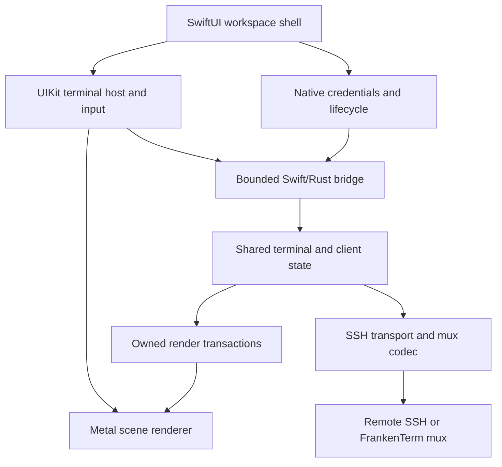

# COMPREHENSIVE PLAN FOR A NATIVE iOS FRANKENTERM APP

> **Design proposal, 2026-10-20.** Build an exceptional iPhone and iPad terminal around SwiftUI, UIKit text input, the existing FrankenTerm terminal and mux semantics, and native Metal presentation.
>
> **Repository evidence baseline:** `fb570a9f536c151adda75f8f127005b2735b3162`. Existing implementation and Beads status below refer to this commit. All mobile components, commands, schemas, numerical budgets, and milestones introduced here are proposed work unless explicitly identified as existing. This document does not declare an iOS app implemented or qualified.
>
> **Product promise:** Export the machine group you already use on your Mac, open it on your phone, connect with the appropriate SSH identities, recognize every machine by its familiar appearance, and move between machines and their panes with fluid, distinct gestures. Put the exact terminal you need under your thumb in a second, without losing your place or sending input to the wrong host.

## Contents

- [0. Executive design](#0-executive-design)
- [1. Repository baseline and the important gaps](#1-repository-baseline-and-the-important-gaps)
- [2. Product experience and release scope](#2-product-experience-and-release-scope)
- [3. Machine and pane navigation](#3-machine-and-pane-navigation)
- [4. Visual identity and native presentation](#4-visual-identity-and-native-presentation)
- [5. Architecture and ownership](#5-architecture-and-ownership)
- [6. The portable core and Swift/Rust boundary](#6-the-portable-core-and-swiftrust-boundary)
- [7. Connection modes and SSH transport](#7-connection-modes-and-ssh-transport)
- [8. Mac export: preserve the workspace the user already knows](#8-mac-export-preserve-the-workspace-the-user-already-knows)
- [9. Portable workspace format and transactional import](#9-portable-workspace-format-and-transactional-import)
- [10. Credentials, pairing, and host identity](#10-credentials-pairing-and-host-identity)
- [11. Mux attachment, effect certainty, and shared control](#11-mux-attachment-effect-certainty-and-shared-control)
- [12. iOS lifecycle, reconnection, and recovery](#12-ios-lifecycle-reconnection-and-recovery)
- [13. Native Metal frame pipeline](#13-native-metal-frame-pipeline)
- [14. Typography, terminal fidelity, and images](#14-typography-terminal-fidelity-and-images)
- [15. Input, composition, and delivery correctness](#15-input-composition-and-delivery-correctness)
- [16. Selection, search, clipboard, and useful workflows](#16-selection-search-clipboard-and-useful-workflows)
- [17. Viewports, keyboard geometry, and remote resize authority](#17-viewports-keyboard-geometry-and-remote-resize-authority)
- [18. Resource, bandwidth, and battery design](#18-resource-bandwidth-and-battery-design)
- [19. Accessibility, ergonomics, and international use](#19-accessibility-ergonomics-and-international-use)
- [20. Features that make the fleet useful on a phone](#20-features-that-make-the-fleet-useful-on-a-phone)
- [21. Local data, privacy, and recovery of the workspace](#21-local-data-privacy-and-recovery-of-the-workspace)
- [22. Build, packaging, and release architecture](#22-build-packaging-and-release-architecture)
- [23. Performance targets and measurement](#23-performance-targets-and-measurement)
- [24. Verification through complete user journeys](#24-verification-through-complete-user-journeys)
- [25. Dependency-ordered implementation tracks and milestones](#25-dependency-ordered-implementation-tracks-and-milestones)
- [26. Existing Beads crosswalk](#26-existing-beads-crosswalk)
- [27. Decisions, risks, and falsifying experiments](#27-decisions-risks-and-falsifying-experiments)
- [28. The first productive implementation session](#28-the-first-productive-implementation-session)
- [29. Source map and maintenance notes](#29-source-map-and-maintenance-notes)

---

## 0. Executive design

### 0.1 The experience to build

On the Mac, choose **Export to iPhone**, select an existing group of machines, and see a faithful preview of its order, names, themes, routes, and credential requirements. Pair the phone or transfer a workspace file. The phone imports the group transactionally, authenticates the selected machine first, and connects the remaining eligible machines through a bounded queue. A problem with one host stays attached to that host.

The terminal fills the phone. A compact identity strip always names the machine, connection route, and selected pane. A one-finger horizontal swipe changes machines. A two-finger horizontal swipe changes panes within the current machine. Each machine remembers its selected pane; each pane remembers its scroll position and local viewing preferences. Opening the keyboard does not destroy that navigation state. A readable overview makes a fleet of dozens of hosts manageable without dozens of sequential swipes.

Every terminal surface, glyph, cursor, selection, supported image, and terminal transition is presented through Metal. SwiftUI provides the application shell and native controls. CPU parsing, font shaping, SSH, and state reconciliation retain their appropriate ownership; GPU acceleration is a rendering requirement, not a claim that every operation runs on a GPU.

The phone can attach directly to a persistent remote FrankenTerm mux, use a conventional SSH terminal, or view the Mac's existing mux sessions. These modes share the interface but have explicitly different dependencies and continuity guarantees.

### 0.2 The decisions that matter most

1. **Build a client of real terminals.** The remote mux owns persistent PTYs. The phone owns its view, input intent, credentials, and bounded caches.
2. **Share terminal meaning and renderer data.** Adapt the existing Rust terminal, protocol contracts, Metal data structures, and shaders. Add native iOS surface and lifecycle integration.
3. **Make Mac export a product feature.** Export a typed, resolved workspace, with a portability report and deliberate credential handling. A copied Lua file or SSH config is insufficient.
4. **Treat input destination as immutable evidence.** Capture machine, route, connection generation, exact pane registration, and focus generation before admitting input. A later swipe cannot retarget it.
5. **Separate viewing from controlling.** Looking at a pane, changing local zoom, or previewing another machine never implicitly resizes a shared PTY or steals another client's input authority.
6. **Make suspension ordinary.** Save local state, stop rendering, and resume by reauthorizing and resynchronizing the exact surviving remote pane. Never depend on indefinite background SSH execution.
7. **Spend resources on what is visible.** One renderer per scene, bounded adjacent previews, a small active working set, and separate budgets for transport, scrollback, glyphs, images, and retained frames.
8. **Deliver vertical slices early.** A real phone, a real key, a real shell, and a real Metal frame come before elaborate fleet automation or speculative renderer optimizations.

### 0.3 The first compelling release

The first release should comfortably support the concrete journey **20 configured machines, 200 discovered panes, one focused phone viewport**, with optional two-to-four-pane iPad layouts. These are qualification targets, not current capacity claims and not a requirement to stream or render all 200 panes continuously.

The defining features are trustworthy Mac import, familiar machine themes, excellent terminal input, fast machine/pane navigation, direct SSH usefulness, and attachment to persistent FrankenTerm sessions. File browsing, remote notifications, collaboration, and agent-fleet interventions extend that foundation; they must not postpone it.

---

## 1. Repository baseline and the important gaps

### 1.1 Read these sources in the right order

The historical [implementation plan](docs/planning/PLAN.md) remains a model for user stories, explicit invariants, architecture, and phased delivery. Its own opening notice makes clear that its transitional backend, Tokio, local-Cargo, and workflow examples are historical. Current [repository instructions](AGENTS.md), [product journey contract](docs/design/product-journey-contract.md), [codec history](docs/codec-versions.md), and live source govern this plan.

The root [Mac rendering plan](PLAN_TO_MAKE_FRANKENTERM_MAC_RENDERING_SUPER_FAST.md) contributes the short-lock snapshot, persistent GPU buffers, dirty rows, row-ring scrolling, bounded atlases, and measurement discipline. Its October 5 implementation statements are not a current source inventory. At the evidence baseline, actual macOS GUI consumers feed terminal panes into the native Metal renderer.

The complete [Beads snapshot](.beads/issues.jsonl) contains 5,788 records: 4,612 closed, 760 open, 347 in progress, 64 blocked, and 5 deferred. The `ft-yccm0.4` Metal subtree contains 26 records, of which 22 are open, 3 closed, and 1 in progress. These counts describe work tracking. They neither prove absence of implementation nor qualify mobile behavior.

### 1.2 Reuse map grounded in source

| Existing surface | Evidence and useful content | Mobile consequence |
|---|---|---|
| Terminal engine | [frankenterm/term](frankenterm/term), [cell](frankenterm/cell), [surface](frankenterm/surface), [escape-parser](frankenterm/escape-parser), [input-types](frankenterm/input-types) | Keep canonical terminal semantics, cell occupancy, modes, and input encoding. Establish a genuinely buildable iOS dependency slice. |
| Native Metal implementation | [renderer crate](crates/frankenterm-renderer-metal), especially `cell_bg.rs`, `cell_text.rs`, `frame.rs`, `atlas.rs`, `window_frame.rs`, and `src/shaders/` | Share portable rendering representations and shader behavior. Its native implementation is macOS-gated; other targets currently use an unsupported-platform stub. |
| Live GUI Metal consumers | [metal_render_thread.rs](crates/frankenterm-gui/src/termwindow/metal_render_thread.rs), [metal_window.rs](crates/frankenterm-gui/src/termwindow/metal_window.rs), [termwindow/mod.rs](crates/frankenterm-gui/src/termwindow/mod.rs) | A dedicated render path and actual pane conversion already exist. Adapt these algorithms instead of creating an unrelated terminal renderer. |
| Incremental render mirror | [render_mirror.rs](frankenterm/mux/src/render_mirror.rs) | Reuse `RenderMirror` and changed-row capture. The generic pane fallback can combine consecutive states; it is not automatically an atomic mobile snapshot. |
| Mux protocol and client | [codec](frankenterm/codec), [client.rs](frankenterm/client/src/client.rs), [codec history](docs/codec-versions.md) | Preserve version/capability negotiation, exact pane registration, effect certainty, bounded messages, and layout-bound reads. Factor platform coupling deliberately. |
| Mac SSH domains | [config/src/ssh.rs](frankenterm/config/src/ssh.rs), [config/src/config.rs](frankenterm/config/src/config.rs) | Source automatic connection preferences, routes, and resolved palettes. `SSH:<host>` and `SSHMUX:<host>` can describe routes to the same machine. |
| SSH configuration resolver | [ssh/src/config.rs](frankenterm/ssh/src/config.rs) | Use its explicit `MatchExecPolicy::Deny` and diagnostic surface for preview. Its default permits `Match exec`; two-phase matching and direct ProxyJump resolution have limitations. |
| SSH implementation | [ssh/Cargo.toml](frankenterm/ssh/Cargo.toml) | Current native backends include libssh/libssh2/OpenSSL. An iOS build, external signing, and nested-hop adapter are substantial work. |
| Core policy, events, and runtime | [frankenterm-core](crates/frankenterm-core), [runtime_async.rs](crates/frankenterm-core/src/runtime_async.rs) | Preserve the core crate and canonical asupersync ownership. Reuse selected contracts; avoid linking the complete desktop control plane into the phone. |
| Session persistence | [persistence architecture](docs/session-persistence-architecture.md), [remote setup](docs/remote-setup-spec.md) | Capture/inspection and restore substrates do not establish live process recovery. Phone reconnect and remote mux crash recovery must remain separate claims. |

### 1.3 Six gaps with the highest product impact

| Priority | Gap | Why it is critical | First concrete result |
|---|---|---|---|
| P0 | iOS portability and transport | No amount of SwiftUI polish compensates for a terminal core or key backend that cannot run on a device. | Link the shared core into an iOS app and establish authenticated SSH with a selected existing identity. |
| P0 | Faithful remote-pane attachment | SSH channels alone do not discover the existing panes on a machine or preserve exact pane identity. | Attach to one existing mux pane through a verified first-party endpoint, with correct state and input authority. |
| P0 | Mac export and mobile import | Re-entering a fleet manually defeats the central use case. | Export/import a real selected group with exact order, routes, themes, and credential references. |
| P0 | Native input and focus correctness | A wrong-machine key, duplicate Enter, broken IME, or hidden cursor makes the product unusable. | Complete shell/editor interaction on a physical phone, including switching while callbacks are pending. |
| P0 | Metal surface and mobile resource control | Existing macOS rendering does not automatically supply UIKit lifecycle handling or phone memory limits. | A live, legible, responsive Metal terminal that remains bounded during floods and transitions. |
| P1 | Mobile reconnection and shared geometry | Phones routinely suspend and change networks; a phone viewport must not disrupt a Mac session. | Lock/resume and route-change recovery to the same surviving pane, with observer-safe geometry. |

There is no native SwiftUI iOS application in the baseline source inventory. Mobile mentions in the Beads snapshot predominantly belong to the browser terminal campaign. Native iOS adapters and device qualification therefore need their own implementation track while sharing applicable server-side work.

---

## 2. Product experience and release scope

### 2.1 The complete first-use journey

1. **Mac selection.** The user chooses an existing machine group or selects concrete SSH domains. The export sheet shows familiar names, colors, ordering, and selected live sessions.
2. **Portability preview.** Each machine is ready for direct access, requires a credential, depends on the Mac, or has an unsupported setting. The user can finish the useful portion immediately.
3. **Pair or transfer.** A short-lived authenticated pairing flow is the preferred path. A workspace document supports deliberate offline transfer and repeatable import.
4. **Credential decision.** Use the Mac's existing sessions, enroll a device identity, or transfer selected exportable keys. Already imported matching identities are reused by fingerprint and policy.
5. **Atomic import.** Validate the whole candidate before publishing its configuration. Host-specific readiness failures do not corrupt the manifest or roll back otherwise useful machines.
6. **First connection.** Select the initial host, show its identity before any authentication prompt, connect it first, then work through the group with bounded concurrency.
7. **First interaction.** The keyboard exposes Esc, Ctrl, Alt, Tab, and arrows immediately. A small, dismissible gesture demonstration teaches the machine/pane distinction.
8. **Return later.** Reopening the app restores the same machine and pane preference, clearly distinguishes retained content from live state, and reattaches when the server authorizes the original pane.

### 2.2 Everyday operator stories

| Story | Required behavior | Release |
|---|---|---|
| Check a build on a train | Select a machine, recognize its theme, reach the last pane, inspect output, send a deliberate response. | First useful beta |
| Move across twenty machines | Swipe quickly, jump from overview/search, preserve order and per-machine focus. | First useful beta |
| Inspect six panes on one host | Two-finger cycling, pane rail, direct picker, unread indicators. | First useful beta |
| Fix a problem in Vim or another TUI | Correct alternate screen, Unicode, control keys, modifiers, mouse policy, resize, and paste. | First useful beta |
| Keep the Mac session intact | Attach as observer, fit or pan locally, explicitly take control before changing shared geometry. | Persistent-mux beta |
| Use a Mac-only identity | Connect through the paired Mac with the dependency clearly visible, or enroll a new phone key. | Mac-paired beta |
| Lose Wi-Fi after pressing Enter | Display the precise delivery state; never turn reconnect into automatic command resubmission. | Every interactive build |
| Return after a remote restart | Detect a new server incarnation and explain the available recovery path. | Every mux build |
| Read output with VoiceOver | Navigate machine, pane, command blocks, and readable transcript without a stream of disruptive announcements. | Public release |

### 2.3 Scope boundaries that protect delivery

The first product is a native remote terminal and fleet workspace. A local Unix environment, local agent execution, an embedded desktop scripting runtime, a public relay service, and complete parity with every desktop plugin are separate projects.

Direct SSH remains useful without installing a remote mux, but its tabs represent phone-created terminal channels. Existing remote pane discovery and strong reattachment belong to FrankenTerm mux mode. A tmux process launched inside a raw SSH terminal remains a remote application; this plan does not create a second mux backend or interpret tmux panes as native FrankenTerm panes.

iPad is part of the architecture from the start. The initial phone journey is the first delivery gate; multiwindow and richer split layouts follow once the same session and rendering contracts are stable.

### 2.4 Product definition of done

An actual user can import their group, connect with supported existing keys, tell which machine owns the visible terminal, switch machines and panes, use a full-screen editor, search and copy output, survive a phone suspension, and return to the correct surviving remote session. These actions work with hardware keyboard and accessible controls as well as touch.

The installed app must remain responsive under a noisy neighboring machine, report partial failures locally, and stay within its declared memory and bandwidth budgets. A successful simulator launch, a screenshot, or a working one-host prototype does not establish this complete journey.

---

## 3. Machine and pane navigation

### 3.1 Two stable rings

Model the workspace as an ordered ring of machines. Each machine owns an ordered ring of pane references. Moving between machines restores that machine's last valid pane; moving between panes never changes the machine group or another machine's remembered pane.

The rings are navigation overlays. Reordering a phone's pane list does not reorder the remote mux topology. Imported ordering is explicit; remote tab/pane ordering is used only when the source actually supplies authoritative order. Numeric pane IDs, titles, and discovery timing are unsuitable order authorities.

Preserve three useful orders separately:

- **Imported group order:** the Mac's intended order, editable by the user.
- **Remote structural order:** window/tab/split hierarchy advertised by the mux.
- **Local navigation order:** stable pinned/reordered views, with newly discovered panes appended predictably.

Recency and attention may drive explicit filters or an overview section. They must not silently rearrange the primary rings while the user builds muscle memory.

### 3.2 Gesture contract

| Gesture | Default action | Arbitration |
|---|---|---|
| One-finger horizontal drag on the machine identity rail | Previous/next machine | Always available outside system-reserved edges and assistive gesture ownership. |
| One-finger horizontal drag on the terminal canvas | Previous/next machine in normal navigation mode | Enabled only when selection, horizontal viewport panning, or terminal mouse interaction does not own the gesture. The rail remains the dependable alternative. |
| Two-finger horizontal drag on the terminal canvas | Previous/next pane within the current machine | Resolve touch count before committing; pinch and accessibility gestures take precedence where appropriate. |
| One-finger vertical drag | Scrollback or explicit remote mouse-mode scrolling | Never changes machines or panes. |
| Long press | Select text and reveal context actions | Captures the interaction until selection ends or is cancelled. |
| Pinch | Preview terminal font size | Commit a local zoom preference at gesture end; resize the PTY only with geometry authority. |
| Tap machine name or pane position | Open overview/picker | Full alternative for one-handed use, keyboard, VoiceOver, and Switch Control. |

Machine and pane switching must be distinct in both gesture and visual feedback. Machine transitions move the complete terminal plus its identity treatment. Pane transitions retain the machine identity strip and move the pane content beneath it.

Provide optional remapping after the defaults are excellent. Do not reserve three-finger editing gestures or the iOS back/home/control-center edges. UIKit supports explicit recognizer precedence and simultaneous-recognition policy through [UIGestureRecognizerDelegate](https://developer.apple.com/documentation/uikit/uigesturerecognizerdelegate); one terminal-owned arbiter must define those relationships coherently.

### 3.3 Gesture state and commit rules

Use a single serialized gesture state machine:

`idle -> possible -> classified -> dragging -> settling -> committed/cancelled -> idle`

At classification, capture the source route, source pane, candidate ring, ring revision, gesture class, initial geometry, and focus generation. Suggested tuning seeds are 10-14 points of slop, a horizontal-to-vertical displacement ratio around 1.4, and a settle decision based on both distance and projected velocity. These are usability-tuning inputs, not correctness constants or release guarantees.

Once classified, a gesture cannot become a different gesture because another finger arrived late. Cancel or continue its existing classification; never apply half a machine switch and half a pane switch. Resolve one-finger/two-finger ambiguity before either action changes focus.

Only the final focus commit selects a new input destination. During dragging, the old pane remains the selected route and the destination is a preview. The UI clearly marks both identities. Input admission follows the routing barrier described below; an animation frame is never an authorization event.

If a candidate pane closes during the gesture, render its closing state and cancel or settle to the original pane. Never redirect the gesture to a numerically reused pane or to a newly adjacent machine. Reconcile inventory after settling.

### 3.4 Wrapping, offline machines, and scale

Offer circular cycling, enabled by default for groups with more than one item. Crossing the last-to-first boundary gets a subtle visual marker and optional differentiated haptic. A one-item ring does not animate a fake move.

Disconnected machines retain their positions and show a last-viewed preview with a timestamp and explicit status. Do not automatically skip them. A user-selected **Connected only** filter may narrow the ring, with the filter visible and its order stable.

For large groups, the overview offers name/tag search, favorites, recent machines, connection status, and attention counts. It uses bounded low-resolution previews, not a live terminal renderer per card. The direct picker should reach any machine or pane in two or three intentional actions regardless of fleet size.

### 3.5 Focus and input barrier

Every admitted input event carries an immutable route token containing:

`workspace_id, machine_id, route_id, scene_id, input_stream_id, transport_generation, source_identity, focus_generation`

`source_identity` is a tagged union: direct SSH uses a local session UUID plus SSH channel generation; mux attachment uses the server incarnation, exact pane registration, and authoritative origin/route witness. A raw SSH server is not required to invent a mux pane identity.

Focus generation is scoped to the scene/input stream, not globally to the workspace. Controller-lease generation and terminal mode/layout witnesses are included when the negotiated operation needs them. The queued event is never resolved later through a mutable `currentPane` pointer.

When focus changes:

1. Settle active IME composition on the source under the explicit policy in section 15; a preview can animate, but focus cannot move while composition is unresolved.
2. Stop accepting new source input and enqueue an ordered barrier behind its already admitted events. Await the runtime's acknowledgement asynchronously, without blocking MainActor.
3. Keep already admitted source events attached to their original route and disposition; settle or report them there. A later focus change alone cannot invalidate or retarget an admitted event.
4. End held-key state on the source where the terminal protocol supports key release. Never forward a delayed release to the new pane.
5. Publish the destination identity and new focus generation together after the barrier is acknowledged. The acknowledgement settles local ordering; it does not pretend that an outstanding remote operation has a known outcome.
6. Open destination input only after its connection, source identity, and applicable controller authority are valid.

Admission checks the current focus token. Subsequent delivery checks the admitted operation's original authority and connection identity, not whichever pane happens to be visible later. If that original authority is lost, report the original operation's effect state.

This is a core product invariant. Sending one password character to the next machine is more serious than dropping an animation frame.

---

## 4. Visual identity and native presentation

### 4.1 Recognize the machine before reading the prompt

Each machine has a stable display name, optional short label, icon, accent, full terminal palette, and optional light/dark variants. Preserve the Mac's resolved per-machine themes when available. The importer previews any font or color mapping it cannot reproduce exactly.

Machine identity appears in the top strip, overview card, reconnect screen, authentication prompt, and paste/input destination UI. A small accent or edge treatment remains visible even when a remote program paints an opaque full-screen background. The name is always present; color reinforces identity rather than carrying it alone.

Keep connection health visually distinct from machine color. A green-themed machine can be offline; its explicit disconnected icon and label must remain unambiguous.

### 4.2 Native, bright, precise chrome

Use SwiftUI's native navigation, sheets, menus, controls, and system materials. Default chrome follows system appearance with a strong light presentation. A terminal's imported theme remains its own preference, independent of the surrounding chrome.

Favor generous touch targets around compact controls, restrained depth, crisp typography, and short direct labels. Avoid decorative gradients behind code or translucency that damages glyph contrast. Machine color belongs to identity, not arbitrary recoloring of remote application content.

The focused view has four deliberate layers:

| Layer | Contents | Behavior |
|---|---|---|
| Identity strip | Group/back affordance, machine name, route/status, pane position | Stable through output and pane transitions. |
| Terminal | Metal-rendered cells, cursor, selection, images, search marks | Receives the maximum practical screen area. |
| Context strip | Scrollback/live indicator, pending input state, selected text actions | Appears when useful and does not hide the cursor. |
| Keyboard accessory | Esc, modifiers, Tab, arrows, expanded keys | Respects safe areas, keyboard geometry, and accessibility. |

### 4.3 State should remain understandable

Show **Connecting**, **Unlock key**, **Host identity changed**, **Via Mac**, **Resynchronizing**, **Viewing saved state**, and **Input outcome unknown** as distinct states. Do not collapse them into a spinner or a generic failure toast.

Remote titles, paths, and user variables are untrusted terminal content. Truncate and sanitize their presentation. They cannot replace the trusted machine name, impersonate system permission UI, or become automatic deep links or commands.

Motion follows the finger and settles quickly. Reduced Motion uses a restrained crossfade or direct change. Haptics occur at discrete selection boundaries, not continuously during movement, and remain optional.

---

## 5. Architecture and ownership

### 5.1 Component shape



The two data paths have different timing. Terminal data moves through bounded queues and render transactions. SwiftUI receives coarse semantic updates such as focus, status, inventory changes, settings, and attention summaries. There is no observable Swift string containing the entire terminal and no SwiftUI view per cell.

### 5.2 Ownership table

| Owner | Owns | Must not own or block on |
|---|---|---|
| MainActor workspace store | Navigation, sheets, per-scene/input-stream focus, user preferences, focus commits | SSH I/O, terminal parsing, full scrollback, disk flushes, GPU completion waits. |
| UIKit terminal host | Responder chain, gesture arbitration, composition, caret geometry, accessibility projection | Mutable terminal internals or remote PTY ownership. |
| Native credential broker | Keychain references, LocalAuthentication context, signing grants, foreground prompts | General terminal transcripts or a global queue of plaintext private keys. |
| Shared Rust mobile session runtime | Exact pane references, protocol effects, ordered input, bounded transport/session tasks | SwiftUI object lifetimes or implicit access to the current view. |
| Terminal/model owner | Parser state for direct SSH; authoritative mirror transactions for mux mode | Main-thread UI calls, disk I/O in parse-critical regions, GPU resources. |
| Native render preparation owner | CoreText shaping, glyph rasterization, atlas allocation decisions, cell-to-instance conversion, per-row versions | Long terminal locks, synchronous network reads, authentication. |
| Native Metal owner per scene | Device/queue/pipelines, frame slots, drawables, atlas textures, presentation | Remote mutation or selecting input targets. |
| Remote mux | Processes, PTYs, canonical pane identity, shared geometry and control authority | Reliance on a phone staying foregrounded. |

One connection does not require one permanently running thread per pane. Use a bounded runtime and explicit ownership. Shared Rust asynchronous work continues through the repository's `runtime_async`/asupersync surface. Swift actors own platform state; they do not introduce Tokio into the Rust graph.

### 5.3 Native application structure

Proposed native sources live under `apps/ios/FrankenTerm/`, with Xcode project/workspace settings alongside them. Suggested logical groups are `App`, `Workspace`, `Terminal`, `Rendering`, `Input`, `Connectivity`, `Credentials`, `ImportExport`, `Accessibility`, and `Diagnostics`. These are responsibilities, not a requirement to create empty directories or a proliferation of tiny packages.

Add one narrow Rust integration crate, provisionally `crates/frankenterm-ios-bridge`, only when the first device spike demonstrates its required API. Reuse existing crates in place. A portable codec/type leaf is justified only where dependency inspection proves that it removes desktop coupling for both existing and mobile consumers.

The permanent `crates/frankenterm-core` remains intact. This project adds a mobile consumption boundary; it does not replace the desktop core, add another mux backend, or copy large subsystems into a parallel implementation.

### 5.4 Two terminal data modes, one presentation contract

**Direct SSH:** the phone receives the remote PTY byte stream and advances the shared terminal engine locally. Its local terminal state owns parser continuation and scrollback within explicit limits.

**FrankenTerm mux:** the remote mux is authoritative for terminal state. The phone consumes negotiated pane state, rows, layout witnesses, and render updates into a client mirror. Do not replay plain-text captures through a second parser and call that the same terminal.

Both produce the same owned mobile render transaction containing semantic rows, style and image references, and geometry/identity witnesses. One native preparation owner performs CoreText shaping, glyph rasterization, atlas allocation, and final cell-instance preparation for the native Metal owner. Rust does not assign atlas coordinates that Swift subsequently replaces.

Reuse the renderer's canonical background/text instance layout and shader behavior through an explicitly verified bridge representation. One definition governs field offsets, alignment, and packed color semantics; the ABI must not acquire an independently evolving Swift copy. The data-mode difference remains visible in capability and continuity state, while fonts, gestures, selection, and Metal presentation share their implementation.

---

## 6. The portable core and Swift/Rust boundary

### 6.1 Establish portability before expanding the app

Build an exact dependency inventory for the device and simulator targets. The existing `codec` depends on desktop-oriented `config`, `mux`, PTY, and compression surfaces; the existing client includes OpenSSL, SSH, and Unix-domain assumptions. Merely adding an iOS target to the workspace is insufficient.

The first extraction should make the smallest useful vertical slice compile:

1. Terminal primitives and input types.
2. A bounded terminal instance or mux mirror.
3. Owned semantic render transactions plus verified shared background/text layout definitions for native preparation.
4. Lifecycle/effect state and only the required wire definitions.
5. A narrow transport and signer interface.

Disable or isolate desktop process spawning, Lua execution, filesystem watching, Unix-socket assumptions, desktop font backends, optional image decoders, and large search/runtime integrations where they are not part of the mobile artifact. Reuse one canonical implementation behind features or adapters; do not fork terminal semantics.

Apple device and simulator targets require the corresponding Xcode SDK. Rust documents `aarch64-apple-ios` and `aarch64-apple-ios-sim` as distinct targets; a simulator library cannot stand in for a device library. See the [Rust iOS target documentation](https://doc.rust-lang.org/rustc/platform-support/apple-ios.html).

### 6.2 Preferred bridge shape

Use an XCFramework containing the Rust static library slices, a small C-compatible header, and a module map consumed by Swift. The C ABI is a language boundary, not a proposal to write a second terminal implementation in C. Prefer explicit, versioned handles and fixed-width fields over exposing Rust layouts or Swift objects.

The initial bridge should offer these operation classes:

| Operation | Contract |
|---|---|
| Create/configure session | Validated typed configuration, explicit capabilities, bounded resources. |
| Submit input or control intent | Nonblocking admission; immutable destination; accepted/rejected/pending result. |
| Feed/drain transport data | Bounded buffers and explicit backpressure; no unbounded callback recursion. |
| Acquire render transaction | Owned immutable snapshot/delta handle with identity and version witnesses. |
| Read transaction spans | Checked offsets/counts over data owned by that transaction. |
| Release handles | Exactly one documented release path; stale/double release rejected by handle generation. |
| Poll/drain semantic events | Bounded batch, explicit reschedule signal, no event per rendered cell. |
| Cancel/close | Idempotent request with a terminal settlement result. |

Start with owned packed buffers. Their bounded copy cost is easier to understand than borrowing terminal memory across Swift, Rust, and GPU lifetimes. Optimize a measured copy only after proving all three lifetimes and cancellation paths.

### 6.3 Boundary invariants

- No borrowed Rust pointer escapes its declared call or owning snapshot handle.
- Swift never frees Rust allocations directly; Rust never retains an unowned Swift object.
- All byte ranges, string lengths, row counts, image dimensions, and arithmetic products are checked before allocation or indexing.
- The ABI uses fixed-width integers and explicit endianness for serialized data; do not export `usize`, compiler-dependent enums, or raw `Vec`/`String` layouts.
- Callbacks carry an owner generation. Late completion after scene/session destruction is ignored safely and releases its resources.
- A callback never reenters a mutable session operation synchronously. Deliver through the documented queue.
- Cancellation propagates across the boundary and settles owned work; dropping a Swift task does not silently abandon a Rust child task or an SSH authentication operation.
- Rust panics do not unwind through Swift or C. Use the repository's documented recoverable-panic boundary where applicable; otherwise return a terminal failure under an explicit boundary contract. Do not silently change release panic policy to make the bridge seem simpler.
- Any new unsafe/native operation has a narrow ownership, aliasing, lifetime, thread, and error contract. Existing audited renderer exceptions are a model, not a blanket exemption.

The bridge protocol version, mobile workspace schema version, terminal semantic version, and mux codec version are independent. Negotiating one does not authorize the others.

### 6.4 Core and frame identity

A render transaction identifies its machine/route, tagged direct-SSH or mux source identity, transport generation, terminal sequence, geometry revision, viewport origin, palette revision, font revision, and row versions. It also states whether it is a full replacement, a compatible delta, or retained stale content.

The consumer rejects an incompatible delta and requests a bounded replacement. It does not combine a new cursor with old dimensions or a new palette with an unrelated row generation. Snapshot production should reuse the existing short-lock dirty-row capture approach, then perform shaping and expansion outside the terminal lock.

---

## 7. Connection modes and SSH transport

### 7.1 Three explicit modes

| Mode | Connection | What a pane means | Continuity |
|---|---|---|---|
| Direct SSH | Phone authenticates to the selected host and opens one or more SSH PTY channels. | A terminal channel created for this client. | No guarantee of survival or exact reattachment after a broken SSH connection. |
| Direct FrankenTerm mux | Phone authenticates to the host, then attaches to an existing persistent FrankenTerm mux through a verified endpoint. | The server's exact registered pane. | Reattach to surviving panes while that mux remains alive; stronger recovery requires separately advertised capabilities. |
| Via Mac | Phone authenticates to the paired Mac's endpoint; the Mac exposes selected existing local/remote mux sessions. | A pane plus its authoritative origin/route within the Mac's session graph. | Depends on the Mac and every required downstream route remaining available. |

The [SSH connection protocol](https://www.rfc-editor.org/rfc/rfc4254) provides channels, PTY requests, window changes, and data transport. Persistent pane discovery and exact reattachment are higher-level mux semantics.

Do not silently fail over from Via Mac to direct access: that changes the credential path, trust boundary, session ownership, and potentially the pane. A user-configured alternate route can be selected only after its identity and continuity requirements are checked.

### 7.2 Preferred first transport spike

Start by qualifying **one existing libssh2-based backend** behind an iOS feature of `frankenterm-ssh`. This has the strongest continuity with existing key/configuration behavior and avoids adding a second Rust async runtime. Build only the chosen native dependency stack into the mobile artifact, pin it, and document every added iOS/native boundary.

The spike must establish: real-device linking, nonblocking socket operation, existing-key authentication, strict host verification, keyboard-interactive prompts, cancellation, bounded I/O, external signing, and the intended jump-host route. It must measure binary size and memory and identify the exact cryptographic backend. Passing a desktop SSH test does not establish these properties on iOS.

The underlying [libssh2 API](https://libssh2.org/docs.html) offers nonblocking operation, memory-key authentication, direct TCP channels, and public-key signing callbacks. The existing Rust wrapper must be audited for what it actually exposes. A general external-signing callback and a nested-channel transport adapter may require small audited additions; neither is assumed to exist already.

If this spike fails on a concrete requirement, evaluate an Apple SwiftNIO SSH adapter behind the same transport contract. Record algorithm coverage, encrypted OpenSSH-key import, keyboard-interactive support, certificate support, signing integration, and its native event-loop ownership before selecting it. Do not silently replace the existing authentication matrix with a narrower implementation. A Tokio-dependent SSH crate is not an admissible drop-in under the repository runtime policy.

### 7.3 Authentication and nested-hop ownership

Authentication prompts belong to the native credential broker. Preauthorize a selected credential where possible, then perform blocking library callbacks on an isolated, bounded authentication worker. A synchronous C signing or keyboard-interactive callback cannot become asynchronous merely by returning a retry code. Prove its reentry behavior or preserve the library's synchronous contract without blocking MainActor or an asupersync executor thread.

For ProxyJump, an inner SSH session consumes the outer session's `direct-tcpip` channel as a byte transport. It must not use the outer TCP socket descriptor as though that socket were already the destination host. Specify bounded buffering, independent inner/outer host verification, cancellation propagation, and parent-route invalidation. Qualify one hop first; a proposed initial limit of three hops bounds prompt, buffer, and failure complexity.

Do not export arbitrary local `ProxyCommand` shell execution to the phone. The portability report offers a structured jump route, an explicitly supported transport adapter, or Via Mac.

### 7.4 First-party mux attachment is real implementation work

The current inherited client builds a command equivalent to `exec <configured executable> cli --prefer-mux proxy`, and uses `--no-auto-start` on later proxy attempts. Its source explicitly says the standalone `ft` does not implement that inherited `cli` grammar. Therefore **`ft cli proxy` is not an existing setup instruction**.

Add a narrow first-party endpoint, provisionally **`ft mobile attach --stdio --no-auto-start`**, as proposed work. It must attach to the selected existing mux, expose only negotiated client capabilities, preserve binary-clean stdin/stdout, put diagnostics on stderr, enforce frame/time/resource bounds, and distinguish absent mux, denied access, incompatible codec, and transport failure. It must not launch a new shell or install a daemon merely because a phone is browsing.

The SSH exec command is assembled from an explicitly selected executable and fixed typed arguments with correct remote-shell quoting. Imported labels, titles, environment strings, and arbitrary commands cannot enter it. Remote provisioning is a separate deliberate Mac workflow with an inspectable change plan and verified artifact identity.

Current native SSH domains do not automatically inherit reconnectability from the existing client: `Reconnectable::reconnectable()` returns false for that mode at the evidence baseline. Mobile reconnection, authentication coalescing, and exact-pane reattachment are new requirements to implement and qualify.

### 7.5 Connection admission

Connect the selected machine first, then its immediate navigation neighbors, then the rest of the opted-in group. Suggested initial limits are three concurrent connection attempts globally, one interactive authentication prompt at a time, and one reconnect attempt per machine. A shared identity may coalesce unlock preparation without weakening its actual Keychain access policy.

Use bounded exponential backoff with jitter and a per-route retry budget. A user selecting a machine can promote its next attempt; repeated swipes must not spawn duplicate handshakes. Host-key mismatch, rejected credentials, unsupported algorithms, and revoked authority require explicit resolution rather than an endless retry loop.

Once imported and authorized, group connection should require no repeated setup. User-disabled machines stay disabled. Cellular, constrained-network, and background policies may reduce subscriptions while preserving the configured group and showing the reason.

---

## 8. Mac export: preserve the workspace the user already knows

### 8.1 Export a resolved workspace, not executable configuration

The Mac application is the best source of the user's actual terminal setup. It already knows selected domains, effective configuration, resolved colors, and current pane inventory. Add **Export to iPhone** beside the workspace/group controls, with this proposed CLI family:

```text
ft mobile export --group agents --output agents.ftworkspace
ft mobile export --group agents --check
ft mobile inspect agents.ftworkspace
ft mobile pair --group agents
ft mobile enroll --device <paired-device-id> --group agents
ft mobile doctor --group agents
```

These are proposed interfaces, not existing commands or setup instructions.

Prefer a typed snapshot from the running Mac application through an authenticated local control channel. Retain the configuration revision used to collect it. Export a consistent revision or obtain another snapshot; never mix old group ordering with newly reloaded connection settings.

Use a finite group of concrete machines. Wildcard SSH declarations describe matching rules, not a finite inventory. If no group exists, offer a picker populated from concrete domains and active sessions. The existing agent-role/session-profile model is not automatically a portable machine-group model.

Export portable connection and presentation data. Include no executable Lua, desktop plugin code, automatic local commands, agent socket paths, or implicit dependencies on files that only exist on the Mac.

### 8.2 Resolve SSH settings without hiding portability failures

The [SSH resolver](frankenterm/ssh/src/config.rs) exposes `MatchExecPolicy::Deny` and match diagnostics. Use that explicit policy for preview and inspection. Its default permits execution, so an ostensibly passive export cannot rely on the default.

A denied `Match exec` criterion evaluates false. This prevents execution but does not prove equivalence with the user's ordinary configuration. Distinguish a faithful snapshot already evaluated by the running Mac, complete declarative resolution, and partial resolution with unsupported or unevaluated conditions.

`ssh -G` is not universally passive: `Match exec` can execute a local command during configuration evaluation. An advanced path may deliberately evaluate trusted Mac configuration with an explicit local operation, but the exported result remains data. See the [OpenSSH configuration reference](https://man.openbsd.org/ssh_config) and [ssh reference](https://man.openbsd.org/ssh).

The baseline resolver also has direct ProxyJump and two-phase matching limitations. An unresolved `%j` that became empty cannot be labeled a verified equivalent route. Obtain an authoritative route from the live connection or report the missing direct-access requirement.

| Source setting | Export rule and mobile behavior |
|---|---|
| HostName, Port, User | Typed endpoint/account fields; preserve display alias separately. |
| IdentityFile | Resolve on the Mac; export public identity plus credential reference, never an unusable local path. |
| IdentityAgent and agent-only identities | Report the identity's actual exportability; offer Via Mac or phone enrollment. |
| Include | Resolve within bounded file/depth limits on the Mac; retain diagnostics, not include paths to execute on iOS. |
| Match, canonical/final passes | Export verified resolved values or a clear incomplete-resolution result. |
| ProxyJump | Explicit ordered hop graph, with separate endpoint, identity, and host verification at every hop. |
| ProxyCommand or executable override | No arbitrary execution on iOS; map only a deliberately supported structured adapter or offer Via Mac. |
| HostKeyAlias, known hosts, host CAs | Preserve the effective trust identity and qualification requirements; do not reduce trust to a display label. |
| SetEnv and SendEnv | Export an explicit user-reviewed allowlist; do not copy the Mac environment wholesale. |
| RemoteCommand and default program | Retain as a separate session-creation preference with typed supported behavior; never execute during import or discovery. |
| LocalForward, RemoteForward, DynamicForward | Report unsupported in the first terminal slice unless a separately qualified forwarding feature exists; never silently open listeners. |
| Agent/X11 forwarding and connection sharing | Do not imply portability of desktop sockets or forwarding authority; expose the limitation. |
| Compression, keepalive, timeouts | Map only supported semantics into bounded mobile policy; report differences that change behavior. |

### 8.3 Separate machine identity from connection routes

A machine is a navigation destination; a route is one way to reach its terminals. `SSH:build` and `SSHMUX:build` may belong to one machine with two routes. Group them from explicit configuration identity or a reviewed mapping, never merely equal IP addresses, titles, or directories. Different accounts, containers, and bastions may legitimately remain separate.

Maintain an exporter-side registry of stable opaque machine IDs so a rename or a repeated export does not create a new machine. Preserve a trusted display name, short label, theme reference, ordered route references, preferred route, and auto-connect policy. Changes to endpoint/account/trust are security-relevant changes even when the machine ID stays stable.

Routes carry endpoint, account, credential and host-trust references, mode, and structured hops. Via Mac additionally names the paired Mac and selected permitted origin scope. The Mac's downstream connection remains a distinct dependency.

Exported pane hints help recover the user's place after fresh discovery. They are preferences, not server authority. Titles and numeric pane IDs cannot carry control leases or prove survival.

### 8.4 A useful portability report

| Finding | Actionable result |
|---|---|
| Portable route and matching credential already present | Ready after the user accepts the group and connection policy. |
| Portable route with an exportable key | Transfer the selected identity during authenticated pairing or import it deliberately later. |
| Mac-bound agent/hardware identity | Use the paired Mac's existing sessions or enroll a new phone identity. |
| Unsupported executable proxy or unresolved condition | Explain the direct-access gap and offer a supported route or Via Mac. |
| Missing font or desktop-only effect | Preserve the palette and preview the mobile mapping. |
| Missing or conflicting host trust | Import the machine as awaiting verification; do not authenticate yet. |
| Remote mux endpoint absent/incompatible | Preserve the machine and identify setup/capability requirements separately from SSH failures. |

Keep the group report scannable, with details attached to each affected machine. One unavailable host does not prevent exporting the rest.

### 8.5 Faithful themes and connection intent

Export resolved foreground/background, cursor foreground/background/border, selection foreground/background, and all sixteen ANSI entries, including explicit indexed-color overrides above 15 where configured. Map normal ANSI 0-7 and bright ANSI 8-15 explicitly from the existing [palette model](frankenterm/config/src/color.rs). Theme names alone cannot reproduce a custom palette. Specify the standard derivation for remaining indexed colors in the schema version.

Distinguish configured base themes from transient terminal OSC palette changes. The workspace theme restores the machine's intended appearance; a live mux snapshot carries its actual current terminal colors. Preserve light/dark variants as explicit alternatives, and keep local phone overrides through reimport unless the user selects incoming values.

Font preferences include a portable descriptor and a preview of substitutions. Version-one workspace JSON does not bundle arbitrary font files. Any later asset packaging needs licensed content, bounded decoding, and its own format/version contract.

Auto-connect becomes convenient after one reviewed group import and credential/trust setup. An untrusted document cannot itself authorize connections, credential submission, key enrollment, or remote commands.

---

## 9. Portable workspace format and transactional import

### 9.1 Version-one format

Define `.ftworkspace` as a UTF-8 JSON document with a registered native document type. Version one contains portable configuration and public credential references. **It contains no private keys and defines no offline private-key envelope.** Selected private-key transfer uses authenticated live pairing. An offline encrypted-key format would require a separate, complete cryptographic design.

Keep exporter, workspace, and bundle identities distinct:

- Exporter ID identifies the source configuration namespace.
- Workspace ID remains stable across exports.
- Bundle ID identifies one immutable export.
- Entity IDs are stable opaque references.
- Export sequence detects rollback only when bound to an authenticated exporter.

This fixture is complete JSON. The reserved `.invalid` endpoints and synthetic fingerprints are nonoperational documentation data. Their claimed provenance grants no trust.

```json
{
  "format": "ftworkspace",
  "version": 1,
  "bundle_id": "bundle-example-001",
  "source": {
    "exporter_id": "mac-example",
    "kind": "mac_snapshot",
    "configuration_revision": "config-example-007",
    "export_sequence": 7
  },
  "required_capabilities": [],
  "workspace": {
    "id": "workspace-agents",
    "name": "Agent Machines",
    "groups": [
      {
        "id": "group-agents",
        "name": "Agents",
        "machine_order": ["machine-build", "machine-gpu"],
        "auto_connect": true
      }
    ],
    "machines": [
      {
        "id": "machine-build",
        "name": "Build",
        "short_label": "BLD",
        "theme_ref": "theme-cobalt",
        "route_refs": ["route-build"],
        "preferred_route_ref": "route-build",
        "auto_connect": true,
        "pane_selection": "last_surviving"
      },
      {
        "id": "machine-gpu",
        "name": "GPU",
        "short_label": "GPU",
        "theme_ref": "theme-orchid",
        "route_refs": ["route-gpu"],
        "preferred_route_ref": "route-gpu",
        "auto_connect": true,
        "pane_selection": "last_surviving"
      }
    ],
    "routes": [
      {
        "id": "route-build",
        "mode": "direct_ssh",
        "host": "build.example.invalid",
        "port": 22,
        "user": "operator",
        "credential_ref": "credential-main",
        "host_trust_ref": "trust-build",
        "jump_routes": []
      },
      {
        "id": "route-gpu",
        "mode": "frankenterm_mux",
        "host": "gpu.example.invalid",
        "port": 22,
        "user": "operator",
        "credential_ref": "credential-main",
        "host_trust_ref": "trust-gpu",
        "jump_routes": [],
        "attach_policy": "existing_only"
      }
    ],
    "credentials": [
      {
        "id": "credential-main",
        "algorithm": "ssh-ed25519",
        "public_fingerprint": "SHA256:ERERERERERERERERERERERERERERERERERERERERERE",
        "requirement": "matching_private_key",
        "private_material": "not_included"
      }
    ],
    "host_trust": [
      {
        "id": "trust-build",
        "host": "build.example.invalid",
        "port": 22,
        "claimed_source": "mac_known_hosts",
        "pins": [
          {
            "algorithm": "ssh-ed25519",
            "fingerprint": "SHA256:AAAAAAAAAAAAAAAAAAAAAAAAAAAAAAAAAAAAAAAAAAA"
          }
        ]
      },
      {
        "id": "trust-gpu",
        "host": "gpu.example.invalid",
        "port": 22,
        "claimed_source": "mac_known_hosts",
        "pins": [
          {
            "algorithm": "ssh-ed25519",
            "fingerprint": "SHA256://////////////////////////////////////////8"
          }
        ]
      }
    ],
    "themes": [
      {
        "id": "theme-cobalt",
        "name": "Cobalt",
        "foreground": "#EAF2FF",
        "background": "#10223C",
        "cursor_foreground": "#10223C",
        "cursor_background": "#FFFFFF",
        "cursor_border": "#FFFFFF",
        "selection_foreground": "#FFFFFF",
        "selection_background": "#345D91",
        "accent": "#3B82F6",
        "ansi": [
          "#14253D", "#FF6B7A", "#7BD88F", "#FFD166",
          "#6DA9FF", "#C792EA", "#66D9E8", "#CEDAF0",
          "#657B99", "#FF9AA5", "#A4E8B2", "#FFE29A",
          "#9BC3FF", "#DDB4F5", "#98E8F1", "#FFFFFF"
        ]
      },
      {
        "id": "theme-orchid",
        "name": "Orchid",
        "foreground": "#F6EFFF",
        "background": "#271B35",
        "cursor_foreground": "#271B35",
        "cursor_background": "#FFFFFF",
        "cursor_border": "#FFFFFF",
        "selection_foreground": "#FFFFFF",
        "selection_background": "#66457D",
        "accent": "#D946EF",
        "ansi": [
          "#30203E", "#FF718D", "#92D88D", "#F2CC75",
          "#94A9FF", "#E397EE", "#7BDCD5", "#E2D6ED",
          "#887496", "#FFA1B3", "#B8E8AE", "#FFE1A0",
          "#BCC9FF", "#F2BCF8", "#AAF0E9", "#FFFFFF"
        ]
      }
    ],
    "preferences": {
      "initial_group_ref": "group-agents",
      "initial_machine_ref": "machine-build",
      "connect_on_open": true
    }
  }
}
```

Production IDs should be sufficiently random and stable, rather than derived from names or array offsets. The illustrative format admits these opaque fixture IDs so examples can be validated by the actual parser.

### 9.2 Validation and references

Proposed initial limits are 2 MiB per document, nesting depth twelve, 128 machines, 256 routes, 64 groups, 256 credential records, 512 pins, and 128 themes. Limit jump chains to three hops in the initial transport profile. These are admission caps, not allocations or launch-time connection counts.

Reject duplicate JSON keys, duplicate entity IDs, dangling references, duplicate group-order entries, jump cycles, invalid ports, malformed fingerprints, overflowing numeric values, and excess strings. Every palette contains exactly sixteen ANSI colors. Define colors as sRGB hex RGB or RGBA values with explicit alpha semantics; validate and normalize before constructing the application object graph.

Normalize endpoint syntax deliberately, including IPv6 and internationalized hostnames. Preserve display values separately from the canonical endpoint used for trust. Labels cannot become shell, path, or host substitutions.

Define one schema and shared fixtures for exporter and importer, with explicit migration rules. The workspace schema, Swift/Rust ABI, terminal feature profile, and mux codec have independent versions.

Unknown required capabilities prevent activation. Optional extensions live in a bounded namespaced object with an explicit preservation policy. Unknown major versions reject safely. A `claimed_source` field is descriptive data, not authentication of its own pins.

### 9.3 Reimport, merge, and readiness

Reimport of the same bundle is idempotent. A newer export from the same authenticated namespace produces a field-level change preview. Stable machine IDs preserve phone ordering, local theme/font overrides, and selected-pane preferences across renames.

Resolve credentials by canonical public-key identity and compatible access policy, not filenames. Reuse does not replace a credential's Keychain protection. Two aliases may reference the same material while retaining different route restrictions.

Do not silently remove machines absent from a later export or close their sessions. A differently paired or unsigned source cannot overwrite an existing trusted namespace by copying IDs; import separately or require an explicit reviewed association.

Publish a structurally valid workspace atomically, while allowing reviewed machines to be in different readiness states. A missing credential or unreachable host can remain on its card without blocking every other machine. Pairing acceptance, structural validation, credential availability, trust approval, network reachability, and remote capability are separate checks.

Automatic admission requires the accepted workspace policy, an opted-in active group, that machine's enabled preference, usable credentials/trust, and current device network policy. A device-local disable wins over incoming defaults. Membership in several groups must not create duplicate connection attempts; connect the union of deliberately active groups through one machine/route scheduler.

### 9.4 Crash-safe publication across Keychain and storage

Keychain and the workspace database are not participants in one shared transaction. Use a recoverable journal:

1. Validate the complete candidate in bounded memory.
2. Durably record a transaction ID, intended revision, and credential-reference changes without secrets.
3. Stage newly transferred credentials under transaction-scoped Keychain identifiers; leave reused items untouched.
4. Verify that every route marked ready resolves to actual material and locally accepted trust.
5. Atomically publish an immutable workspace revision and its reference mapping.
6. Mark the journal committed and retire owned staging metadata.

Before publication, the existing workspace stays active. Recovery consults both the journal and published revision. It removes an abandoned transaction's newly created, unreferenced items only after ownership and reachability checks. It never removes a reused credential because another import failed.

If publication succeeded but cleanup did not, finish cleanup without rolling back the active revision. If a required Keychain write failed, do not publish a false ready state. The old or new complete configuration survives; arbitrary partial activation does not.

---

## 10. Credentials, pairing, and host identity

### 10.1 Three useful credential paths

| Path | User experience | Availability and identity contract |
|---|---|---|
| Transfer selected exportable keys | Choose specific existing identities during authenticated pairing. | Same public identity, protected separately on the phone; not every Mac key is exportable. |
| Enroll a phone identity | Generate a device key and authorize its public key through an already authenticated Mac workflow. | Independently revocable phone identity, with per-host results. |
| Use existing Mac sessions | Attach through the paired Mac's permitted mux scope. | Agent/hardware identities remain on the Mac; its availability is an explicit dependency. |

Enrollment is an explicit remote change. Preserve existing authorized identities, restrictions, comments, ownership, and file permissions. Add only the intended public-key entry idempotently, verify the resulting authorization, and retain an operation ID and per-host result. A lost acknowledgement requires readback/reconciliation before repeating the edit. Managed certificate environments may need an approved issuer flow instead.

There is no atomic transaction across twenty hosts. Partial enrollment is a visible per-machine result, with safe continuation and deliberately scoped removal of entries this operation owns.

Via Mac is not a general signing oracle. Attach to permitted sessions rather than exposing the Mac's agent to arbitrary phone requests or enabling forwarded agents by default.

### 10.2 Qualify key capabilities explicitly

The matrix is a release qualification requirement, not a claim that all existing desktop paths already work on iOS.

| Identity or authentication case | Required proof or supported alternative |
|---|---|
| File-backed Ed25519 | Actual encrypted/unencrypted OpenSSH-file import, passphrase handling, signing, cancellation, and strict server verification. |
| File-backed ECDSA | Each supported curve and key container, correct SSH signature representation, and server-policy compatibility. |
| Existing RSA | Supported key sizes and containers, RSA-SHA2 negotiation where required; never infer permission for deprecated algorithms from the word RSA. |
| Phone-generated software key | Secure generation, public-key export, Keychain storage, enrollment, and per-device revocation. |
| Secure Enclave P-256 | Device generation, access-control policy, signing callback integration, and conversion to SSH's expected signature encoding. |
| Mac agent, hardware token, security-key identity | Via Mac or independent phone enrollment unless a real native integration is separately qualified. |
| User certificate | Public-key/credential binding, certificate expiry/principal policy, issuer workflow, and backend support. |
| Host certificate | Independent CA/principal/time/critical-option validation, not merely parsing a certificate object. |
| Password or keyboard-interactive MFA | Foreground prompts bound to the exact host/hop and attempt, bounded worker ownership, cancellation, no logging of responses. |

A DER-encoded platform ECDSA signature is not automatically the SSH wire signature; encoding and algorithm binding belong in the audited signer adapter. SwiftNIO SSH remains a fallback subject to the same matrix, including encrypted OpenSSH import and keyboard-interactive coverage. Do not silently narrow supported credentials to make a demo connect.

### 10.3 Keychain and Secure Enclave have different roles

Store imported private material in Keychain under deliberate access controls. A proposed foreground default is `kSecAttrAccessibleWhenPasscodeSetThisDeviceOnly`, with explicit user-presence/biometric policy. It requires a passcode, does not migrate, and loses its items if the passcode is disabled; restored configuration therefore may need credential re-enrollment. See [Apple's accessibility contract](https://developer.apple.com/documentation/security/ksecattraccessiblewhenpasscodesetthisdeviceonly).

Imported OpenSSH keys cannot become Secure Enclave keys while preserving identity. Apple's documented Secure Enclave path generates device-bound P-256 keys and does not import preexisting plaintext keys. Use it for an appropriate new phone identity once backend and server support are proven. See [Protecting keys with the Secure Enclave](https://developer.apple.com/documentation/security/protecting-keys-with-the-secure-enclave).

The native broker owns Keychain access, local authentication context, and bounded signing grants. Keep private bytes out of UserDefaults, manifests, clipboard, terminal state, logs, and crash metadata. Minimize copies and zero/release owned buffers where the actual runtime permits it; do not promise universal forensic erasure. User-selected source files remain under the user's file-management control.

### 10.4 Preferred pairing transport

Use a short-lived Mac pairing service with **TLS 1.3 and certificate or SPKI pinning conveyed by a QR code**. Discovery identifies a candidate endpoint; the authenticated pairing ceremony establishes authority.

The QR includes a protocol version, session ID, endpoint policy, precisely encoded pin, high-entropy single-use challenge, and expiration. Start with a five-minute invitation lifetime. It contains no SSH private key. Verify the pin before sending the challenge, follow no redirects, and bind every accepted message to that pairing session.

The Mac confirms the intended phone through its device identity and a comparison code or equivalent verification before authorizing selected credential transfer. A photographed QR alone cannot silently approve exporting private keys. Rate-limit attempts and atomically bind the redeemed invitation to one recipient.

Separate invitation redemption from transfer completion. If a connection drops afterward, authenticated resumption may continue the same bounded transaction for that recipient; it must not redeem the invitation for another phone.

Bind transfer records to protocol/session/source/recipient/workspace/credential IDs and payload digest inside the authenticated stream. A hash alone proves neither sender nor recipient. Version one transfers selected secrets only through this live authenticated channel. Do not invent an offline encryption format by adding an undocumented password field to JSON.

### 10.5 Fit authentication to the actual library

The underlying [libssh2 signing callback](https://libssh2.org/libssh2_userauth_publickey.html) does not imply that the current Rust wrapper already exposes a general native signer. Implement and qualify the narrow boundary described in section 7.

Signing and keyboard-interactive callbacks are synchronous library contracts. Preauthorize where possible and use an isolated bounded authentication worker. Do not block MainActor, an asupersync executor, or a lock required by the prompt completion. Cancellation must release every waiter and retire the exact attempt.

Coalesce unlock preparation only for the same identity when its real access policy permits. Twenty hosts must not launch twenty simultaneous biometric sheets, but the app cannot promise one prompt if selected policies require several.

### 10.6 Host verification precedes user authentication

Verify the server before offering credentials. Preserve endpoint, port, effective host-key alias, algorithm, pins, and supported CA policy. Verify each jump hop and the final host independently; trusting a bastion does not automatically trust every downstream destination.

Accept imported pins through authenticated Mac pairing or explicit local review. A mismatch stops the affected connection and shows old/new fingerprints with the trusted machine and route. Discovery by `ssh-keyscan` is not independent identity verification.

Host certificates require full CA, principal/hostname, validity, certificate-type, and critical-option handling. An API that parses certificate syntax has not necessarily performed those checks.

Trust changes are separate from cosmetic merge policy. A rename, theme change, route reorder, or repeated import cannot clear a rejection, revive a revoked identity, or bypass an altered host key.

### 10.7 Revocation has several scopes

Revoking a Mac pairing stops that device's Via Mac authorization and future transfers. Removing a local Keychain item stops that phone's use of the item. Revoking a distinct enrolled phone public key or certificate stops its corresponding remote authentication.

A copied Mac private key has the same public identity as the original. Servers cannot revoke only the phone's copy by fingerprint; rotating/removing that shared identity affects all copies. Prefer an independently enrolled identity when per-phone revocation matters.

Removing a workspace is not remote credential revocation. Present these operations with their actual scope, preserve unrelated keys, and report per-host revocation results and uncertainty. No global success label may hide a host that has not confirmed the change.

---

## 11. Mux attachment, effect certainty, and shared control

### 11.1 Extend the existing protocol contract

At the evidence baseline, the [codec history](docs/codec-versions.md) identifies current version 70 and minimum supported dialect 61. Historical version 60 introduced reliable keys; it is not a currently supported standalone negotiation target.

| Existing version | Relevant contract | Mobile consequence |
|---|---|---|
| 60 | Reliable key events with exact pane-registration authority and typed outcomes. | Reuse the no-effect authority probe and ordered input model. |
| 61 | Typed content-free errors with effect certainty and retry/reconciliation authority. | Interpret validated authority, not error-message text. |
| 62-63 | Sampled traced key/paste wrappers. | Preserve content-free observability without creating a second input path. |
| 64 | Reliable arbitrary pane writes and exact applied prefixes. | Reuse bounded input, digest binding, deduplication, and ordered suffix handling. |
| 65 | Rows fetched against an observed sequence/layout. | Reject asynchronous history results that no longer match their geometry. |
| 66 | Bounded server-owned selection anchors. | Qualify nested forwarding before claiming reflow-stable mobile selection. |
| 67 | Explicit warm-scrollback eviction. | Remote memory mutation remains separate from local cache eviction. |
| 68 | Exact-pane domain information. | Resolve proxied origins without guessing from a title or directory. |
| 69 | Correlated render-state request. | Obtain the correlated fence through the correct request, preserving older semantics. |
| 70 | Bounded complete pane user-variable snapshots. | Hydrate optional metadata on demand after discovery. |

The history also records exact-render-delivery PDUs in version 52 as reserved and deliberately unadvertised until remaining server retention, client admission/application, and convergence work is complete. Their wire definitions alone do not supply mobile snapshot recovery.

Negotiate per connection generation and enforce the selected dialect for each PDU. A Via Mac route may cross several peers; the outer connection's capability does not prove that every inner source supports the operation.

### 11.2 First-party attachment handshake

The proposed `ft mobile attach --stdio --no-auto-start` endpoint must:

1. Locate the explicitly selected existing mux without silently starting one.
2. Establish the authenticated account and permitted session/origin scope.
3. Negotiate codec overlap and application capabilities.
4. Retain the dialect and capability set for this connection generation.
5. Discover panes with authoritative topology, origin, and registration witnesses.
6. Establish bounded subscriptions and obtain coherent selected-pane state.
7. Obtain the required control authority before enabling interactive input.

Protocol stdout is binary-clean; diagnostics go to stderr. Bound banners, handshake duration, compressed and expanded bodies, outstanding requests, and total receiver memory. Validate dialect, direction, role, and capability before allocating a serial or transmitting a PDU, and before accepting an inbound effect.

Do not add fields to existing positional payloads and assume compatibility through a default-value annotation. Follow the actual assigned-PDU and minimum-dialect rules. New lease/endpoint capabilities receive IDs through the registry when implemented; this plan reserves no fictional wire numbers.

The existing inherited proxy command discussed in section 7 remains a distinct interface. The mobile setup flow must inspect endpoint availability and give an accurate update/provisioning requirement, rather than recommend a nonexistent command.

### 11.3 Source identity and ordering authority

Direct SSH identity includes a local terminal/session UUID, route revision, transport generation, and SSH channel generation. It identifies a phone-owned terminal instance, not a remote persistent mux pane.

Mux identity includes the authenticated route, server/session incarnation, exact server-issued pane registration, and origin binding. A numeric pane ID cannot authorize input by itself.

Each scene/responder has an input stream and monotonic focus generation. If multiple streams share one protocol connection, allocate server-facing ordering serials through one documented authority; scenes cannot independently reuse serial numbers. Stream-local focus and server-side controller ownership remain separate concepts.

A reconnect or route change establishes new transport authority. Equal titles, addresses, numeric IDs, or saved workspace entries do not prove that the original pane survived.

### 11.4 Admission binds the destination

At admission, capture immutable source identity, stream, focus generation, ordering serial, payload identity, and applicable control authority. The focus barrier closes the old stream to new admission but does not retarget or erase already admitted operations. They settle against the original source while another machine may be visible.

| State | Meaning | Permitted automatic action |
|---|---|---|
| Local draft | Text not admitted as terminal input. | Edit or discard locally. |
| Admitted | Destination/order fixed and operation owned by the input ledger. | Progress only against that destination. |
| Pending outcome | Submitted or awaiting a qualified response. | Wait or reconcile within original deadlines and authority. |
| Applied prefix | A qualified response proves an exact prefix. | Follow the existing reliable-write suffix contract. |
| Definitely not sent | Transport proves the operation never crossed its send boundary. | Re-evaluate current intent and authority; do not retarget automatically. |
| Rejected with no effect | A qualified response proves no application. | Explain; retry only under separately validated authority. |
| Retry authorized with no effect | Typed bounded scheduling retry proves zero effect. | Retry within the original budget and destination. |
| Outcome unknown | Available evidence cannot establish what happened. | No automatic replay. |

A network timeout does not prove zero effect. A successful local socket write does not prove a remote command executed. Even a reliable acknowledgement establishes the specific accepted/applied protocol effect, not successful completion of the user's shell command.

### 11.5 Keep the reliable-write ledger's real guarantees

Version 64 retains outcomes within the mux process and reports exact applied prefixes. Reuse its ordering, digest binding, deduplication, queue bounds, and suffix semantics. A partial suffix stays ahead of later keys/writes under the prescribed fresh serial; it cannot move to another pane or be resent as the complete original payload.

ACK-loss reconciliation is permitted only while the exact server, pane registration, retained ledger, and replay authority remain valid. This is not crash-durable replay. A remote restart invalidates the assumption that process-local records still exist.

`OutcomeUnknown` remains unresolved until stronger evidence arrives. Unlocking a credential, selecting another route, or reconnecting does not manufacture that evidence. Keep the status attached to the original operation and offer a deliberate new action after inspection where appropriate.

Direct SSH has weaker certainty. Once bytes enter the transport, connection failure may leave their remote effect unknowable. Record that uncertainty; do not manufacture mux-style acknowledgements.

Do not persist raw keystrokes or paste payloads for automatic reconnect replay. A bounded local ledger may retain protected operation metadata and disposition needed to explain uncertainty. Its existence is not authority to execute the payload again.

### 11.6 Viewing, input, geometry, and topology are separate capabilities

A proposed server control capability distinguishes discovery/viewing, input, shared PTY geometry, and topology/memory mutations. Bind controller leases to exact pane registration, authenticated client/session, owner stream, scope, generation, and expiry. Enforce them where the mutation enters the mux and return typed stale/revoked outcomes.

The native Mac client must participate in this authority model. A phone-only lock cannot prevent the Mac and phone from issuing competing writes or resizes.

Viewing defaults to observer behavior. The phone can fit or pan the remote grid locally. Taking input control and controlling size are explicit actions with understandable conflict and revocation states.

Retain enough source authority to settle admitted input across a local focus change. Do not revoke a lease first and silently abandon its pending ledger. If authority actually expires before server admission, retain the resulting no-effect rejection or uncertainty accurately.

Closing a local view, disconnecting a client, terminating a remote PTY, and deleting a saved workspace are different operations. Only the deliberate remote mutation can terminate the remote pane.

### 11.7 Synchronize state before enabling interaction

A useful snapshot identifies source, terminal sequence, geometry, palette and modes, cursor, row versions, and relevant image state coherently. Apply a full replacement or a proven compatible delta as one model transaction.

Version 69 correlation is useful but does not resolve every capture/coherence/retention gap. Complete the missing mobile snapshot contract, including the generic pane-capture limitation, before claiming exact resynchronization. Do not replay a plain-text capture through a new parser and call it the same terminal.

When retained deltas have a gap, request a bounded authoritative replacement. When the source lacks the required contract, expose a narrower supported capability. Retained output may remain visible as stale, but new interactive input stays closed until source, state, and authority are valid.

---

## 12. iOS lifecycle, reconnection, and recovery

### 12.1 Make suspension ordinary

Model scene activity separately from application execution and transport health. The useful lifecycle is foreground live, quiescing, suspended/unavailable, reconnecting, resynchronizing, and live again. A scene becoming inactive does not necessarily mean every scene or transport has stopped.

iOS has no general mechanism promising indefinitely running background SSH. Its background APIs serve specific purposes. Remote PTY survival must be owned by the remote mux, independent of whether the phone runs. See [Apple's background-execution guidance](https://developer.apple.com/forums/thread/685525).

On process backgrounding:

1. Close ordinary input admission for affected scenes.
2. Apply section 15's OS-interruption policy to unsubmitted composition; do not wait indefinitely for an IME choice or synthesize a commit.
3. Stop display scheduling and speculative preparation; complete the Metal submission/scheduling barrier.
4. Persist navigation and any policy-permitted coherent local checkpoint.
5. Cancel speculative connections and retire pending authentication UI.
6. Settle what can be settled and retain honest metadata for outstanding effects.
7. Reduce/release viewer subscriptions without terminating persistent remote panes.

A finite UIKit background task may finish bounded transition work. Its expiration handler must release resources promptly; network success is never a precondition for expiration. See [Extending background execution time](https://developer.apple.com/documentation/uikit/extending-your-app-s-background-execution-time).

Correctness cannot require a final disconnect message reaching the server. Server leases and subscriptions need expiry and cleanup even if the app is killed before sending anything.

### 12.2 Restore local intent before remote authority

| State | Restoration rule |
|---|---|
| Group, machine names, order, theme preferences | Restore the last committed local revision immediately. |
| Credentials | Check actual Keychain availability and access policy. |
| Retained terminal content | Show as saved state only when retention policy permits. |
| Transport | Establish a fresh authenticated generation. |
| Mux pane | Verify the original server incarnation and exact surviving registration. |
| Input/geometry authority | Acquire current authority; never restore a stale lease as live. |
| Ambiguous prior input | Preserve uncertainty; do not replay. |

Persist retained content with its resume witness atomically if persistent caching is enabled. After an incomplete checkpoint, discard unproven resume authority while allowing safe retained content to be shown as stale. Default memory-only caching does not promise a transcript after process termination.

### 12.3 Bounded reconnect scheduling

Reconnect the selected machine first, then navigation neighbors, then the opted-in group through the bounded queue in section 7. Promote existing work when focus changes rather than creating duplicate handshakes. Serialize interactive prompts and coalesce only compatible credential preparation.

Network-path changes are hints, not evidence that an SSH transport migrated. When a new transport is needed, repeat host verification and establish new authentication authority. A user-selected alternate route must pass its own trust, origin, and continuity checks.

For mux mode, apply compatible retained deltas only when the peer authorizes them. A retention gap requires a full bounded replacement. A new mux incarnation, vanished pane, or different origin requires a visible discontinuity. Do not bind input to a same-number successor.

For direct SSH, explain when a new channel/session is necessary and obtain the intended session-creation action. Do not present a new shell as the old shell or rerun its startup commands as an invisible recovery step.

### 12.4 Failure domains remain distinct

| Failure | Required result |
|---|---|
| Phone suspends; remote mux survives | Reauthenticate/resynchronize and reattach to the exact surviving pane. |
| Direct SSH connection dies | Report uncertain effects and the need for a distinct new session where applicable. |
| Paired Mac becomes unavailable | Mark Via Mac dependency unavailable; do not silently move to a different direct session. |
| Jump host fails | Invalidate dependent route generations and settle their child work. |
| Remote host or mux restarts | Treat process continuity and old ledger authority as lost unless separately proven. |
| Pane closes or numeric ID is reused | Mark the original pane closed; never redirect pending operations. |
| Keychain identity is unavailable after device restore | Keep configuration and offer deliberate key import/enrollment. |
| Local-network permission is denied | Explain the LAN-access requirement separately from SSH authentication. |
| Retained render state expires | Request a bounded authoritative replacement or show the qualified capability limit. |

The first continuity goal is the ordinary case of phone interruption while the remote mux survives. Guardian-backed process survival, lossless mux upgrades, full recovery images, and agent resume remain separately qualified server capabilities.

### 12.5 Bound local and remote work independently

A persistent mux must not make PTY capture depend on one slow phone. It owns bounded retention, subscription backpressure, and eviction policy. The phone owns its mirror, glyph/image caches, and local history.

Release previews and reconstructible resources under pressure before selected source identity and input disposition. Local cache eviction never implicitly issues the server's warm-scrollback eviction mutation.

Optional pushes carry minimal event references and require foreground refresh before interaction. They are not transcripts, command authority, or a workaround for continuous sockets. Newer finite continued-processing APIs do not change this persistence contract.

### 12.6 Recovery acceptance

Use physical devices with the debugger detached where it changes lifecycle behavior. Exercise lock/unlock during authentication, output, held modifiers, and IME; Wi-Fi/cellular changes and silent blackholes; termination across import publication; lost key/paste acknowledgements; focus changes during reconnection; two scenes controlling one source; mux restart and ID reuse; expired retention; Mac loss; missing device-bound keys; IPv6-only networks; and memory pressure during noisy-neighbor output.

Each trace verifies the visible state, exact destination, effect certainty, bounded resources, and eventual settlement. A spinner disappearing is not evidence that the right terminal was recovered.

---

## 13. Native Metal frame pipeline

### 13.1 One mobile rendering owner

Keep a persistent `MTKView` inside the UIKit terminal host, exposed to SwiftUI through [UIViewRepresentable](https://developer.apple.com/documentation/swiftui/uiviewrepresentable). SwiftUI changes the selected source and chrome without destroying the Metal device, pipelines, atlases, or responder arrangement. A machine swipe changes what that surface presents; it does not construct another rendering stack.

The mobile pipeline has one native Swift render-preparation and atlas owner. Rust supplies owned semantic rows, cell occupancy, unresolved colors, attributes, image references, cursor state, and coordinate witnesses. Swift performs Core Text shaping, glyph rasterization scheduling, atlas placement, and final GPU instance preparation. Rust does not also assign mobile atlas coordinates.

Reuse the portable representations and shader contracts in [cell_bg.rs](crates/frankenterm-renderer-metal/src/cell_bg.rs), [cell_text.rs](crates/frankenterm-renderer-metal/src/cell_text.rs), and [the existing shaders](crates/frankenterm-renderer-metal/src/shaders). The current `CellText` representation includes atlas-dependent fields; those fields are filled only after the mobile owner allocates the glyph. Shared packing helpers are acceptable, but two independent atlas allocators are not.

Treat Rust, Swift, and Metal Shading Language layout agreement as an executable contract: byte size, stride, alignment, field offsets, endianness, flags, and reserved bytes. Do not assume similarly named Swift and Rust structs have identical memory layouts.

### 13.2 From semantic transaction to presented frame

Use this pipeline:

1. Apply all admitted terminal bytes or mux state transactions in their authoritative order.
2. Publish an owned semantic transaction with source identity, coordinate witness, row versions, and compatible base revision.
3. Merge compatible pending changes into the newest coherent display state.
4. Shape changed runs and prepare changed instances outside terminal locks and MainActor.
5. Acquire an available frame slot without blocking the UI.
6. Obtain a drawable through the view's documented lifecycle, encode bounded rendering work, and submit once.
7. Retire referenced resources only when Metal completion permits it.

[RenderMirror](frankenterm/mux/src/render_mirror.rs) already separates unresolved row capture from style resolution and GPU preparation. Preserve that boundary. A plain-text capture is not a substitute for these semantic rows.

Skipping a presentation is permissible; dropping terminal bytes or losing an unapplied delta is not. When coalescing, retain each row's newest compatible state, including cursor, images, palette, and geometry. If the delta chain no longer matches the consumer's base, request a bounded replacement instead of guessing.

The render owner serializes atlas mutation, instance preparation, and resource retirement. UIKit view operations stay on MainActor. Cross-executor draw tickets retain their resources and are single-use; their handoff is part of the native ownership contract, not an unchecked transfer of arbitrary UIKit objects. Measure drawable acquisition stalls explicitly and avoid scheduling redundant work while no drawable or safe frame slot is available.

### 13.3 Passes and retained resources

The initial frame uses a small, explicit set of passes:

| Pass | Content | Reuse rule |
|---|---|---|
| Background | Resolved cell backgrounds and terminal base | Update changed rows and geometry-dependent uniforms. |
| Text | Grayscale glyph coverage and color glyph instances | Reuse shaped runs and valid atlas slots. |
| Decorations | Cursor, underlines, strikeout, overline, selection, search marks | Preserve terminal attribute and coordinate semantics. |
| Images | Qualified inline-image placements | Enforce decode, texture, animation, and lifetime budgets. |
| Transition | Source and candidate surfaces during navigation | Bound retained previews; release them after settling. |

The frame may combine compatible passes where measurement justifies it. Correct blending, clipping, and cell occupancy precede draw-call reduction.

Use persistent GPU buffers with bounded geometric growth. Count replacement buffers and old textures awaiting retirement against the resource budget; temporary duplication is still memory consumption. Reuse row-ring scrolling from the existing renderer where the transaction's coordinate witness proves that it is valid. Partial scroll regions, reflow, geometry changes, and alternate-screen transitions require their own invalidation rules; a cheap whole-viewport row rotation is not universally correct.

A full-resolution preview is expensive. Retain only the active transition's necessary surfaces and a small, separately budgeted set of reduced-resolution overview previews. Prefer composing source and destination scenes with explicit transforms and scissors where that avoids duplicate full-screen textures. There is no full-resolution render target per configured pane.

### 13.4 Frame slots, dirty generations, and atlas retirement

The ownership model in [frame.rs](crates/frankenterm-renderer-metal/src/frame.rs) is the starting point: a slot is writable only when no GPU work references it. Maintain a small fixed pool, initially three slots, and avoid queuing additional obsolete frames simply because capacity exists.

**Dirty state must be tracked per slot.** If row 12 changes while slot A is used, clearing one global dirty flag does not update slots B and C. Each slot records the row, palette, geometry, and instance generations it actually contains. Before reuse, upload every required difference from that slot's recorded state. An incompatible layout requires a full rebuild of that slot.

The existing [atlas.rs](crates/frankenterm-renderer-metal/src/atlas.rs) supplies useful page epochs, frame fences, and retirement concepts. Mobile glyph-cache entries carry atlas identity, page/slot generation, and rasterization key. A frame pins every page and texture it samples. Eviction waits until those references retire; reusing the same rectangle does not preserve its old identity.

A retirement watermark represents a completed contiguous prefix, or an equivalent proven reference-count condition. Taking the maximum completed frame ID is unsafe if an earlier frame remains in flight. Swift task cancellation is not GPU completion.

When no safe slot or atlas space exists, defer preparation, discard reconstructible previews, or present the last coherent frame. Never overwrite a live resource. Handle command-buffer failure by settling ownership and invalidating affected cached assumptions before retrying. Apple's [CPU/GPU synchronization sample](https://developer.apple.com/documentation/metal/synchronizing-cpu-and-gpu-work) documents the underlying multiple-resource approach.

### 13.5 One display scheduler

Use one display scheduler per visible scene. The proposed first mobile scheduler is `CADisplayLink` driving a paused `MTKView`; disable MTKView's independent continuous loop and avoid a second timer-driven rendering loop.

A display tick consumes the newest prepared work when presentation is necessary. Output, selection changes, gesture movement, cursor changes, and drawable-size changes request work. A quiet terminal with a steady cursor pauses the scheduler. Cursor blinking schedules discrete changes rather than hundreds of identical frames.

Use display-link timestamps and supported frame-rate hints. Follow Apple's [ProMotion guidance](https://developer.apple.com/documentation/quartzcore/optimizing-iphone-and-ipad-apps-to-support-promotion-displays), including the documented Info.plist opt-in when using the relevant timing hints. The system controls the actual refresh rate. A 120 Hz interaction target is not a guarantee on every device or under every power condition.

Do not transplant the macOS display-link implementation into iOS. Qualify the actual UIKit/MetalKit path on devices. If a different scheduling mechanism later wins, it replaces this scheduler rather than running beside it.

### 13.6 Backgrounding, pressure, and thermal behavior

Stop new GPU submissions as the app deactivates. Before completing the documented background transition, ensure previously committed command buffers have reached scheduled state, using `waitUntilScheduled()` where Apple requires it. This lifecycle requirement is distinct from blocking for GPU completion on every frame. Follow [Metal background preparation](https://developer.apple.com/documentation/metal/preparing-your-metal-app-to-run-in-the-background).

A scene becoming hidden stops that scene's rendering; process backgrounding applies the submission barrier to every renderer. Delayed preparation results carry a scene generation and cannot restart rendering after deactivation.

On memory pressure, evict overview previews, unused decoded images, and reconstructible glyph resources before active semantic state. Under thermal or power constraints, reduce animation rate, image animation, and speculative preparation. Preserve text correctness and input responsiveness. On return, validate drawable geometry and resource generations before presenting live content.

---

## 14. Typography, terminal fidelity, and images

### 14.1 Share terminal meaning; adapt platform typography

The iOS app uses the existing [terminal engine](frankenterm/term), [cell model](frankenterm/cell), [escape parser](frankenterm/escape-parser), and [input types](frankenterm/input-types). Swift does not implement another ANSI parser or infer terminal state from rendered strings.

Core Text supplies native font selection, fallback, shaping, and glyph metrics. Apple documents its [threading constraints](https://developer.apple.com/documentation/coretext): font objects may be shared appropriately, while layout objects remain within their owning operation or queue. Keep shaping work off MainActor and publish immutable results.

The imported font preference includes family, face, size, relevant variation settings, and fallback choices. Unavailable or nontransferable fonts receive a visible portability mapping. Bundled fonts must have suitable distribution rights; a desktop font filename is not an iOS font installation contract.

### 14.2 Columns are authoritative

Keep separate mappings for UTF-8 storage offsets, Unicode scalar boundaries, grapheme clusters, shaped glyphs, and terminal cells. None is interchangeable with the others.

The terminal core determines cell occupancy. Core Text determines how a run looks within that occupancy. A fallback font's measured advance must not silently move subsequent terminal columns. Wide characters occupy their canonical span; combining marks attach to the intended cluster; spacer cells are not copied as extra characters.

Shaping respects attribute, font, hyperlink, and semantic boundaries. Ligatures may improve appearance, but cursor positioning, selection, copy, and hit testing remain attached to the original cells. Italic overhangs and combining marks need deliberate clipping rules rather than accidental truncation at every cell edge.

Maintain the engine's established bidi and width policies. Native typography must not reorder a terminal row independently of the terminal's cursor and input model.

### 14.3 Rasterization and color contracts

Cache glyphs using the actual font face and glyph identity, size, display scale, variations, rendering mode, and applicable styling. Reusing a glyph ID across unrelated fallback fonts is invalid. Keep shape-cache identity independent of transient atlas coordinates so atlas eviction does not pin every previously shaped run.

Use separate grayscale and color paths, following the distinction already present in [atlas.rs](crates/frankenterm-renderer-metal/src/atlas.rs). Define conversion and blending once: source color space, texture interpretation, alpha convention, shader arithmetic, and drawable format. Apply premultiplication exactly where the contract requires it. Screenshot comparisons should reveal halos, incorrect alpha, and darkened emoji edges.

Preserve default colors, indexed colors, explicit true color, reverse video, faint/bold behavior, invisible text, underline styles, and cursor modes according to the shared semantics. A machine theme changes its configured palette and identity treatment; it does not recolor arbitrary application-specified RGB content.

Retain crisp text at the view's actual drawable scale. Pinch previews may temporarily transform a surface, but settled text is rerasterized at the committed size. Upscaled preview textures are not the final typography path.

### 14.4 Images and pathological output

Inline-image support is capability-gated. Share parser/protocol meaning with FrankenTerm, then qualify the mobile decode and texture path separately. Bound compressed bytes, decoded dimensions, total pixels, frame count, animation cadence, and aggregate retained texture memory before expensive allocation.

An unsupported or rejected image becomes a stable placeholder with an explanation. It must not corrupt cell layout or block later text. Remote image references cannot trigger arbitrary local-file reads or unsolicited network fetches.

The fidelity corpus includes CJK, combining sequences, emoji/ZWJ, powerline symbols, fallback fonts, ligatures, box drawing, alternate screens, palette changes, concealment, cursor shapes, and image updates during scrolling. Compare semantic outcomes as well as pixels; attractive screenshots alone cannot establish correct terminal behavior.


### 14.5 Advertise only the terminal capabilities that work

Choose and document the initial TERM value together with the actual terminal feature profile. A conservative compatible profile is preferable to advertising an extended keyboard or image protocol that the mobile parser, renderer, or input path has not qualified. Where a FrankenTerm-specific terminfo entry is required, remote setup must install or verify that entry deliberately; importing a workspace does not silently modify the remote machine.

Keep terminal identity, negotiated keyboard/mouse modes, bracketed paste, image capabilities, and mux codec version separate. A remote program can change modes while the user is typing. Encode input under the appropriate current semantic witness and ordered admission contract; a stale mode snapshot must not produce a second interpretation of an admitted key.

Export environment preferences through an explicit allowlist. Preserve TERM and locale policy intentionally, validate values, and report settings the remote SSH server refuses. Do not copy the Mac's entire environment or promise that a particular locale exists on every remote host. Shell integration can add semantic command boundaries when present, but it remains optional for ordinary terminal correctness.


---

## 15. Input, composition, and delivery correctness

### 15.1 Native text input is a complete subsystem

Implement a dedicated UIKit responder conforming to [UITextInput](https://developer.apple.com/documentation/uikit/uitextinput), not only `UIKeyInput`. Apple's [custom text-input guide](https://developer.apple.com/library/archive/documentation/StringsTextFonts/Conceptual/TextAndWebiPhoneOS/LowerLevelText-HandlingTechnologies/LowerLevelText-HandlingTechnologies.html) explains the multistage input responsibilities.

The responder maintains a bounded local composition document, selected and marked ranges, tokenizer, caret/range geometry, and input-delegate notifications. Terminal output is not inserted into that document merely to provide keyboard context. Uncommitted composition is displayed locally and is not transmitted.

Disable prose-oriented automatic substitutions by default: capitalization, smart quotes, smart dashes, and autocorrection must not change shell input unexpectedly. Preserve native language entry and candidate selection. Provide an explicit local command composer for users who want editable multiline drafting; it is separate from direct terminal typing.

UIKit positions commonly operate in UTF-16-oriented text coordinates, while the shared terminal uses its own storage and cell indices. Perform checked conversions. Never use a UTF-16 offset as a Rust byte index or delete half a surrogate pair. Composition editing follows grapheme boundaries; terminal Backspace is an encoded terminal event, not an instruction to remove the last local Unicode scalar.

### 15.2 Exact input identity

Every input stream is scoped to a scene and responder context. Its route token includes workspace, machine, route, `scene_id`, `input_stream_id`, and that stream's `focus_generation`, plus a tagged source identity:

| Source mode | Required source identity |
|---|---|
| Direct SSH | Local session UUID, transport generation, local channel generation. |
| FrankenTerm mux | Server incarnation, exact pane registration, authoritative origin, and applicable route witnesses. |

Raw SSH has no mux pane registration. Do not manufacture one. Opening a new SSH channel creates a new terminal session even when the host and command are unchanged.

Controller-lease, mode, and layout witnesses accompany operations that require them. Held-key state belongs to the input stream that admitted the key-down.

Distinguish admission from delivery. Admission validates the stream's current focus generation. Already admitted events remain bound to their original destination after a local focus change; delivery validates the original transport/session/pane and applicable authority. A later focus change alone does not retarget those events or erase their disposition.

### 15.3 Deterministic IME and focus barrier

The default user-initiated navigation policy is **finish composition on the original source before switching**:

1. Freeze new ordinary input for the switching stream while allowing the current composition transaction to settle.
2. Ask the input adapter to finish marked text without synthesizing Enter.
3. Keep the retiring responder/composition context bound to its original route.
4. Admit the final composed text exactly once while that source remains valid.
5. Receive local composition-completion acknowledgement, then submit an ordered close-generation barrier to the Rust session owner.
6. After barrier acknowledgement, publish the destination identity and new stream generation together.
7. Open destination input only when that destination is ready and authorized.

Requesting composition completion is not proof that every resulting callback has settled. In particular, an `unmarkText` call is not a substitute for implementing and proving the adapter's completion semantics. Late callbacks from a retiring context cannot consult the new current pane. The adapter preserves their original context until retirement and cannot synthesize a second `insertText` commit.

If completion cannot be admitted because the source disconnected, disappeared, or lost authority, hold a user-initiated switch and offer explicit **Cancel composition and switch** or **Stay**. A deliberately retained draft is visibly unsent and stays associated with its source; it is never automatically submitted elsewhere.

**OS deactivation is a different event.** The app cannot keep iOS foregrounded while waiting for an IME choice or remote acknowledgement. Close ordinary admission, retain bounded unsubmitted composition text as a source-bound local draft when permitted by privacy policy, retire the responder context, and proceed with quiescence. Do not synthesize a final network commit or persist sensitive draft text contrary to the retention policy. Already admitted operations retain their own settlement state.

The barrier acknowledgement establishes runtime ordering, not remote execution. Already admitted source events may continue settling after the view changes, with their result attached to the source.

### 15.4 Hardware keyboards and helper keys

Use the [UIKit physical-keyboard APIs](https://developer.apple.com/documentation/uikit/handling-key-presses-made-on-a-physical-keyboard) and route terminal events through shared input encoding. Distinguish committed text from raw key presses to avoid sending one keystroke twice through `pressesBegan` and `insertText`.

Support Esc, Tab, arrows, navigation keys, function keys, Ctrl/Alt combinations, repeat, and negotiated extended keyboard behavior. Respect system-reserved shortcuts and allow user remapping. The software accessory row exposes essential terminal keys immediately, with visible one-shot or locked modifier state.

On focus change, release held keys on the original source when its protocol supports release events. Never send delayed releases to the destination. Clear local sticky modifiers deterministically. A scene losing activity also retires its held-key state.

### 15.5 Paste is an ordered, cancellable operation

Capture the destination, source identity, input stream, and applicable mode witnesses when the user accepts the paste. Show the trusted machine/pane identity and a preview for multiline or control-bearing content. Do not append a newline unless requested.

Use bracketed paste when negotiated, but do not treat it as a sandbox. Embedded control bytes and bracketed-paste delimiters require explicit handling; ordinary text paste must not silently become raw terminal-control injection.

Transmit through a bounded queue with an operation ID and ordered chunks. For ordinary UTF-8 text, choose valid character boundaries and keep the bracket delimiters separate from payload data; parser state across admitted chunks remains ordered. Cancellation stops further admission and reports the prefix already admitted or written under the transport's actual certainty model. It cannot retract bytes already sent. If a bracketed-paste closing marker is needed, send it only to the same valid source under the operation's cleanup contract; never replay the payload after reconnect.

While a paste is active, reserve that stream's ordering so helper keys or another paste cannot accidentally interleave inside its delimiters. A deliberate interrupt is a separate visible action with defined ordering. Source loss leaves the remaining text unsent and reports any uncertain prefix.

---

## 16. Selection, search, clipboard, and useful workflows

### 16.1 Selection anchors survive only proven transformations

A selection is anchored to exact source identity, screen/coordinate witness, stable row or logical-line identity, and cell/cluster boundaries. Screen pixels and a mutable row number are insufficient.

Output below the viewport does not move the user's selection. Reflow preserves it only when the core can map its anchors authoritatively. Scrollback eviction, alternate-screen changes, or lost coordinate continuity produce an explicit truncated or expired selection; the app must not copy unrelated replacement rows.

Selection operates on semantic text. Copy joins soft-wrapped lines according to their actual wrap metadata and preserves hard line breaks. Offer an explicit rectangular selection mode where useful on iPad or hardware keyboards. Wide-cell spacers and glyph ligatures must not introduce duplicated or missing text.

During handle dragging, the selection recognizer owns the gesture. Machine navigation remains available through the identity rail or explicit controls, subject to the input/composition barrier.

### 16.2 Search with visible scope

Provide two clearly distinguished scopes:

- **Loaded content:** search the phone's retained semantic history immediately.
- **Remote history:** search an authorized server capability with bounded requests and cancellable results.

A local miss does not imply that remote history has no match. Show the retained range or remote coverage where relevant. Regex search requires bounded compilation and execution; literal search is the dependable default.

Results carry exact source identity, coordinate/history anchors, match spans, and available context. Selecting a result navigates to that source and fetches the required bounded range. If the pane has closed or history expired, show that result's retained context and status. Do not resolve it by a matching title or reused numeric pane ID.

Search highlights are local overlays. They do not modify the terminal or send text to the shell. Preserve the original viewport so the user can return from search to the prior position.

### 16.3 Clipboard and links remain deliberate actions

Read pasteboard content through user-initiated paste affordances, including [UIPasteControl](https://developer.apple.com/documentation/uikit/uipastecontrol) where appropriate. Do not poll clipboard contents on foregrounding or infer permission from a machine connection.

Remote OSC clipboard requests are requests, not blanket access to the system clipboard. Apply a per-host policy, distinguish writes from reads, and require deliberate authorization for sensitive directions. A remote terminal must not obtain the phone's clipboard merely by emitting an escape sequence.

For explicit copies, support device-local and expiring clipboard options through Apple's [pasteboard privacy options](https://developer.apple.com/documentation/uikit/uipasteboard/optionskey). The app must not later erase a clipboard value written by another application.

Hyperlinks display their actual destination before consequential opening. Keep trusted host identity separate from remote-supplied labels. Permit supported URL schemes deliberately; local file, settings, application-control, and custom command schemes are not ordinary web links.

### 16.4 Workflows that repay the native design

| Intent | Workflow |
|---|---|
| Copy a failing command's output | Select an identified command block or anchored text range, preview, copy. |
| Find an error on a busy host | Search loaded or authorized remote history, open the exact pane and match. |
| Move a command between machines | Copy or draft it locally, select the destination, review its identity, explicitly send. |
| Share a diagnostic excerpt | Export an explicit range with optional machine/pane/time context and a redaction preview. |
| Return to live output | One action restores the live viewport without losing the prior inspection bookmark. |

Shell-integration markers can improve command-block selection when present. Without them, use ordinary text selection; do not claim arbitrary output has been reliably parsed into commands. Sharing and diagnostic export use explicit user-selected content, not an automatic full transcript.

---

## 17. Viewports, keyboard geometry, and remote resize authority

### 17.1 Three geometries

Represent three geometries separately:

1. **Remote terminal geometry:** the rows and columns governing the actual PTY and application layout.
2. **Local viewport geometry:** the portion and scale visible in this scene.
3. **Drawable geometry:** the pixel dimensions Metal presents.

Phone rotation, local zoom, overview previews, and machine swipes initially change local geometry only. They do not automatically change a shared remote terminal.

An observer can fit the remote grid, inspect it at readable scale with panning, or choose an explicit local presentation preference. A controller may request a different remote grid after acquiring the applicable authority. The UI makes **View only** and **Control size** understandable without exposing protocol jargon.

Use the existing coordinate-witness and row metadata in [render_mirror.rs](frankenterm/mux/src/render_mirror.rs). A local viewport transformation does not authorize reinterpretation of remote row identities.

### 17.2 Resize requires an owner and a generation

For a phone-created direct SSH channel, its owning client determines PTY dimensions. For a shared mux pane, resize requires negotiated geometry authority, independently represented from local focus.

A resize intent contains exact pane identity, owner/lease generation, expected geometry revision, requested rows/columns, and a monotonic request generation. Bound dimensions and reject zero-sized or overflowing products before allocation or transmission.

Permit one in-flight resize per controlling view, with at most one coalesced successor containing the newest desired dimensions. Discard superseded unsent requests. Process responses against their request and source generations; a late acknowledgement from another pane or lease cannot update the current grid.

Until an acknowledged authoritative layout arrives, retain coherent old terminal geometry and transform its presentation locally. Do not combine rows from one size with cursor coordinates from another. If the source cannot provide the required geometry contract, expose the limitation and use its qualified simpler behavior.

### 17.3 Keyboard appearance is a layout transition

Use [UIKeyboardLayoutGuide](https://developer.apple.com/documentation/uikit/adjusting-your-layout-with-keyboard-layout-guide) and actual scene geometry. Account for docked keyboards, floating/undocked keyboards, hardware-keyboard accessories, safe areas, and iPad windows. A global keyboard-height subtraction is insufficient.

During keyboard animation, keep the cursor or active composition visible through local viewport adjustment. Coalesce any authorized PTY resize until layout settles; do not send a window-change request on every animation frame.

A floating keyboard need not collapse the entire terminal to the keyboard's top edge. Use tracked occlusion and local panning where appropriate. Preserve manual scrollback inspection unless the user resumes direct input or explicitly returns to live output.

Pinch zoom likewise commits a local font preference first. Only an authorized control-size policy converts the settled preference and available viewport into a remote resize request.

### 17.4 Multiple scenes and split panes

Each scene owns its viewport, focus generation, input streams, keyboard state, selection, and renderer. Scenes may share transport and semantic session resources through the bounded runtime, but they do not share a mutable global current pane.

Two scenes observing the same remote pane may use different font sizes and viewport positions. At most the negotiated geometry owner changes the shared PTY. Merely opening another window cannot seize that role. Ownership transfer or lease loss invalidates pending resize intents from the previous generation.

For iPad splits, render the visible panes through one scene renderer with independent clipping, viewport transforms, and source identities. Only the explicitly focused input stream receives keyboard input. Changing a local split divider resizes remote panes only under the selected control policy.

Closing a scene releases its subscriptions and authority deliberately. Shared transport remains alive while another scene legitimately uses it. Late keyboard, rendering, search, and resize callbacks settle against the closed scene's generation and cannot attach themselves to a surviving window.

### 17.5 Geometry acceptance cases

Qualify keyboard show/hide, rotation, pinch, iPad divider changes, floating keyboards, multiwindow observation, lease transfer, and remote resize arriving during a swipe. Each case preserves source identity and produces either a coherent new frame or an explicit waiting state.

The essential proof is behavioral: the phone remains readable, the cursor stays correctly located, and a Mac's shared terminal does not resize merely because the user opened a preview or changed the phone's viewing scale.

---

## 18. Resource, bandwidth, and battery design

### 18.1 A fleet is an inventory, not two hundred active viewports

Keep machine configuration, discovered pane metadata, transport state, terminal state, and GPU residency as separate objects. The initial target of twenty machines and two hundred panes must not accidentally allocate two hundred terminals, two hundred atlases, or two hundred display links.

A machine may be configured but disconnected; connected with metadata only; subscribed for bounded attention updates; or actively presenting a terminal. A pane may be discovered without its transcript being resident. The selected pane gets first claim on preparation and bandwidth. The previous and next navigation candidates get small, cancellable warm-up jobs. Everything else stays cold or receives explicitly bounded updates.

**Automatic group connection does not mean automatic creation of new remote shells.** For mux routes, connect, authenticate, and discover existing panes. For direct SSH, establish the transport when authorized, then create the initial PTY only under the group's explicit session-creation policy. Reconnect cannot silently create duplicate tabs or re-run startup commands. User-disabled auto-connect and cellular preferences remain authoritative.

### 18.2 Initial phone memory envelope

Use the following as a proposed allocation ledger for a single foreground phone scene. These are starting budgets to falsify on a physical device, not measurements or a promise that iOS grants a fixed jetsam allowance.

| Account | Initial ceiling | Includes and eviction rule |
|---|---:|---|
| Terminal/parser/mirror working sets | 40 MiB | Visible and deliberately warm terminals; discard reconstructible mux mirrors before an active parser. |
| Resident scrollback/search pages | 16 MiB | Shared page cache, including line indices and search results; cold history is paged or explicitly unavailable. |
| Glyph atlases and glyph bitmaps | 32 MiB | Alpha and color glyphs, pending uploads, old generations still referenced by the GPU. |
| Decoded terminal images | 24 MiB | All decoded frames and pending decode reservations; do not charge only compressed input. |
| Frame instances and transient staging | 8 MiB | All in-flight slots, selection/overlay geometry, and upload staging. |
| Drawable/depth/intermediate allowance | 64 MiB | Recompute from actual drawable dimensions, format, and in-flight count; avoid unnecessary depth/MSAA surfaces. |
| Preview cache | 12 MiB | Low-resolution thumbnails across the workspace, with a strict LRU. |
| Transport and decoded message queues | 16 MiB | Every hop, channel, compressed and expanded message, and pending write reservation. |
| Workspace/import/model overhead | 8 MiB | Parsed manifests, staged changes, inventory, and bounded event batches. |
| Native shell, loaded code, and remaining runtime reserve | 80 MiB | Measured framework/runtime footprint, stacks, allocators, and platform objects. |
| **Initial planned accounts** | **300 MiB** | Leave a further 20 MiB below the initial 320 MiB measured-footprint target. |

Unified-memory resources must be attributed consistently rather than counted once as CPU memory and again as GPU memory in the total. Also report resource allocation totals separately so a shrinking CPU heap cannot disguise a growing texture pool. Shared library and drawable accounting varies; reconcile the ledger against the device's measured process footprint.

For iPad multi-pane work, start with a separately qualified 512 MiB target, not a multiplier applied blindly to every cache. Multiple scenes share session state and cold caches where safe, but their drawable and in-flight frame costs are real. Lower-memory supported devices may require smaller caps. A memory warning is an immediate eviction signal, not permission to wait for another large allocation.

### 18.3 Explicit bounds at every producer

Reserve capacity before allocating or decoding. Bound terminal rows and cell count, scrollback bytes, UTF-8 expansion, grapheme work, image dimensions, image-frame count, atlas pages, pending glyph jobs, transport channels, decoded protocol frames, and semantic-event queues. A two-kilobyte escape sequence can request a huge image; compressed input size alone is insufficient.

Use small per-route receive windows and a global byte budget. A suggested starting point for raw SSH is 256 KiB of queued, unparsed channel data per active route and 2 MiB globally, within the broader transport account. Treat these as tuning seeds. Mux message limits must be negotiated against existing frame semantics; do not cut a valid frame in half and continue decoding. Request smaller pages or a bounded full replacement when supported, otherwise report the unsupported resource requirement.

A queue has an overflow policy tied to its semantics:

| Data | Permitted pressure response |
|---|---|
| Replaceable status/attention summary | Coalesce by exact source and retain the newest version. |
| Mux state deltas | Coalesce only when the protocol proves equivalence; otherwise unsubscribe or resnapshot. |
| Raw terminal byte stream | Apply SSH/TCP backpressure or terminate the affected session explicitly; never skip arbitrary bytes. |
| Admitted user input | Preserve order and effect state; reject further admission before exceeding its bounded reservation. |
| Search pages, previews, glyph requests | Cancel lower-priority work and release reservations. |
| Import/enrollment operations | Stop before the next bounded side effect; retain a resumable operation journal without secret payloads. |

Backpressure on a raw SSH channel can eventually slow the remote process writing to that PTY. That is an honest consequence to expose when necessary, not a reason to corrupt the parser by sampling bytes. Mux mode can often reduce a phone's subscription while the remote terminal continues parsing independently.

### 18.4 Scheduling and thermal policy

Use a small number of priority classes: focused input and control settlement; focused terminal updates; destination warm-up; inventory/attention; bulk history, previews, and transfers. Apply per-host fairness within each class so one noisy connection cannot occupy the runtime indefinitely. Budget by bytes and CPU work, not message count alone.

Coalesce consecutive model changes before frame preparation. The renderer may present the newest coherent state without drawing every intermediate state, while the terminal model still processes every required transition. This distinction permits smooth output under load without losing terminal meaning.

At idle, stop continuous rendering. Schedule discrete cursor-blink and attention updates, then return to sleep. Under Low Power Mode, serious thermal pressure, constrained network, or memory pressure, reduce refresh requests, cancel speculative warm-up, trim previews, stop image animation, and reduce background subscriptions. Input ordering, glyph legibility, host verification, and effect certainty do not degrade.

Do not promise that a refresh-rate request produces 120 Hz. The system and display retain control. Apple describes the relevant policy in [ProMotion guidance](https://developer.apple.com/documentation/quartzcore/optimizing-iphone-and-ipad-apps-to-support-promotion-displays).

### 18.5 Instrumentation that helps implementation

Record local counters for admitted/rejected input, unknown outcomes, source-generation mismatches, frame preparation time, GPU duration, drawable starvation, dirty rows, atlas misses/evictions, live handle count, queue high-water marks, subscription bytes, and reconnect stage durations. Include the selected capability matrix in a diagnostic export.

Diagnostics default to counts, timings, versions, and locally generated correlation IDs. Terminal content, clipboard text, hostnames, paths, key material, and authentication responses are excluded by default. A user may explicitly attach a redacted, previewable diagnostic bundle. Redaction must be applied before serialization, not after a sensitive log was already written.

---

## 19. Accessibility, ergonomics, and international use

### 19.1 The terminal needs a semantic projection

Metal pixels are not an accessibility tree. Build a bounded UIKit accessibility projection from the same coherent terminal transaction used for presentation. Represent meaningful lines, command blocks when authoritative markers exist, selection, cursor position, machine identity, connection status, and available actions. Do not create one persistent accessibility element per cell or announce every arriving byte.

VoiceOver navigation should offer rotors or equivalent structured movement for machines, panes, commands, links, and search results. Stable element identity follows source identity and content anchors, not a row number that changes after every scroll. If the referenced history expires, say so and keep focus somewhere understandable.

A live-output announcement policy is separate from rendering: default to no interruption while the user is reading, coalesce completion/attention messages, and offer an explicit Read Latest Output action. The visual terminal and accessible transcript must agree on whether content is live, retained, or still loading. See Apple's [accessibility container](https://developer.apple.com/documentation/uikit/uiaccessibilitycontainer) and [VoiceOver design guidance](https://developer.apple.com/design/human-interface-guidelines/voiceover).

### 19.2 Every gesture has a direct alternative

Machine and pane pickers, Previous/Next actions, keyboard shortcuts, and accessible custom actions provide the same navigation without requiring multi-finger gestures. While VoiceOver owns its gestures, the app does not fight them. Switch Control and Full Keyboard Access must reach identity, control acquisition, terminal input, search, selection, and disconnect.

Use large hit regions around compact icons. Keep machine names readable at large text sizes. System text scaling applies to the chrome; terminal font size is an independently adjustable user preference, with accessible controls and a preview. Scaling the chrome must not silently resize every remote PTY.

Reduced Motion removes sliding depth and parallax. Increased Contrast, Differentiate Without Color, light/dark appearance, and reduced transparency change the native presentation without altering source identity. Imported themes get a contrast preview and a deliberate local override; the app does not silently rewrite a user's palette. Text, icons, and names carry status alongside color.

### 19.3 One-handed operation and localization

Provide an optional compact thumb rail near the keyboard with machine and pane access. The rail is a second path to the existing navigation model, not a separate ordering system. Respect left/right handed preference without reversing imported group order unexpectedly.

Localize native chrome, empty states, permission explanations, and recovery choices. Keep protocol tokens and remote terminal text exact. Bidirectional interface layout must not reverse shell input bytes or treat terminal cell order as localized prose. Test long localized machine labels, composed Unicode names, CJK candidate windows, dictation, and keyboard layouts with dead keys.

An accessible terminal remains a real terminal: distinguish the local accessibility selection from remote application selection, expose input authority before typing, and announce a host change before enabling the new destination.

---

## 20. Features that make the fleet useful on a phone

### 20.1 Attention without chaotic navigation

Use existing authoritative events and pane state to surface a small set of useful badges: new output, completed activity when supported, explicit agent waiting-for-input state, connection trouble, and uncertain input outcome. Record the evidence source and freshness internally. A title containing “done” is not proof of completion; a prompt-shaped line is not necessarily an authorization request.

The overview can show **Needs attention**, **Running**, **Disconnected**, and user tags as filters. A Next Attention action jumps to the next eligible source in a stable order. Incoming activity never steals focus, changes the ring, opens a keyboard, or acquires control.

A compact activity inbox can retain bounded references to significant events. Opening an event resolves its exact source and checks whether that pane still exists. A saved event from a prior server incarnation becomes historical context, not a shortcut that binds to a reused numeric pane.

### 20.2 Useful actions with visible scope

The first release needs a focused set of actions: connect/reconnect, inspect route, open a shell where supported, select an existing pane, take/release control, search, copy, paste, rename locally, pin, and close the local view.

Distinguish three operations in both terminology and implementation:

| User intent | Operation |
|---|---|
| “Remove this from my phone's current layout” | Close the local view; preserve the remote process. |
| “Disconnect my phone” | End this client's subscription/transport as appropriate; preserve remotely owned sessions. |
| “Stop that process or close its PTY” | A separate, explicit remote mutation against the exact current pane with applicable authority. |

A future command composer may prepare a command locally and show its target before submission. It must not silently turn arbitrary selected text into a shell command or append Enter to a paste. Multicast input is a later, opt-in feature with a visible target set, per-target readiness and authority, independent delivery results, and no claim of atomic execution across machines.

### 20.3 Optional transfers and remote files

SFTP browsing and transfer can follow the terminal foundation, reusing the authenticated route, host verification, credential broker, and channel budget. It should feel native through Files import/export and share sheets, while retaining an explicit machine/path destination.

Transfers need bounded chunks, cancellation, overwrite policy, byte counts, and content/version checks before resume. An offset alone does not prove that a remote file is still the same file. Treat uploads as remote writes and show their destination before starting. Do not run arbitrary shell commands to emulate a file API without a deliberately supported contract.

Initial transfers are foreground work. An SSH transfer does not become an operating-system-managed background transfer merely because the UI starts a background task. Durable remote jobs or another transfer protocol would require separate, explicit design.

### 20.4 Optional notifications

The first release needs no hosted relay or notification service. In-app attention works while connected. A future push feature requires a deliberate server/APNs path, device registration and revocation, bounded event content, and a trustworthy source reference. A push indicates that the app may wish to reconnect; it neither guarantees execution time nor authorizes input.

Push payloads should carry opaque event references and a user-selected amount of context, not terminal transcripts or secrets. Mutating notification actions, if ever added, must pass the same live source and authority checks as foreground actions.

---

## 21. Local data, privacy, and recovery of the workspace

### 21.1 Persist preferences, not an imaginary running process

Persist the workspace revision, machine and pane preferences, order overlays, local theme/font overrides, route readiness, and bounded navigation state. Credentials remain in Keychain under their own access controls. Runtime handles, live pointers, connection generations, controller leases, and “connected” booleans are not restorable authority.

Terminal transcripts, recent previews, and command/search history are opt-in persistent content. Default to a minimal configuration store and memory-only terminal caches. If content retention is enabled, use protected storage, explicit retention limits, and a clear per-workspace erase control. The live terminal naturally displays the user's authorized remote content; privacy controls govern its retention and export, not arbitrary censorship of the visible session.

Restore local preferences before connecting, but visually mark retained output until current remote state has been acquired. A persisted selected pane is a preference to resolve, never proof that the pane survived.

### 21.2 Transactional configuration and backup

Use one versioned local model with validated migrations, an atomic publication boundary, and an import journal as specified in section 9. Keep the last known valid configuration revision until the next one commits. Unknown future required fields reject import safely; optional extension fields follow an explicit preservation policy.

Backup/sync policy is independent for configuration, trust state, transcripts, and credentials. A workspace copied to another device cannot inherit Keychain access or silently accept new host keys. Initial release should not depend on cloud synchronization. A later sync feature must preserve device-local identity, conflict handling, and trust review rather than treating a shared file as an authentication authority.

### 21.3 Protect native presentation surfaces

When a scene leaves the foreground, replace sensitive content in the app-switcher snapshot according to the user's privacy preference and lock policy. Avoid placing terminal content into notifications, widgets, searchable system indices, or analytics by default.

Do not claim that an app can prevent every screenshot or photograph. Where supported, react to capture state with the user's chosen privacy treatment. A local app lock can gate the UI, but it does not revoke a credential already installed on a remote host.

### 21.4 Explain failures at the affected scope

A broken theme affects that machine's appearance. A missing key affects the routes that reference it. A failed jump host affects dependent routes. A corrupted optional thumbnail does not prevent opening the workspace. An invalid required manifest field prevents publication of that candidate while preserving the existing workspace.

The recovery UI should state the missing requirement and offer the next useful action: choose a key, verify a host, unlock the Mac, select an alternate configured route, update the remote endpoint, or open a fresh SSH terminal as a distinct session. Keep diagnostic codes available behind details rather than making them the main product language.

---

## 22. Build, packaging, and release architecture

### 22.1 Choose an explicit supported platform

Use **iOS 26 and iPadOS 26 as the proposed initial deployment floor**, subject to the first device spike confirming that the intended installed-device coverage is acceptable. Build with a currently supported stable Xcode/SDK, pin its exact version for each qualified artifact, and test both the deployment floor and current public OS. The deployment target and the SDK used to submit an app are different decisions.

As of this document's research date, Apple's [submission requirements](https://developer.apple.com/news/upcoming-requirements/) and [App Store submission guidance](https://developer.apple.com/app-store/submitting/) govern accepted SDKs. Recheck them for a release; this plan is not a permanent promise about future store requirements.

The default renderer should use the Metal functionality available across the chosen device set. Add newer GPU features only behind actual capability checks and a measured benefit. A newer Metal API name is not a reason to raise the entire product's minimum OS or to maintain two unrelated renderers.

### 22.2 Produce reproducible native artifacts

The native build graph consists of the Swift app, the minimal Rust static-library dependency slice, the selected native SSH/crypto dependencies, fonts/assets with verified redistribution rights, and the Metal shader library. Record source revision, lockfiles, toolchain/SDK versions, feature sets, deployment targets, ABI version, shader inputs, and native dependency build settings.

Create device and simulator slices separately. At minimum, qualify the actual arm64 device target and arm64 simulator target; add an Intel simulator slice only if there is a real supported development need. Do not hide missing device support behind a universal archive assembled from simulator objects. The [Rust Apple iOS target documentation](https://doc.rust-lang.org/rustc/platform-support/apple-ios.html) describes the distinct targets and SDK requirements.

Keep linking and symbol ownership explicit: one intended crypto backend, no accidental duplicate terminal engines, no desktop process-launch code linked merely through a convenience dependency, and no unsupported dynamic loading. Bundle shaders with a versioned layout contract. Verify release optimization, debug-symbol retention for diagnosis, and panic/error boundary behavior in the packaged artifact.

### 22.3 Follow the repository's actual build authority

Development-time Rust proof uses the repository's RCH path and its fail-closed policy. Native Swift/Xcode builds, simulator checks, and physical-device traces are separate evidence; a remote Rust check cannot certify UIKit, Keychain, Metal, or device signing. The iOS Rust slice also needs a worker with the correct Apple SDK and target toolchain. Qualify that development dispatch explicitly; if unavailable, report the missing native build route rather than disguising a local Cargo fallback inside an Xcode build phase.

DSR remains the exclusive release system. Implement a **new iOS lane** for native build, archive, signing, packaging, and the approved distribution destination. Do not invent a currently available DSR command or add a GitHub Actions workflow. Release credentials belong to the native release environment and established secret handling, not the workspace export format or the repository.

The first implementation milestone may use an authorized development-signed app on an owned device. Public distribution waits for the integrated release lane and product acceptance. Writing this plan performs no build signing, host provisioning, TestFlight upload, or publication.

### 22.4 Native permissions and distribution fit

Keep capabilities minimal and attached to visible user features:

| Capability | Product reason and constraint |
|---|---|
| Keychain and local authentication | Device credentials and explicit foreground unlock/signing policy. |
| Local network access | Connect to a selected Mac or LAN machine; explain that actual connection request. |
| Bonjour service declarations | Only for the exact service types the pairing/discovery implementation uses. |
| Files/document import and export | User-selected workspace documents and optional transfer destinations. |
| Camera access | Only if the in-app pairing scanner uses it; provide a document/manual alternative. |
| Push notifications | Optional later feature; absent from the essential terminal path. |

Use the actual [local-network privacy rules](https://developer.apple.com/documentation/technotes/tn3179-understanding-local-network-privacy), including direct LAN connections, rather than assuming that avoiding Bonjour avoids permission requirements. Qualify IPv6-only/DNS64 environments and normal hostname resolution. Hard-coded IPv4 addresses and network-monitor state must not be the sole connection strategy.

Before distribution, review the current [App Review Guidelines](https://developer.apple.com/app-store/review/guidelines/) against the actual feature set and complete the applicable privacy, encryption, and licensing declarations. The first release executes commands on user-selected remote machines; a local execution environment or downloaded executable extension system is outside this scope and would require its own platform analysis.

---

## 23. Performance targets and measurement

### 23.1 Define the workload before the number

Every result must identify device model, OS build, app/source revision, build mode, screen dimensions/scale, refresh policy, thermal/power state, transport topology, network conditions, visible terminal geometry, font and theme, and enabled image/input modes. Separate direct-SSH parsing from mux mirroring and cold connection from warm navigation.

The initial phone workload is twenty configured machines, two hundred discovered panes, one focused terminal around 100 columns by 50 rows, two bounded adjacent previews, and a mix of idle, scrolling, and full-screen content. Repeat with a narrower phone geometry, a larger iPad layout, CJK/emoji content, and image-heavy output. The numbers below are **proposed acceptance targets**, not baseline measurements.

### 23.2 Latency and smoothness targets

| Measurement | Initial target | Interpretation |
|---|---|---|
| Native input callback to bounded runtime admission | p95 at or below 5 ms; p99 at or below 10 ms | Excludes network and remote program response; measure under output load as well as idle. |
| Warm focus commit to first correctly identified destination frame | p95 at or below 50 ms | Destination already has a compatible resident snapshot; IME settlement and explicit authentication are reported separately. |
| Gesture tracking and active terminal animation | Meet the currently selected display interval without sustained hitching | Evaluate 60 Hz and supported higher-refresh modes separately; the app cannot command the system's actual refresh rate. |
| Render preparation plus encoding | p95 below 6 ms at 60 Hz; below 3 ms when qualifying 120 Hz | Off-main-thread work still consumes the frame deadline and device power. |
| MainActor work associated with an update | No routine synchronous task above 8 ms; no blocking I/O or GPU waits | Inspect worst cases during import, font changes, keyboard transitions, and reconnect. |
| Focused input echo on a controlled local test host | p95 within measured transport RTT plus 50 ms | Use a known echo workload and report SSH/mux processing separately; a busy remote editor is a different workload. |
| Selected-pane synchronization after a warm authenticated reconnect | p95 within two measured RTTs plus 250 ms, excluding required user interaction | A starting target for a bounded snapshot on the controlled fixture, not a universal internet guarantee. |
| Peak measured phone footprint in the standard workload | At or below 320 MiB | Reconcile with section 18's ledger; include churn and in-flight retirement. |
| Idle terminal rendering | No continuously running frame loop | Discrete blinking or explicit animations are measured independently. |

A responsive preview must never hide stale or unverified state. Report “first retained frame,” “first current remote frame,” and “input enabled” as separate timestamps. A fast screenshot is not a fast reconnect.

### 23.3 Measure the actual path

Instrument timestamps at UIKit receipt, admission, transport enqueue, server receipt/ack where available, model update, render-transaction publication, preparation, command-buffer commit, GPU completion, and presentation. Cross-machine timestamps require clock-correlation uncertainty; do not subtract unsynchronized wall clocks and call the result one-way latency.

Software presentation timestamps are useful but do not establish physical input-to-photon latency. Use a controlled camera or external measurement when making that stronger claim. Keep instrumentation content-free and bounded so the benchmark itself cannot consume an unbounded terminal log.

For a renderer optimization, compare the same device, content, build settings, and thermal conditions with alternating baseline/candidate order. Retain distributions, outliers, memory, and energy alongside averages. An improvement in glyph upload time that doubles wakeups or breaks an emoji sequence is not an acceptable improvement.

### 23.4 Optimize only an identified bottleneck

Start with coherent dirty-row transactions, persistent instance buffers, bounded atlases, and a sleeping idle renderer. Their correctness and ownership are more valuable than speculative complexity.

The following belong in the negative experiment ledger until a trace identifies a reason to revisit them:

- Replacing short-lock capture with a new copy-on-write terminal architecture before snapshot cost is material.
- GPU terminal parsing or GPU font shaping.
- Signed-distance-field text as the default for small, precise terminal glyphs.
- Rendering every pane continuously to make overview thumbnails look live.
- Copying desktop image-cache sizes onto a phone.
- An unconditional 120 Hz loop for a static shell prompt.
- A “zero-copy” bridge whose borrowing or frame-retirement lifetime is not proven.

Adopt an optimization with its observed benefit, validity conditions, fallback, and resource cost. The product should become simpler to operate even when the implementation needs careful low-level work.

---

## 24. Verification through complete user journeys

### 24.1 The qualification matrix

| Dimension | Required coverage |
|---|---|
| Devices and OS | An oldest-supported physical phone, a higher-refresh phone, an iPad with hardware keyboard, deployment-floor OS, and current public OS. |
| Input | Latin, CJK composition, combining marks, emoji/ZWJ sequences, dead keys, alternate layouts, dictation, helper modifiers, physical key repeat and release. |
| Terminal applications | Shell editing, a full-screen editor, a process monitor, long wrapped logs, mouse-aware TUI, alternate-screen transitions, bracketed paste. |
| Routes and identities | Direct SSH, direct mux, Via Mac, one qualified jump route, exportable keys, phone identity, Mac-bound identity path, host-key mismatch, MFA where supported. |
| Lifecycle | Lock/unlock, background/foreground, force quit, scene destruction, Wi-Fi/cellular change, airplane mode, Mac unavailable, remote mux restart. |
| Presentation | Light/dark themes, different machine palettes, font changes, large text, selection/search overlays, orientation, floating/docked keyboard, Reduce Motion, VoiceOver. |
| Load | Sustained output, a noisy neighbor, wide Unicode rows, bounded image pressure, rapid navigation, repeated import/reconnect, low-memory and thermal pressure. |

Keep a compact supported/unsupported matrix for key formats, host/user certificates, input protocols, image protocols, and continuity capabilities in the actual release. Feature names without exercised cases are not evidence.

### 24.2 Adversarial traces with decisive outcomes

The highest-value tests target interactions that a happy-path demo will miss:

1. **Enter, lost acknowledgement, swipe, reconnect.** The original operation keeps its source and certainty. It is not applied to the newly visible pane and is not blindly replayed.
2. **IME candidate plus machine switch.** Composition settles on the original input stream, or the switch remains visibly pending until the user cancels/settles it. No synthetic duplicate commit reaches the next host.
3. **Pane closes and its numeric ID is reused.** Selection, input, search result navigation, and a pending gesture reject the replacement unless the new exact identity is deliberately selected.
4. **Two scenes share a workspace.** Focus in one scene does not invalidate the other scene's input stream; shared server control and resize rules still apply.
5. **Mac and phone resize simultaneously.** The authoritative controller/geometry lease determines the accepted result; stale resize acknowledgement cannot revert newer geometry.
6. **Frame slot lags through scroll, palette change, and atlas eviction.** Every submitted frame has correct row generations, layout, glyphs, and texture lifetime. Out-of-order completion cannot prematurely retire a still-referenced resource.
7. **Import crashes between Keychain staging and model publication.** Relaunch yields the old or committed new workspace, with only owned staged resources eligible for cleanup and no partially activated trust update.
8. **Route loss during authentication or nested-hop creation.** Cancellation owns all callbacks and child work to settlement; no late prompt or signer result reaches a retired connection.
9. **Raw SSH flood during a two-finger pane transition.** The parser remains correct, queues remain bounded, focused input stays responsive, and background pressure is attributed to the responsible route.
10. **Mux restart after ambiguous input.** A new server incarnation is recognized; an in-memory deduplication ledger from the old process is not treated as surviving proof.

These traces should use synthetic content and controlled hosts, with host-side effect observation where needed. Tests that merely restate an implementation's current output cannot establish these properties.

### 24.3 Verification layers

Use the existing Rust terminal and protocol fixtures for semantic parity. Add bounded parser/import fuzzing where the new untrusted input boundary requires it, with caps enforced before allocation. Check C/Swift/Rust layout agreement, handle generation, release, cancellation, and callback ownership at the bridge.

Native tests exercise composition, gesture arbitration, selection, keyboard geometry, scene lifecycle, and accessibility against the actual host view. Image parity fixtures compare reference content at fixed fonts, geometry, scale, color space, and rendering mode. Keep tolerances narrow and justified around rasterization differences; a broad screenshot tolerance must not hide a missing wide cell or cursor.

Physical-device scenarios establish Keychain/signing, Metal lifetime, real keyboard behavior, power, memory, and suspension behavior. The simulator is valuable for deterministic development but cannot substitute for those results.

### 24.4 Qualification and honest reporting

A feature is complete when its product journey, correctness contract, and applicable resource target are exercised in an identified artifact. Existing closed desktop beads supply reusable evidence about shared code, not automatic iOS acceptance.

Preserve a small, useful result set: source/build identity, device/OS, scenario and route, capability negotiation, pass/fail outcome, timing/footprint distribution where relevant, and a sanitized trace that explains a failure. Follow current repository evidence requirements without turning implementation into a collection of empty reports.

This document itself is a design deliverable. Its structural validation, source review, and commits do not constitute a native build, a security qualification, or a performance result.

---

## 25. Dependency-ordered implementation tracks and milestones

The implementation should produce a real terminal on a real iPhone before expanding into a large application shell. The first architectural question is whether the selected SSH stack, shared terminal semantics, Swift/Rust boundary, and Metal surface work together under iOS ownership rules. Answer that through one complete connection. Then add Mac export and navigation, followed by attachment to existing mux panes, control arbitration, and recovery.

The `IOS-*` identifiers below are **planning labels for future implementation tasks**. They are not created Beads issues and must not be reported as completed merely because this document exists.

### 25.1 Tracks and their first useful results

| Track | First useful result | Dependencies and sequencing |
|---|---|---|
| **IOS-A: Native terminal foundation** | An iPhone authenticates to an owned SSH host, presents real output through Metal, and sends correct keyboard input. | Starts immediately. Qualifies portability, transport, native surface, and bridge ownership together. |
| **IOS-B: Portable Mac workspace** | A selected Mac machine group imports with its order, resolved themes, routes, host trust, and usable identity mappings. | Schema and exporter can begin beside IOS-A. Real connection acceptance requires its transport and credential broker. |
| **IOS-C: Machine and pane navigation** | The imported workspace supports the two gesture families, remembered focus, and exact input targeting. | Uses IOS-A's terminal surface and IOS-B's stable identities. Fixtures help development; acceptance uses actual terminals. |
| **IOS-D: Existing mux sessions and continuity** | The phone attaches to surviving FrankenTerm panes, obtains explicit control, and reconciles after suspension or network loss. | Protocol analysis starts immediately. Live completion requires the bounded client boundary, an admitted remote endpoint, and shared effect authority. |
| **IOS-E: Product completion and release** | The whole first-use and daily-use journey works with required devices, terminal applications, input methods, and failure states. | Begins as acceptance design, then closes against the integrated IOS-A through IOS-D artifact. |

Do not make IOS-A depend on PageGrid, the complete desktop Metal performance campaign, the browser product, or guardian-backed mux crash survival. None is required to prove a working native SSH terminal. Conversely, do not call the complete FrankenTerm mobile experience delivered until IOS-D attaches to existing panes correctly.

### 25.2 IOS-A: prove the architecture through one terminal

Build the smallest production-shaped slice:

1. Establish the mobile Rust dependency boundary and a SwiftUI application containing the native terminal surface.
2. Adapt the existing renderer's portable frame, cell, atlas, and shader contracts to an iOS-owned Metal surface.
3. Qualify the selected `frankenterm-ssh` backend against one owned host using a representative existing-key format and strict host verification.
4. Feed received bytes into the shared terminal model; publish bounded render state; draw the resulting glyphs and cursor.
5. Route native text and control input to that exact connection.
6. Cancel and destroy the view, connection, and authentication work without leaving callbacks targeting retired objects.

The slice must include a real full-screen terminal application and composed Unicode input. An ANSI-colored log viewer with a working TCP socket does not resolve the important architectural risks.

Reuse actual macOS consumer code as well as the renderer crate. [metal_window.rs](crates/frankenterm-gui/src/termwindow/metal_window.rs) and [metal_render_thread.rs](crates/frankenterm-gui/src/termwindow/metal_render_thread.rs) already connect pane data to native rendering. Their AppKit ownership is not portable, but their existence prevents an unnecessary second terminal-to-Metal implementation.

### 25.3 IOS-B and IOS-C: complete the Mac-to-phone experience

The next slice should use a small representative group: one directly reachable machine, one machine reached through the intended jump route, and one temporarily unavailable machine. Give them visibly distinct palettes and more than one pane or session each.

IOS-B implements the exporter, import transaction, portability report, host-trust projection, and identity mapping as one coherent feature. Reimport must update the intended workspace without duplicating machines, overwriting unrelated local preferences, or activating a changed route before the user can inspect it.

IOS-C adds the stable machine and pane rings, overview, remembered focus, and native gesture arbitration. It must distinguish a visual preview from a committed input destination. A pane closing, an authentication prompt appearing, or a machine reconnecting during a swipe cannot change the destination of already admitted input.

Ship this slice with ordinary SSH mode clearly identified. It is useful before mux attachment is complete, but newly opened SSH sessions must not be presented as the Mac's existing panes.

### 25.4 IOS-D: attach to real mux state and preserve authority

Implement the narrow mobile client boundary around existing codec and effect contracts. Do not independently recreate the wire format in Swift or use repeated `ft robot get-text` calls as the terminal transport.

This track includes:

- A supported bounded remote attachment endpoint.
- Negotiated codec and feature authority.
- Exact server, connection, domain, and pane-incarnation identities.
- Authoritative topology reconciliation and local navigation overlays.
- Input/control and resize arbitration with the native client.
- Bounded state refresh after suspension or disconnection.
- Explicit settlement of accepted, unsent, and uncertain input.

The current SSH client does not provide an existing `ft cli proxy` endpoint. Its inherited command builder invokes the configured WezTerm-compatible executable, defaulting to `wezterm`; see [client.rs](frankenterm/client/src/client.rs). Any first-party headless proxy command introduced for mobile is new implementation work and needs its own live attachment proof.

When a peer lacks required control or geometry authority, offer an accurately scoped viewing capability or a separate ordinary SSH session. Do not silently route writes through a weaker legacy path.

### 25.5 Milestones that demonstrate progress

| Milestone | Required demonstration |
|---|---|
| **M0: Real iPhone terminal** | Existing-key SSH authentication, Metal output, text/control input, resize, cancellation, and explicit creation of a new SSH session after connection loss on an owned device and host. |
| **M1: My machines in my pocket** | Export a real Mac group, import it, connect eligible machines, preserve distinct themes, and switch machines/panes without losing position or misrouting input. |
| **M2: My existing FrankenTerm sessions** | Attach to actual surviving mux panes, coexist with the Mac, transfer control explicitly, and return from suspension with correct state and honest input settlement. |
| **M3: Qualified native app** | Complete required product and device acceptance scenarios using one identified build and the documented release process. |

Each milestone should land through meaningful commits that contain an integrated capability or a resolved architectural boundary. Complete useful journeys as the work expands.

---

## 26. Existing Beads crosswalk

The following statuses come from [.beads/issues.jsonl](.beads/issues.jsonl) at baseline **`fb570a9f536c151adda75f8f127005b2735b3162`**. They identify existing ownership and avoid parallel implementations of the same protocol, renderer, or recovery contract. This plan does not change their statuses.

An open bead may already have substantial source implementation awaiting acceptance. A closed bead does not establish iOS portability or physical-device performance. Inspect both the current source and the bead's retained evidence when implementation begins.

### 26.1 Renderer and snapshot work

| Existing bead | Baseline status | Relationship to this plan |
|---|---|---|
| `ft-yccm0.4.1.1` | closed | Reuse native renderer structure and audited FFI discipline; add an iOS surface adapter. |
| `ft-yccm0.4.1.2` | open | Share dedicated-render-thread ownership and existing implementation; qualify UIKit lifecycle separately. |
| `ft-yccm0.4.1.3` | open | Reuse pacing and idle-work principles; adapt display scheduling and scene transitions to iOS. |
| `ft-yccm0.4.2.1` | closed | Reuse bounded frame-slot ownership and protection of in-flight GPU resources. |
| `ft-yccm0.4.2.2` | open | Reuse incremental background updates and row-ring behavior where coordinate continuity permits them. |
| `ft-yccm0.4.2.3` | in_progress | Share glyph-instance representation, wide-cell behavior, emoji, and decorations. |
| `ft-yccm0.4.2.4` | open | Reuse dirty-row and slot catch-up contracts rather than uploading every visible cell after each output event. |
| `ft-yccm0.4.3.2` | closed | Reuse grayscale/color atlas separation and safe eviction; select mobile budgets independently. |
| `ft-yccm0.4.3.4` | open | Keep shape identity independent of transient atlas handles and foreground-only paint changes. |
| `ft-yccm0.4.4` | open | The legacy-grid snapshot adapter permits useful Metal rendering before PageGrid is complete. |
| `ft-yccm0.4.5` | open | Later PageGrid optimization; not a prerequisite for M0 or M1. |
| `ft-yccm0.4.6` | open | Share multi-pane composition and idle-pane accounting. |
| `ft-yccm0.4.7.2` | open | Shared image semantics; mobile decoding and residency remain separately bounded. |
| `ft-yccm0.4.7.3` | open | Shared text/cursor/IME presentation semantics; UIKit composition requires new acceptance. |
| `ft-yccm0.1.7` | closed | Reuse GPU resource accounting and measurement infrastructure. |
| `ft-yccm0.1.10` | in_progress | Reuse renderer parity fixtures while adding iOS-specific cases. |

Two dependency relationships are especially useful. `ft-yccm0.4.2.3` depends on `ft-yccm0.4.2.1` and `ft-yccm0.4.3.2`; those shared primitives should precede mobile glyph submission. `ft-yccm0.4.5` depends on `ft-yccm0.3.3.4`, `ft-yccm0.4.2.4`, and `ft-yccm0.4.4`; the first mobile release should not unnecessarily wait for it.

The snapshot work also overlaps `ft-interactive-systems-performance-4tenz.6.3` (**open**) and `ft-8aoi6` (**in_progress**). The mobile app should consume their strongest available coherent-state contract, not introduce a competing snapshot system.

### 26.2 Input, geometry, and session ownership

| Existing bead | Baseline status | Relationship to this plan |
|---|---|---|
| `ft-6vfeq.2` | closed | Reuse bounded composed-input ownership, byte caps, and truthful delivery outcomes. |
| `ft-browser-frankenterm-7z4il.2.3` | open | Shared requirements for IME, helper keys, duplicate-event prevention, and uncertain-delivery presentation. |
| `ft-browser-frankenterm-7z4il.2.5` | open | Shared distinction between local viewer layout and remote PTY geometry. |
| `ft-xxfwy.55.9` | open | Reuse exact pane authority, controller fencing, and native/local takeover semantics. |
| `ft-pdawh` | open | Domain classification still has a known consumer gap; do not infer machine ownership from titles or paths. |
| `ft-interactive-swarm-product-convergence-7xqz4.8.3` | open | GUI/device recovery must preserve surviving remote PTYs. |
| `ft-interactive-swarm-product-convergence-7xqz4.8.4` | open | Shared route-change, generation, backoff, resync, and input-settlement contracts. |
| `ft-interactive-swarm-product-convergence-7xqz4.8.5` | open | Distinguish live reattach, layout recovery, replacement processes, and agent resume. |
| `ft-interactive-swarm-product-convergence-7xqz4.8.10` | in_progress | Reuse authoritative ordering and stable local overlays across domains. |
| `ft-interactive-swarm-product-convergence-7xqz4.8.11` | blocked | Cancellation retains ownership of native discovery work until it actually settles. |
| `ft-interactive-swarm-product-convergence-7xqz4.8.12` | open | Guardian-backed mux crash survival is a separate capability, not implied by phone reconnect. |
| `ft-interactive-swarm-product-convergence-7xqz4.8.13` | open | Lossless remote mux upgrade remains separate from shipping or updating the phone app. |
| `ft-interactive-swarm-product-convergence-7xqz4.8.14` | open | Whole-mux recovery images do not alone prove surviving processes or crash-durable input effects. |

`ft-browser-frankenterm-7z4il.2.3` depends on `ft-browser-frankenterm-7z4il.2.2` and `ft-xxfwy.55.9`; `ft-browser-frankenterm-7z4il.2.5` depends on `ft-browser-frankenterm-7z4il.2.2` and `ft-browser-frankenterm-7z4il.2.3`. These browser edges do not make the browser frontend a prerequisite for iOS. Extend shared server contracts under their existing ownership, then implement native adapters.

`ft-xxfwy.55.9` records dependencies on `ft-xxfwy.55.17`, `ft-xxfwy.55.5`, `ft-xxfwy.55.6`, and `ft-xxfwy.55.7`. Control must be enforced where input and resize affect the mux, with an explicit rule for the native Mac client. A phone-only mutex cannot establish that guarantee.

The codec history additionally names `ft-interactive-systems-performance-4tenz.5.5.3.5.8.2.1` as the version-52 exact-render-delivery wire owner. Its tracking status is not asserted here; the source contract explicitly leaves the capability unadvertised until remaining server retention, client admission/application, and convergence work is complete. IOS-D must integrate that work or specify a narrower honest capability.

New Beads should be created when the corresponding IOS track is decomposed into concrete implementation work. Reference these existing owners, avoid duplicated acceptance obligations, and do not turn an epic's open status into a blanket dependency on every child closing.

---

## 27. Decisions, risks, and falsifying experiments

The plan needs preferred choices and experiments capable of disproving them. Unbounded investigation is insufficient for decisions that determine whether the application can ship.

| Decision | Preferred design | Experiment or failure that changes the decision |
|---|---|---|
| SSH implementation | Qualify one existing libssh2-based backend through `frankenterm-ssh`. | Real-device linking, key authentication, external signing, keyboard-interactive handling, nested hops, or cancellation cannot satisfy the contract without excessive or unsafe adaptation. |
| SSH alternative | Evaluate a SwiftNIO SSH adapter after a concrete failure of the preferred path. | Its algorithm, key-import, prompt, certificate, signer, or event-loop support fails the same acceptance matrix. Do not accept a silent capability reduction. |
| Shared core | Expose the smallest useful terminal/codec/client boundary. | Linking still drags desktop UI, local PTY ownership, Lua, or unrelated control-plane dependencies into the phone. Refactor the boundary rather than copying the protocol. |
| Rendering | Adapt existing Metal data/shaders and shared semantic conversion. | An iOS lifecycle/resource constraint cannot be represented safely by current ownership. Add a platform adapter or narrow shared change. |
| Existing Mac keys | Classify identities as exportable, locally available, or Mac-bound; present an explicit usable route. | A key cannot be exported or used by the selected signer. Keep the Mac route visible or enroll a distinct phone key. |
| Machine identity | Stable workspace machine identity separate from alias, endpoint, and mode. | Aliases or changed routes create duplicates or attach preferences to the wrong machine. Resolve before import activates connections. |
| Runtime ownership | Canonical `runtime_async`/asupersync for shared Rust; Swift ownership for native UI. | Cancellation, callbacks, or backpressure require unowned tasks or MainActor blocking. Redesign the bridge instead of adding another Rust runtime. |
| Continuity | Reattach only to authenticated surviving sessions with exact generation authority. | Restart, stale IDs, or lost acknowledgement cannot be reconciled. Show discontinuity and uncertain effects; do not fabricate restoration or replay authority. |
| Native boundary | Narrow audited FFI with explicit lifetime, thread, error, and cancellation contracts. | A pointer, callback, retained object, or buffer can outlive its owner or cross an unproved thread boundary. Fix the contract before broadening use. |

### 27.1 Preserve the difficult distinctions

Foreground execution and remote process survival are different. The phone may stop running while the remote mux continues. Recover from that normal condition without requiring an indefinite background socket.

A configuration import is not permission to run arbitrary desktop shell logic. The current resolver has limitations around two-phase matching and ProxyJump; [ssh/src/config.rs](frankenterm/ssh/src/config.rs) must be inspected rather than treated as evidence of complete OpenSSH equivalence.

The historical [PLAN.md](docs/planning/PLAN.md) is a useful structural model, but its transitional backend, runtime, and automation assumptions are not current authority. Human terminal input must work in full-screen programs. Automation restrictions remain attached to the corresponding automation operation and must not block ordinary Vim or other TUI use.

### 27.2 Build and release policy is part of feasibility

[AGENTS.md](AGENTS.md) keeps `frankenterm-core` permanent and requires canonical Rust runtime ownership and audited native exceptions. The requested SwiftUI shell fits that structure: native Swift handles native UI while the Rust core retains its own contracts.

RCH remains the development-time Cargo proof mechanism. Xcode compilation and physical-device execution provide separate native evidence. DSR owns release, including a **newly implemented iOS build/sign/package lane**. Do not describe that lane as already existing or introduce GitHub Actions as a substitute.

---

## 28. The first productive implementation session

The first implementation session should aim to end with visible, inspectable behavior on an iPhone. Its purpose is to resolve the largest uncertainties before investing in a large application shell.

### 28.1 Execute one coherent slice

1. **Inspect the immediate source baseline and ownership.** Read the renderer consumers, selected SSH backend, terminal dependencies, and native exception contracts. Identify actual build targets and an owned host/device.
2. **Create the minimal mobile build boundary.** Produce the SwiftUI shell, native terminal surface, shared Rust artifact, and bridge for one connection. Keep unsupported capabilities explicit.
3. **Render actual terminal state.** Start with a deterministic fixture to verify the bridge, then feed the real SSH byte stream into the same terminal and surface.
4. **Authenticate with a representative key.** Exercise host verification and a usable credential path. A mismatched host key prevents authentication to that target.
5. **Send real input and observe its effect.** Demonstrate printable text, Escape/Ctrl/Tab/arrows, composed Unicode, bracketed paste where negotiated, and a full-screen program.
6. **Exercise lifecycle ownership.** Rotate, show/hide the keyboard, navigate away, cancel connection work, and return from background. Distinguish a surviving remote session from a newly created SSH session.
7. **Commit the complete slice.** Include the native integration and enough retained evidence to establish what actually ran.

If transport or linking fails, the useful outcome is a precise failed requirement and the next adapter experiment, while preserving completed terminal/rendering work. Do not hide the blocker behind a simulated connection screen.

### 28.2 The closing demonstration

Retain an identified physical-device trace showing:

- Source/build and actual iPhone model.
- Authentication to the owned host and negotiated connection mode.
- Real terminal output rendered through the selected Metal path.
- Correct Unicode and control-input effects.
- Correct viewport behavior through keyboard and orientation changes.
- Bounded disconnect/cancellation with no input redirected to another session.
- A return to a truthful usable state, including any continuity limitation.

Use content-free operational events and synthetic test content where possible. The decisive evidence is the working device journey and its host-side effects. Mac export and dual navigation can then build on a foundation whose hardest native assumptions have been exercised.

---

## 29. Source map and maintenance notes

### 29.1 Repository sources

Repository statements and Beads statuses in this document refer to commit `fb570a9f536c151adda75f8f127005b2735b3162`. Relative links intentionally lead to the working repository so implementers can inspect the current code; use the evidence commit when reproducing a historical claim.

| Source | Why it matters |
|---|---|
| [AGENTS.md](AGENTS.md) | Current build, runtime, native-boundary, repository, and release constraints. |
| [Historical comprehensive plan](docs/planning/PLAN.md) | Model for detailed user stories, architecture, and delivery sequencing; its historical notice limits obsolete implementation advice. |
| [Mac rendering plan](PLAN_TO_MAKE_FRANKENTERM_MAC_RENDERING_SUPER_FAST.md) | Incremental rendering, memory ownership, measurements, and rejected premature optimizations. |
| [Product journey contract](docs/design/product-journey-contract.md) | What product claims require and how partial capabilities remain honest. |
| [Beads](.beads/issues.jsonl) | Existing work ownership and dependency evidence; section 26 is a dated crosswalk, not a second task database. |
| [Metal renderer](crates/frankenterm-renderer-metal) and [GUI consumers](crates/frankenterm-gui/src/termwindow) | Actual current rendering primitives and their live terminal consumers. |
| [Terminal](frankenterm/term), [cell model](frankenterm/cell), and [escape parser](frankenterm/escape-parser) | Canonical terminal interpretation and input/display fidelity. |
| [Render mirror](frankenterm/mux/src/render_mirror.rs) | Row capture, coordinates, styles, and snapshot coherence boundaries. |
| [SSH domains](frankenterm/config/src/ssh.rs) and [SSH resolver](frankenterm/ssh/src/config.rs) | Mac export input, existing identity/route behavior, and portability diagnostics. |
| [SSH dependencies](frankenterm/ssh/Cargo.toml) and [client](frankenterm/client/src/client.rs) | Real native transport dependencies, proxy grammar, and current reconnect behavior. |
| [Codec history](docs/codec-versions.md) and [codec](frankenterm/codec) | Assigned wire contracts, version boundaries, effect certainty, and capability limits. |
| [Persistence architecture](docs/session-persistence-architecture.md) and [remote setup](docs/remote-setup-spec.md) | Separate attachment, snapshots, provisioning, and stronger remote recovery. |
| [Core runtime surface](crates/frankenterm-core/src/runtime_async.rs) | Canonical shared Rust async ownership. |

### 29.2 Primary platform and protocol references

These references establish platform/API constraints. Proposed product policies, schema fields, memory ceilings, gestures, and performance targets are design choices in this document.

| Reference | Constraint used here |
|---|---|
| [UIViewRepresentable](https://developer.apple.com/documentation/swiftui/uiviewrepresentable) and [MTKView](https://developer.apple.com/documentation/metalkit/mtkview) | Native UIKit/Metal presentation inside a SwiftUI shell. |
| [CPU/GPU synchronization](https://developer.apple.com/documentation/metal/synchronizing-cpu-and-gpu-work) | Multiple resources and explicit protection of in-flight work. |
| [Apple GPU storage modes](https://developer.apple.com/documentation/metal/choosing-a-resource-storage-mode-for-apple-gpus) | Explicit resource storage and shared-memory behavior. |
| [ProMotion](https://developer.apple.com/documentation/quartzcore/optimizing-iphone-and-ipad-apps-to-support-promotion-displays) | Display timing hints, opt-in, and system-controlled refresh behavior. |
| [Metal background preparation](https://developer.apple.com/documentation/metal/preparing-your-metal-app-to-run-in-the-background) | Submission shutdown and committed-buffer scheduling at lifecycle transitions. |
| [Core Text](https://developer.apple.com/documentation/coretext) | Native shaping, fallback, metrics, and threading ownership. |
| [UITextInput](https://developer.apple.com/documentation/uikit/uitextinput) and [custom text-input guide](https://developer.apple.com/library/archive/documentation/StringsTextFonts/Conceptual/TextAndWebiPhoneOS/LowerLevelText-HandlingTechnologies/LowerLevelText-HandlingTechnologies.html) | Marked text, composition, native text coordinates, and responder responsibilities. |
| [Physical keyboard input](https://developer.apple.com/documentation/uikit/handling-key-presses-made-on-a-physical-keyboard) and [keyboard layout guide](https://developer.apple.com/documentation/uikit/adjusting-your-layout-with-keyboard-layout-guide) | Key events and actual keyboard/scene geometry. |
| [Secure Enclave](https://developer.apple.com/documentation/security/protecting-keys-with-the-secure-enclave) and [passcode-bound Keychain accessibility](https://developer.apple.com/documentation/security/ksecattraccessiblewhenpasscodesetthisdeviceonly) | Device-generated identity and imported-key storage are distinct capabilities. |
| [Local network privacy](https://developer.apple.com/documentation/technotes/tn3179-understanding-local-network-privacy) and [background execution](https://developer.apple.com/forums/thread/685525) | Explicit LAN access and no general indefinite background SSH guarantee. |
| [SSH connection protocol](https://www.rfc-editor.org/rfc/rfc4254) and [OpenSSH configuration](https://man.openbsd.org/ssh_config) | PTY/channel semantics, SSH options, and executable configuration conditions. |
| [libssh2 API](https://libssh2.org/docs.html) and [public-key callback](https://libssh2.org/libssh2_userauth_publickey.html) | Existing backend qualification and the native signer boundary. |
| [SwiftNIO SSH source](https://github.com/apple/swift-nio-ssh) | Contingency transport implementation; qualify its actual feature matrix before selection. |
| [Rust iOS targets](https://doc.rust-lang.org/rustc/platform-support/apple-ios.html) | Device/simulator target and SDK requirements. |
| [App submission](https://developer.apple.com/app-store/submitting/) and [review guidelines](https://developer.apple.com/app-store/review/guidelines/) | Release-time native packaging and distribution requirements. |

### 29.3 Keep this plan useful as implementation lands

Update an architectural claim when live source or a decisive experiment changes it. Record whether a capability is proposed, implemented, or qualified; those states are different. Keep implementation tasks in Beads and source contracts in code rather than creating a second parallel status system here.

The first device spike should settle the transport/backend and native ownership decisions. The first real Mac import should settle schema and credential ergonomics. The first interrupted mux session should settle continuity and control claims. Subsequent revisions should incorporate that evidence while preserving the central experience: familiar machines, distinct gestures, correct input, and a fast native terminal.
