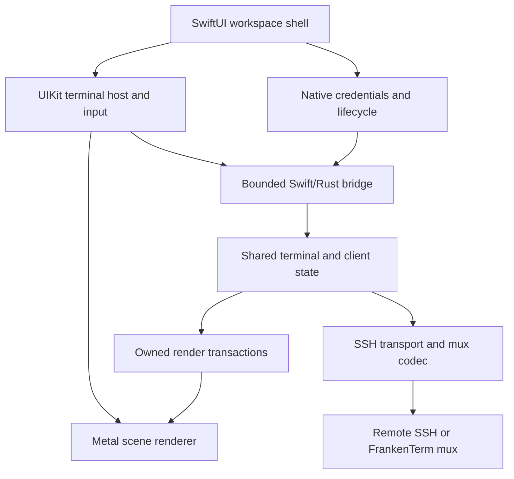

# COMPREHENSIVE PLAN FOR A NATIVE iOS FRANKENTERM APP

> **Design proposal, 2026-10-20.** Build an exceptional iPhone and iPad terminal around SwiftUI, UIKit text input, the existing FrankenTerm terminal and mux semantics, and native Metal presentation.
>
> **Repository evidence baseline:** `fb570a9f536c151adda75f8f127005b2735b3162`. Existing implementation and Beads status below refer to this commit. All mobile components, commands, schemas, numerical budgets, and milestones introduced here are proposed work unless explicitly identified as existing. This document does not declare an iOS app implemented or qualified.
>
> **Product promise:** Export the machine group you already use on your Mac, open it on your phone, connect with the appropriate SSH identities, recognize every machine by its familiar appearance, and move between machines and their panes with fluid, distinct gestures. Put the exact terminal you need under your thumb in a second, without losing your place or sending input to the wrong host.

## Contents

- [0. Executive design](#0-executive-design)
- [1. Repository baseline and the important gaps](#1-repository-baseline-and-the-important-gaps)
- [2. Product experience and release scope](#2-product-experience-and-release-scope)
- [3. Machine and pane navigation](#3-machine-and-pane-navigation)
- [4. Visual identity and native presentation](#4-visual-identity-and-native-presentation)
- [5. Architecture and ownership](#5-architecture-and-ownership)
- [6. The portable core and Swift/Rust boundary](#6-the-portable-core-and-swiftrust-boundary)
- [7. Connection modes and SSH transport](#7-connection-modes-and-ssh-transport)

---

## 0. Executive design

### 0.1 The experience to build

On the Mac, choose **Export to iPhone**, select an existing group of machines, and see a faithful preview of its order, names, themes, routes, and credential requirements. Pair the phone or transfer a workspace file. The phone imports the group transactionally, authenticates the selected machine first, and connects the remaining eligible machines through a bounded queue. A problem with one host stays attached to that host.

The terminal fills the phone. A compact identity strip always names the machine, connection route, and selected pane. A one-finger horizontal swipe changes machines. A two-finger horizontal swipe changes panes within the current machine. Each machine remembers its selected pane; each pane remembers its scroll position and local viewing preferences. Opening the keyboard does not destroy that navigation state. A readable overview makes a fleet of dozens of hosts manageable without dozens of sequential swipes.

Every terminal surface, glyph, cursor, selection, supported image, and terminal transition is presented through Metal. SwiftUI provides the application shell and native controls. CPU parsing, font shaping, SSH, and state reconciliation retain their appropriate ownership; GPU acceleration is a rendering requirement, not a claim that every operation runs on a GPU.

The phone can attach directly to a persistent remote FrankenTerm mux, use a conventional SSH terminal, or view the Mac's existing mux sessions. These modes share the interface but have explicitly different dependencies and continuity guarantees.

### 0.2 The decisions that matter most

1. **Build a client of real terminals.** The remote mux owns persistent PTYs. The phone owns its view, input intent, credentials, and bounded caches.
2. **Share terminal meaning and renderer data.** Adapt the existing Rust terminal, protocol contracts, Metal data structures, and shaders. Add native iOS surface and lifecycle integration.
3. **Make Mac export a product feature.** Export a typed, resolved workspace, with a portability report and deliberate credential handling. A copied Lua file or SSH config is insufficient.
4. **Treat input destination as immutable evidence.** Capture machine, route, connection generation, exact pane registration, and focus generation before admitting input. A later swipe cannot retarget it.
5. **Separate viewing from controlling.** Looking at a pane, changing local zoom, or previewing another machine never implicitly resizes a shared PTY or steals another client's input authority.
6. **Make suspension ordinary.** Save local state, stop rendering, and resume by reauthorizing and resynchronizing the exact surviving remote pane. Never depend on indefinite background SSH execution.
7. **Spend resources on what is visible.** One renderer per scene, bounded adjacent previews, a small active working set, and separate budgets for transport, scrollback, glyphs, images, and retained frames.
8. **Deliver vertical slices early.** A real phone, a real key, a real shell, and a real Metal frame come before elaborate fleet automation or speculative renderer optimizations.

### 0.3 The first compelling release

The first release should comfortably support the concrete journey **20 configured machines, 200 discovered panes, one focused phone viewport**, with optional two-to-four-pane iPad layouts. These are qualification targets, not current capacity claims and not a requirement to stream or render all 200 panes continuously.

The defining features are trustworthy Mac import, familiar machine themes, excellent terminal input, fast machine/pane navigation, direct SSH usefulness, and attachment to persistent FrankenTerm sessions. File browsing, remote notifications, collaboration, and agent-fleet interventions extend that foundation; they must not postpone it.

---

## 1. Repository baseline and the important gaps

### 1.1 Read these sources in the right order

The historical [implementation plan](docs/planning/PLAN.md) remains a model for user stories, explicit invariants, architecture, and phased delivery. Its own opening notice makes clear that its transitional backend, Tokio, local-Cargo, and workflow examples are historical. Current [repository instructions](AGENTS.md), [product journey contract](docs/design/product-journey-contract.md), [codec history](docs/codec-versions.md), and live source govern this plan.

The root [Mac rendering plan](PLAN_TO_MAKE_FRANKENTERM_MAC_RENDERING_SUPER_FAST.md) contributes the short-lock snapshot, persistent GPU buffers, dirty rows, row-ring scrolling, bounded atlases, and measurement discipline. Its October 5 implementation statements are not a current source inventory. At the evidence baseline, actual macOS GUI consumers feed terminal panes into the native Metal renderer.

The complete [Beads snapshot](.beads/issues.jsonl) contains 5,788 records: 4,612 closed, 760 open, 347 in progress, 64 blocked, and 5 deferred. The `ft-yccm0.4` Metal subtree contains 26 records, of which 22 are open, 3 closed, and 1 in progress. These counts describe work tracking. They neither prove absence of implementation nor qualify mobile behavior.

### 1.2 Reuse map grounded in source

| Existing surface | Evidence and useful content | Mobile consequence |
|---|---|---|
| Terminal engine | [frankenterm/term](frankenterm/term), [cell](frankenterm/cell), [surface](frankenterm/surface), [escape-parser](frankenterm/escape-parser), [input-types](frankenterm/input-types) | Keep canonical terminal semantics, cell occupancy, modes, and input encoding. Establish a genuinely buildable iOS dependency slice. |
| Native Metal implementation | [renderer crate](crates/frankenterm-renderer-metal), especially `cell_bg.rs`, `cell_text.rs`, `frame.rs`, `atlas.rs`, `window_frame.rs`, and `src/shaders/` | Share portable rendering representations and shader behavior. Its native implementation is macOS-gated; other targets currently use an unsupported-platform stub. |
| Live GUI Metal consumers | [metal_render_thread.rs](crates/frankenterm-gui/src/termwindow/metal_render_thread.rs), [metal_window.rs](crates/frankenterm-gui/src/termwindow/metal_window.rs), [termwindow/mod.rs](crates/frankenterm-gui/src/termwindow/mod.rs) | A dedicated render path and actual pane conversion already exist. Adapt these algorithms instead of creating an unrelated terminal renderer. |
| Incremental render mirror | [render_mirror.rs](frankenterm/mux/src/render_mirror.rs) | Reuse `RenderMirror` and changed-row capture. The generic pane fallback can combine consecutive states; it is not automatically an atomic mobile snapshot. |
| Mux protocol and client | [codec](frankenterm/codec), [client.rs](frankenterm/client/src/client.rs), [codec history](docs/codec-versions.md) | Preserve version/capability negotiation, exact pane registration, effect certainty, bounded messages, and layout-bound reads. Factor platform coupling deliberately. |
| Mac SSH domains | [config/src/ssh.rs](frankenterm/config/src/ssh.rs), [config/src/config.rs](frankenterm/config/src/config.rs) | Source automatic connection preferences, routes, and resolved palettes. `SSH:<host>` and `SSHMUX:<host>` can describe routes to the same machine. |
| SSH configuration resolver | [ssh/src/config.rs](frankenterm/ssh/src/config.rs) | Use its explicit `MatchExecPolicy::Deny` and diagnostic surface for preview. Its default permits `Match exec`; two-phase matching and direct ProxyJump resolution have limitations. |
| SSH implementation | [ssh/Cargo.toml](frankenterm/ssh/Cargo.toml) | Current native backends include libssh/libssh2/OpenSSL. An iOS build, external signing, and nested-hop adapter are substantial work. |
| Core policy, events, and runtime | [frankenterm-core](crates/frankenterm-core), [runtime_async.rs](crates/frankenterm-core/src/runtime_async.rs) | Preserve the core crate and canonical asupersync ownership. Reuse selected contracts; avoid linking the complete desktop control plane into the phone. |
| Session persistence | [persistence architecture](docs/session-persistence-architecture.md), [remote setup](docs/remote-setup-spec.md) | Capture/inspection and restore substrates do not establish live process recovery. Phone reconnect and remote mux crash recovery must remain separate claims. |

### 1.3 Six gaps with the highest product impact

| Priority | Gap | Why it is critical | First concrete result |
|---|---|---|---|
| P0 | iOS portability and transport | No amount of SwiftUI polish compensates for a terminal core or key backend that cannot run on a device. | Link the shared core into an iOS app and establish authenticated SSH with a selected existing identity. |
| P0 | Faithful remote-pane attachment | SSH channels alone do not discover the existing panes on a machine or preserve exact pane identity. | Attach to one existing mux pane through a verified first-party endpoint, with correct state and input authority. |
| P0 | Mac export and mobile import | Re-entering a fleet manually defeats the central use case. | Export/import a real selected group with exact order, routes, themes, and credential references. |
| P0 | Native input and focus correctness | A wrong-machine key, duplicate Enter, broken IME, or hidden cursor makes the product unusable. | Complete shell/editor interaction on a physical phone, including switching while callbacks are pending. |
| P0 | Metal surface and mobile resource control | Existing macOS rendering does not automatically supply UIKit lifecycle handling or phone memory limits. | A live, legible, responsive Metal terminal that remains bounded during floods and transitions. |
| P1 | Mobile reconnection and shared geometry | Phones routinely suspend and change networks; a phone viewport must not disrupt a Mac session. | Lock/resume and route-change recovery to the same surviving pane, with observer-safe geometry. |

There is no native SwiftUI iOS application in the baseline source inventory. Mobile mentions in the Beads snapshot predominantly belong to the browser terminal campaign. Native iOS adapters and device qualification therefore need their own implementation track while sharing applicable server-side work.

---

## 2. Product experience and release scope

### 2.1 The complete first-use journey

1. **Mac selection.** The user chooses an existing machine group or selects concrete SSH domains. The export sheet shows familiar names, colors, ordering, and selected live sessions.
2. **Portability preview.** Each machine is ready for direct access, requires a credential, depends on the Mac, or has an unsupported setting. The user can finish the useful portion immediately.
3. **Pair or transfer.** A short-lived authenticated pairing flow is the preferred path. A workspace document supports deliberate offline transfer and repeatable import.
4. **Credential decision.** Use the Mac's existing sessions, enroll a device identity, or transfer selected exportable keys. Already imported matching identities are reused by fingerprint and policy.
5. **Atomic import.** Validate the whole candidate before publishing its configuration. Host-specific readiness failures do not corrupt the manifest or roll back otherwise useful machines.
6. **First connection.** Select the initial host, show its identity before any authentication prompt, connect it first, then work through the group with bounded concurrency.
7. **First interaction.** The keyboard exposes Esc, Ctrl, Alt, Tab, and arrows immediately. A small, dismissible gesture demonstration teaches the machine/pane distinction.
8. **Return later.** Reopening the app restores the same machine and pane preference, clearly distinguishes retained content from live state, and reattaches when the server authorizes the original pane.

### 2.2 Everyday operator stories

| Story | Required behavior | Release |
|---|---|---|
| Check a build on a train | Select a machine, recognize its theme, reach the last pane, inspect output, send a deliberate response. | First useful beta |
| Move across twenty machines | Swipe quickly, jump from overview/search, preserve order and per-machine focus. | First useful beta |
| Inspect six panes on one host | Two-finger cycling, pane rail, direct picker, unread indicators. | First useful beta |
| Fix a problem in Vim or another TUI | Correct alternate screen, Unicode, control keys, modifiers, mouse policy, resize, and paste. | First useful beta |
| Keep the Mac session intact | Attach as observer, fit or pan locally, explicitly take control before changing shared geometry. | Persistent-mux beta |
| Use a Mac-only identity | Connect through the paired Mac with the dependency clearly visible, or enroll a new phone key. | Mac-paired beta |
| Lose Wi-Fi after pressing Enter | Display the precise delivery state; never turn reconnect into automatic command resubmission. | Every interactive build |
| Return after a remote restart | Detect a new server incarnation and explain the available recovery path. | Every mux build |
| Read output with VoiceOver | Navigate machine, pane, command blocks, and readable transcript without a stream of disruptive announcements. | Public release |

### 2.3 Scope boundaries that protect delivery

The first product is a native remote terminal and fleet workspace. A local Unix environment, local agent execution, an embedded desktop scripting runtime, a public relay service, and complete parity with every desktop plugin are separate projects.

Direct SSH remains useful without installing a remote mux, but its tabs represent phone-created terminal channels. Existing remote pane discovery and strong reattachment belong to FrankenTerm mux mode. A tmux process launched inside a raw SSH terminal remains a remote application; this plan does not create a second mux backend or interpret tmux panes as native FrankenTerm panes.

iPad is part of the architecture from the start. The initial phone journey is the first delivery gate; multiwindow and richer split layouts follow once the same session and rendering contracts are stable.

### 2.4 Product definition of done

An actual user can import their group, connect with supported existing keys, tell which machine owns the visible terminal, switch machines and panes, use a full-screen editor, search and copy output, survive a phone suspension, and return to the correct surviving remote session. These actions work with hardware keyboard and accessible controls as well as touch.

The installed app must remain responsive under a noisy neighboring machine, report partial failures locally, and stay within its declared memory and bandwidth budgets. A successful simulator launch, a screenshot, or a working one-host prototype does not establish this complete journey.

---

## 3. Machine and pane navigation

### 3.1 Two stable rings

Model the workspace as an ordered ring of machines. Each machine owns an ordered ring of pane references. Moving between machines restores that machine's last valid pane; moving between panes never changes the machine group or another machine's remembered pane.

The rings are navigation overlays. Reordering a phone's pane list does not reorder the remote mux topology. Imported ordering is explicit; remote tab/pane ordering is used only when the source actually supplies authoritative order. Numeric pane IDs, titles, and discovery timing are unsuitable order authorities.

Preserve three useful orders separately:

- **Imported group order:** the Mac's intended order, editable by the user.
- **Remote structural order:** window/tab/split hierarchy advertised by the mux.
- **Local navigation order:** stable pinned/reordered views, with newly discovered panes appended predictably.

Recency and attention may drive explicit filters or an overview section. They must not silently rearrange the primary rings while the user builds muscle memory.

### 3.2 Gesture contract

| Gesture | Default action | Arbitration |
|---|---|---|
| One-finger horizontal drag on the machine identity rail | Previous/next machine | Always available outside system-reserved edges and assistive gesture ownership. |
| One-finger horizontal drag on the terminal canvas | Previous/next machine in normal navigation mode | Enabled only when selection, horizontal viewport panning, or terminal mouse interaction does not own the gesture. The rail remains the dependable alternative. |
| Two-finger horizontal drag on the terminal canvas | Previous/next pane within the current machine | Resolve touch count before committing; pinch and accessibility gestures take precedence where appropriate. |
| One-finger vertical drag | Scrollback or explicit remote mouse-mode scrolling | Never changes machines or panes. |
| Long press | Select text and reveal context actions | Captures the interaction until selection ends or is cancelled. |
| Pinch | Preview terminal font size | Commit a local zoom preference at gesture end; resize the PTY only with geometry authority. |
| Tap machine name or pane position | Open overview/picker | Full alternative for one-handed use, keyboard, VoiceOver, and Switch Control. |

Machine and pane switching must be distinct in both gesture and visual feedback. Machine transitions move the complete terminal plus its identity treatment. Pane transitions retain the machine identity strip and move the pane content beneath it.

Provide optional remapping after the defaults are excellent. Do not reserve three-finger editing gestures or the iOS back/home/control-center edges. UIKit supports explicit recognizer precedence and simultaneous-recognition policy through [UIGestureRecognizerDelegate](https://developer.apple.com/documentation/uikit/uigesturerecognizerdelegate); one terminal-owned arbiter must define those relationships coherently.

### 3.3 Gesture state and commit rules

Use a single serialized gesture state machine:

`idle -> possible -> classified -> dragging -> settling -> committed/cancelled -> idle`

At classification, capture the source route, source pane, candidate ring, ring revision, gesture class, initial geometry, and focus generation. Suggested tuning seeds are 10-14 points of slop, a horizontal-to-vertical displacement ratio around 1.4, and a settle decision based on both distance and projected velocity. These are usability-tuning inputs, not correctness constants or release guarantees.

Once classified, a gesture cannot become a different gesture because another finger arrived late. Cancel or continue its existing classification; never apply half a machine switch and half a pane switch. Resolve one-finger/two-finger ambiguity before either action changes focus.

Only the final focus commit selects a new input destination. During dragging, the old pane remains the selected route and the destination is a preview. The UI clearly marks both identities. Input admission follows the routing barrier described below; an animation frame is never an authorization event.

If a candidate pane closes during the gesture, render its closing state and cancel or settle to the original pane. Never redirect the gesture to a numerically reused pane or to a newly adjacent machine. Reconcile inventory after settling.

### 3.4 Wrapping, offline machines, and scale

Offer circular cycling, enabled by default for groups with more than one item. Crossing the last-to-first boundary gets a subtle visual marker and optional differentiated haptic. A one-item ring does not animate a fake move.

Disconnected machines retain their positions and show a last-viewed preview with a timestamp and explicit status. Do not automatically skip them. A user-selected **Connected only** filter may narrow the ring, with the filter visible and its order stable.

For large groups, the overview offers name/tag search, favorites, recent machines, connection status, and attention counts. It uses bounded low-resolution previews, not a live terminal renderer per card. The direct picker should reach any machine or pane in two or three intentional actions regardless of fleet size.

### 3.5 Focus and input barrier

Every admitted input event carries an immutable route token containing:

`workspace_id, machine_id, route_id, transport_generation, server_incarnation, pane_registration, focus_generation`

Controller-lease generation and terminal mode/layout witnesses are included when the negotiated operation needs them. The queued event is never resolved later through a mutable `currentPane` pointer.

When focus changes:

1. Close the source input-admission generation.
2. Keep already admitted source events attached to their original route and disposition; settle or report them there.
3. End held-key state on the source where the terminal protocol supports key release. Never forward a delayed release to the new pane.
4. Resolve active IME composition before committing the switch: commit it to the source while that source remains valid, explicitly cancel it, or hold the switch until the input system settles. A stored draft is a separate local object, never a synthetic completed composition.
5. Publish the destination identity and new focus generation together.
6. Open destination input only after its connection, pane identity, and applicable controller authority are valid.

This is a core product invariant. Sending one password character to the next machine is more serious than dropping an animation frame.

---

## 4. Visual identity and native presentation

### 4.1 Recognize the machine before reading the prompt

Each machine has a stable display name, optional short label, icon, accent, full terminal palette, and optional light/dark variants. Preserve the Mac's resolved per-machine themes when available. The importer previews any font or color mapping it cannot reproduce exactly.

Machine identity appears in the top strip, overview card, reconnect screen, authentication prompt, and paste/input destination UI. A small accent or edge treatment remains visible even when a remote program paints an opaque full-screen background. The name is always present; color reinforces identity rather than carrying it alone.

Keep connection health visually distinct from machine color. A green-themed machine can be offline; its explicit disconnected icon and label must remain unambiguous.

### 4.2 Native, bright, precise chrome

Use SwiftUI's native navigation, sheets, menus, controls, and system materials. Default chrome follows system appearance with a strong light presentation. A terminal's imported theme remains its own preference, independent of the surrounding chrome.

Favor generous touch targets around compact controls, restrained depth, crisp typography, and short direct labels. Avoid decorative gradients behind code or translucency that damages glyph contrast. Machine color belongs to identity, not arbitrary recoloring of remote application content.

The focused view has four deliberate layers:

| Layer | Contents | Behavior |
|---|---|---|
| Identity strip | Group/back affordance, machine name, route/status, pane position | Stable through output and pane transitions. |
| Terminal | Metal-rendered cells, cursor, selection, images, search marks | Receives the maximum practical screen area. |
| Context strip | Scrollback/live indicator, pending input state, selected text actions | Appears when useful and does not hide the cursor. |
| Keyboard accessory | Esc, modifiers, Tab, arrows, expanded keys | Respects safe areas, keyboard geometry, and accessibility. |

### 4.3 State should remain understandable

Show **Connecting**, **Unlock key**, **Host identity changed**, **Via Mac**, **Resynchronizing**, **Viewing saved state**, and **Input outcome unknown** as distinct states. Do not collapse them into a spinner or a generic failure toast.

Remote titles, paths, and user variables are untrusted terminal content. Truncate and sanitize their presentation. They cannot replace the trusted machine name, impersonate system permission UI, or become automatic deep links or commands.

Motion follows the finger and settles quickly. Reduced Motion uses a restrained crossfade or direct change. Haptics occur at discrete selection boundaries, not continuously during movement, and remain optional.

---

## 5. Architecture and ownership

### 5.1 Component shape

The two data paths have different timing. Terminal data moves through bounded queues and render transactions. SwiftUI receives coarse semantic updates such as focus, status, inventory changes, settings, and attention summaries. There is no observable Swift string containing the entire terminal and no SwiftUI view per cell.

### 5.2 Ownership table

| Owner | Owns | Must not own or block on |
|---|---|---|
| MainActor workspace store | Navigation, sheets, scene state, user preferences, focus commits | SSH I/O, terminal parsing, full scrollback, disk flushes, GPU completion waits. |
| UIKit terminal host | Responder chain, gesture arbitration, composition, caret geometry, accessibility projection | Mutable terminal internals or remote PTY ownership. |
| Native credential broker | Keychain references, LocalAuthentication context, signing grants, foreground prompts | General terminal transcripts or a global queue of plaintext private keys. |
| Shared Rust mobile session runtime | Exact pane references, protocol effects, ordered input, bounded transport/session tasks | SwiftUI object lifetimes or implicit access to the current view. |
| Terminal/model owner | Parser state for direct SSH; authoritative mirror transactions for mux mode | Main-thread UI calls, disk I/O in parse-critical regions, GPU resources. |
| Render preparation owner | Shaping, cell-to-instance conversion, per-row versions, pending glyph work | Long terminal locks, synchronous network reads, authentication. |
| Native Metal owner per scene | Device/queue/pipelines, frame slots, drawables, atlas textures, presentation | Remote mutation or selecting input targets. |
| Remote mux | Processes, PTYs, canonical pane identity, shared geometry and control authority | Reliance on a phone staying foregrounded. |

One connection does not require one permanently running thread per pane. Use a bounded runtime and explicit ownership. Shared Rust asynchronous work continues through the repository's `runtime_async`/asupersync surface. Swift actors own platform state; they do not introduce Tokio into the Rust graph.

### 5.3 Native application structure

Proposed native sources live under `apps/ios/FrankenTerm/`, with Xcode project/workspace settings alongside them. Suggested logical groups are `App`, `Workspace`, `Terminal`, `Rendering`, `Input`, `Connectivity`, `Credentials`, `ImportExport`, `Accessibility`, and `Diagnostics`. These are responsibilities, not a requirement to create empty directories or a proliferation of tiny packages.

Add one narrow Rust integration crate, provisionally `crates/frankenterm-ios-bridge`, only when the first device spike demonstrates its required API. Reuse existing crates in place. A portable codec/type leaf is justified only where dependency inspection proves that it removes desktop coupling for both existing and mobile consumers.

The permanent `crates/frankenterm-core` remains intact. This project adds a mobile consumption boundary; it does not replace the desktop core, add another mux backend, or copy large subsystems into a parallel implementation.

### 5.4 Two terminal data modes, one presentation contract

**Direct SSH:** the phone receives the remote PTY byte stream and advances the shared terminal engine locally. Its local terminal state owns parser continuation and scrollback within explicit limits.

**FrankenTerm mux:** the remote mux is authoritative for terminal state. The phone consumes negotiated pane state, rows, layout witnesses, and render updates into a client mirror. Do not replay plain-text captures through a second parser and call that the same terminal.

Both produce the same owned mobile render transaction. The difference remains visible in capability and continuity state, while fonts, gestures, selection, and Metal presentation share their implementation.

---

## 6. The portable core and Swift/Rust boundary

### 6.1 Establish portability before expanding the app

Build an exact dependency inventory for the device and simulator targets. The existing `codec` depends on desktop-oriented `config`, `mux`, PTY, and compression surfaces; the existing client includes OpenSSL, SSH, and Unix-domain assumptions. Merely adding an iOS target to the workspace is insufficient.

The first extraction should make the smallest useful vertical slice compile:

1. Terminal primitives and input types.
2. A bounded terminal instance or mux mirror.
3. Owned render transactions using shared background/text structures.
4. Lifecycle/effect state and only the required wire definitions.
5. A narrow transport and signer interface.

Disable or isolate desktop process spawning, Lua execution, filesystem watching, Unix-socket assumptions, desktop font backends, optional image decoders, and large search/runtime integrations where they are not part of the mobile artifact. Reuse one canonical implementation behind features or adapters; do not fork terminal semantics.

Apple device and simulator targets require the corresponding Xcode SDK. Rust documents `aarch64-apple-ios` and `aarch64-apple-ios-sim` as distinct targets; a simulator library cannot stand in for a device library. See the [Rust iOS target documentation](https://doc.rust-lang.org/rustc/platform-support/apple-ios.html).

### 6.2 Preferred bridge shape

Use an XCFramework containing the Rust static library slices, a small C-compatible header, and a module map consumed by Swift. The C ABI is a language boundary, not a proposal to write a second terminal implementation in C. Prefer explicit, versioned handles and fixed-width fields over exposing Rust layouts or Swift objects.

The initial bridge should offer these operation classes:

| Operation | Contract |
|---|---|
| Create/configure session | Validated typed configuration, explicit capabilities, bounded resources. |
| Submit input or control intent | Nonblocking admission; immutable destination; accepted/rejected/pending result. |
| Feed/drain transport data | Bounded buffers and explicit backpressure; no unbounded callback recursion. |
| Acquire render transaction | Owned immutable snapshot/delta handle with identity and version witnesses. |
| Read transaction spans | Checked offsets/counts over data owned by that transaction. |
| Release handles | Exactly one documented release path; stale/double release rejected by handle generation. |
| Poll/drain semantic events | Bounded batch, explicit reschedule signal, no event per rendered cell. |
| Cancel/close | Idempotent request with a terminal settlement result. |

Start with owned packed buffers. Their bounded copy cost is easier to understand than borrowing terminal memory across Swift, Rust, and GPU lifetimes. Optimize a measured copy only after proving all three lifetimes and cancellation paths.

### 6.3 Boundary invariants

- No borrowed Rust pointer escapes its declared call or owning snapshot handle.
- Swift never frees Rust allocations directly; Rust never retains an unowned Swift object.
- All byte ranges, string lengths, row counts, image dimensions, and arithmetic products are checked before allocation or indexing.
- The ABI uses fixed-width integers and explicit endianness for serialized data; do not export `usize`, compiler-dependent enums, or raw `Vec`/`String` layouts.
- Callbacks carry an owner generation. Late completion after scene/session destruction is ignored safely and releases its resources.
- A callback never reenters a mutable session operation synchronously. Deliver through the documented queue.
- Cancellation propagates across the boundary and settles owned work; dropping a Swift task does not silently abandon a Rust child task or an SSH authentication operation.
- Rust panics do not unwind through Swift or C. Use the repository's documented recoverable-panic boundary where applicable; otherwise return a terminal failure under an explicit boundary contract. Do not silently change release panic policy to make the bridge seem simpler.
- Any new unsafe/native operation has a narrow ownership, aliasing, lifetime, thread, and error contract. Existing audited renderer exceptions are a model, not a blanket exemption.

The bridge protocol version, mobile workspace schema version, terminal semantic version, and mux codec version are independent. Negotiating one does not authorize the others.

### 6.4 Core and frame identity

A render transaction identifies its source machine/route/pane, transport and server incarnation, terminal sequence, geometry revision, viewport origin, palette revision, font revision, and row versions. It also states whether it is a full replacement, a compatible delta, or retained stale content.

The consumer rejects an incompatible delta and requests a bounded replacement. It does not combine a new cursor with old dimensions or a new palette with an unrelated row generation. Snapshot production should reuse the existing short-lock dirty-row capture approach, then perform shaping and expansion outside the terminal lock.

---

## 7. Connection modes and SSH transport

### 7.1 Three explicit modes

| Mode | Connection | What a pane means | Continuity |
|---|---|---|---|
| Direct SSH | Phone authenticates to the selected host and opens one or more SSH PTY channels. | A terminal channel created for this client. | No guarantee of survival or exact reattachment after a broken SSH connection. |
| Direct FrankenTerm mux | Phone authenticates to the host, then attaches to an existing persistent FrankenTerm mux through a verified endpoint. | The server's exact registered pane. | Reattach to surviving panes while that mux remains alive; stronger recovery requires separately advertised capabilities. |
| Via Mac | Phone authenticates to the paired Mac's endpoint; the Mac exposes selected existing local/remote mux sessions. | A pane plus its authoritative origin/route within the Mac's session graph. | Depends on the Mac and every required downstream route remaining available. |

The [SSH connection protocol](https://www.rfc-editor.org/rfc/rfc4254) provides channels, PTY requests, window changes, and data transport. Persistent pane discovery and exact reattachment are higher-level mux semantics.

Do not silently fail over from Via Mac to direct access: that changes the credential path, trust boundary, session ownership, and potentially the pane. A user-configured alternate route can be selected only after its identity and continuity requirements are checked.

### 7.2 Preferred first transport spike

Start by qualifying **one existing libssh2-based backend** behind an iOS feature of `frankenterm-ssh`. This has the strongest continuity with existing key/configuration behavior and avoids adding a second Rust async runtime. Build only the chosen native dependency stack into the mobile artifact, pin it, and document every added iOS/native boundary.

The spike must establish: real-device linking, nonblocking socket operation, existing-key authentication, strict host verification, keyboard-interactive prompts, cancellation, bounded I/O, external signing, and the intended jump-host route. It must measure binary size and memory and identify the exact cryptographic backend. Passing a desktop SSH test does not establish these properties on iOS.

The underlying [libssh2 API](https://libssh2.org/docs.html) offers nonblocking operation, memory-key authentication, direct TCP channels, and public-key signing callbacks. The existing Rust wrapper must be audited for what it actually exposes. A general external-signing callback and a nested-channel transport adapter may require small audited additions; neither is assumed to exist already.

If this spike fails on a concrete requirement, evaluate an Apple SwiftNIO SSH adapter behind the same transport contract. Record algorithm coverage, encrypted OpenSSH-key import, keyboard-interactive support, certificate support, signing integration, and its native event-loop ownership before selecting it. Do not silently replace the existing authentication matrix with a narrower implementation. A Tokio-dependent SSH crate is not an admissible drop-in under the repository runtime policy.

### 7.3 Authentication and nested-hop ownership

Authentication prompts belong to the native credential broker. Preauthorize a selected credential where possible, then perform blocking library callbacks on an isolated, bounded authentication worker. A synchronous C signing or keyboard-interactive callback cannot become asynchronous merely by returning a retry code. Prove its reentry behavior or preserve the library's synchronous contract without blocking MainActor or an asupersync executor thread.

For ProxyJump, an inner SSH session consumes the outer session's `direct-tcpip` channel as a byte transport. It must not use the outer TCP socket descriptor as though that socket were already the destination host. Specify bounded buffering, independent inner/outer host verification, cancellation propagation, and parent-route invalidation. Qualify one hop first; a proposed initial limit of three hops bounds prompt, buffer, and failure complexity.

Do not export arbitrary local `ProxyCommand` shell execution to the phone. The portability report offers a structured jump route, an explicitly supported transport adapter, or Via Mac.

### 7.4 First-party mux attachment is real implementation work

The current inherited client builds a command equivalent to `exec <configured executable> cli --prefer-mux proxy`, and uses `--no-auto-start` on later proxy attempts. Its source explicitly says the standalone `ft` does not implement that inherited `cli` grammar. Therefore **`ft cli proxy` is not an existing setup instruction**.

Add a narrow first-party endpoint, provisionally **`ft mobile attach --stdio --no-auto-start`**, as proposed work. It must attach to the selected existing mux, expose only negotiated client capabilities, preserve binary-clean stdin/stdout, put diagnostics on stderr, enforce frame/time/resource bounds, and distinguish absent mux, denied access, incompatible codec, and transport failure. It must not launch a new shell or install a daemon merely because a phone is browsing.

The SSH exec command is assembled from an explicitly selected executable and fixed typed arguments with correct remote-shell quoting. Imported labels, titles, environment strings, and arbitrary commands cannot enter it. Remote provisioning is a separate deliberate Mac workflow with an inspectable change plan and verified artifact identity.

Current native SSH domains do not automatically inherit reconnectability from the existing client: `Reconnectable::reconnectable()` returns false for that mode at the evidence baseline. Mobile reconnection, authentication coalescing, and exact-pane reattachment are new requirements to implement and qualify.

### 7.5 Connection admission

Connect the selected machine first, then its immediate navigation neighbors, then the rest of the opted-in group. Suggested initial limits are three concurrent connection attempts globally, one interactive authentication prompt at a time, and one reconnect attempt per machine. A shared identity may coalesce unlock preparation without weakening its actual Keychain access policy.

Use bounded exponential backoff with jitter and a per-route retry budget. A user selecting a machine can promote its next attempt; repeated swipes must not spawn duplicate handshakes. Host-key mismatch, rejected credentials, unsupported algorithms, and revoked authority require explicit resolution rather than an endless retry loop.

Once imported and authorized, group connection should require no repeated setup. User-disabled machines stay disabled. Cellular, constrained-network, and background policies may reduce subscriptions while preserving the configured group and showing the reason.
